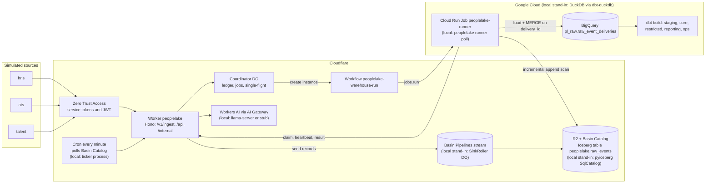

# PeopleLake

Replayable workforce ELT and historical analytics warehouse. Three simulated enterprise sources (`hris`, `ats`, `talent`) carrying HR, recruiting, compensation and performance data post events to a Cloudflare Worker, which streams them through Basin Pipelines into an Iceberg lake on R2. A Python runner loads the lake incrementally into BigQuery and dbt builds a dimensional model with effective-dated employee history, five workforce metrics and reconciliation checks. Cloudflare Workflows orchestrate every warehouse run so any step can fail, retry or be re-delivered without changing the outputs.

All data is synthetic. The design is in [SPEC.md](SPEC.md); the domain glossary is in [CONTEXT.md](CONTEXT.md); build progress is in [PROGRESS.md](PROGRESS.md).

## Status

v1 is under construction and this repository is published while it is built. This table is updated in every commit that changes what works.

| Area | State |
|---|---|
| Repo scaffold, TypeScript configs, generated Worker types, prose check | done |
| Synthetic generator with exact counts and oracle | done: 100,000 events (full) and 10,000 (small) from `hris`, `ats`, `talent`, pinned sha256, committed oracle seeds |
| Contracts and canonical JSON golden | not started |
| DuckDB loader and output digests | not started |
| dbt models, five metrics, reconciliation checks | not started |
| BigQuery configs and offline compile | not started |
| Local Iceberg lake | not started |
| Worker: auth, ingest, sinks | not started (only `GET /v1/health` exists) |
| Orchestration: Coordinator, Workflow, dispatchers | not started |
| Runner and local stack | not started |
| Scenario and freshness evals | not started |
| CI | not started |
| Workers AI and `/api/ask` | not started |
| Production setup (`setup:prod`, `doctor`, `bootstrap-gcp`) | not started |
| Front end | none in v1 (the dashboard is below the core cut line); `/api/*` is the read interface |

Identical outputs across scenarios: not yet measured on any engine. BigQuery: pending (needs the production setup below).

## Architecture

Production path, with the local stand-ins in brackets.



## What runs where

| Concern | Local (offline, CI) | Production |
|---|---|---|
| Ingest API | wrangler dev 4.149.0 (workerd via Miniflare) on 127.0.0.1:8791, Worker name `peoplelake-local` | Worker `peoplelake` on workers.dev behind Cloudflare Access |
| Stream to lake | **stand-in**: `SinkRoller` Durable Object writes NDJSON roll files to local R2 (Miniflare's Pipeline binding discards data) | Basin Pipelines stream, pipeline and sink (`r2-data-catalog`, roll 60 s) |
| Lake catalog | **stand-in**: pyiceberg `SqlCatalog` (SQLite) on disk | Basin Catalog (Iceberg REST) on R2 bucket `peoplelake-lake` |
| New-data trigger | **stand-in**: SinkRoller enqueues an R2-notification-shaped message on every roll | per-minute cron polls Basin Catalog table metadata; R2 notifications to a Queue as an optimization |
| Orchestration | Workflows as implemented by Miniflare | Cloudflare Workflows |
| Runner | `peoplelake runner poll` process | Cloud Run Job `peoplelake-runner` (us-central1) |
| Warehouse | **stand-in**: DuckDB 1.5.6 via dbt-duckdb 1.11.0, session UTC | BigQuery (US) via dbt-bigquery 1.12.1 |
| Column security | none | policy tags, data masking, authorized views |
| Auth | locally generated RS256 keys, same verifier code | Access JWT (RS256) against the team JWKS |
| LLM | llama-server (Qwen3-1.7B) on 8150, or a deterministic stub in CI | Workers AI through AI Gateway `peoplelake` |
| Cron | ticker process | Workers cron `* * * * *` |

## Local setup

Requirements: Node 22.18 or newer (CI uses 24), npm, uv 0.12.x, Python 3.12.

```bash
git clone https://github.com/nitishsjsucs/peoplelake && cd peoplelake
npm ci
uv sync --locked --project pipeline
npm run typecheck
npm test            # vitest (TZ=UTC)
npm run test:py     # pytest (TZ=UTC)
npm run check:prose

# synthetic data: exact counts, byte-identical on every platform
uv run --project pipeline peoplelake generate --profile small --out .data/generated/small --check
uv run --project pipeline peoplelake generate --profile full --out .data/generated/full --check
uv run --project pipeline peoplelake generate --write-seeds   # rewrites warehouse/seeds (committed)
```

### Synthetic data

| Source | Domains | Full profile events | Small profile events |
|---|---|---:|---:|
| `hris` | HR: hires, rehires, terminations, transfers, job and FTE changes, corrections, rescinds | 14,470 | 1,447 |
| `ats` | recruiting: requisitions, applications, stage changes, offers | 55,530 | 5,553 |
| `talent` | compensation changes and performance reviews | 30,000 | 3,000 |
| total | | 100,000 | 10,000 |

The generator (`pipeline/src/peoplelake/generator`) keeps the true world state and computes the expected value of every metric for every month and department from it (the oracle), never from the events. Both profiles' oracle rows are committed as dbt seeds in `warehouse/seeds/oracle/` and a test regenerates and diffs them. True-world totals on the full profile: headcount 4,000 at 2022-12-31 and 4,650 at 2025-12-31, 2,550 hires (150 of them rehires) and 1,900 departures in 2023 to 2025, offer acceptance 2,600 / 3,120 = 0.833333.

More commands are added here as each part lands (see Status).

## Production setup

Production needs a Cloudflare account on Workers Paid with R2 and Zero Trust, and a Google Cloud project with billing for BigQuery and Cloud Run. The idempotent `npm run setup:prod` and `npm run doctor` commands that provision and check every resource are planned in SPEC.md sections 20 and 21 and are not built yet. Until they exist, nothing in this repo runs against Cloudflare production services or BigQuery.

## Results

No results yet. This section only ever contains numbers produced by this repository's scripts, each with its command, date and engine.

## License

MIT
