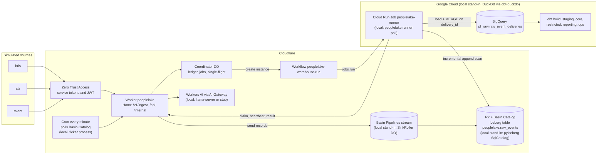

# PeopleLake

Replayable workforce ELT and historical analytics warehouse. Three simulated enterprise sources (`hris`, `ats`, `talent`) carrying HR, recruiting, compensation and performance data post events to a Cloudflare Worker, which streams them through Basin Pipelines into an Iceberg lake on R2. A Python runner loads the lake incrementally into BigQuery and dbt builds a dimensional model with effective-dated employee history, five workforce metrics and reconciliation checks. Cloudflare Workflows orchestrate every warehouse run so any step can fail, retry or be re-delivered without changing the outputs.

All data is synthetic. The design is in [SPEC.md](SPEC.md); the domain glossary is in [CONTEXT.md](CONTEXT.md); build progress is in [PROGRESS.md](PROGRESS.md).

## Status

v1 is under construction and this repository is published while it is built. This table is updated in every commit that changes what works.

| Area | State |
|---|---|
| Repo scaffold, TypeScript configs, generated Worker types, prose check | done |
| Synthetic generator with exact counts and oracle | done: 100,000 events (full) and 10,000 (small) from `hris`, `ats`, `talent`, pinned sha256, committed oracle seeds |
| Contracts and canonical JSON golden | done: zod contracts generate `contracts/*.schema.json`; pydantic mirrors; fixtures and a canonical JSON golden asserted by vitest (in workerd) and pytest |
| DuckDB loader and output digests | done: idempotent load on `delivery_id`, UTC sessions, engine-independent digests for the 10 published models |
| dbt models, five metrics, reconciliation checks | done on DuckDB: staging, spells, SCD2 history with per-model bucket cursors, facts, metrics mart, reporting and ops models, 10 unit tests, reconciliation checks R1 to R11 |
| BigQuery configs and offline compile | done offline: dbt-bigquery profiles, policy tags, authorized views, int64 range `insert_overwrite`, both compile branches parse as BigQuery, ORDER BY lint, BigQuery loader tested against a fake client; nothing has run on BigQuery yet |
| Local Iceberg lake | done locally: pyiceberg SqlCatalog stand-in, committer for sink roll files (idempotent on key and etag), incremental reader with full-scan fallback; Basin Catalog configured through Iceberg REST but not exercised (needs production) |
| Worker: auth, ingest, sinks | done locally: fail-closed config, Access JWT verification (RS256, iss, aud, exp) with locally generated dev keys, role gates, `POST /v1/ingest/:source` for three envelopes (zod, all-or-nothing), RawRecord normalization shared with Python through a golden, Basin stream sink (production) and the SinkRoller stand-in (local) |
| Orchestration: Coordinator, Workflow, dispatchers | done locally (Miniflare Workflows): Coordinator ledger with single-flight runs, attempt-scoped jobs and leases, `WarehouseRunWorkflow` (load, transform or skip, verify, commit, release), poll and Cloud Run dispatchers, Basin Catalog poll, lake-events queue consumer, per-minute cron, eval faults; production Workflows not exercised yet |
| Runner and local stack | done locally: `peoplelake runner poll` (in-process dbt, heartbeats, eval fault hooks) and `peoplelake stack up/down` (wrangler dev, runner, ticker in their own process groups, ports checked free) |
| Scenario and freshness evals | done on the local stack (see Results): scenario equivalence on DuckDB, and the 60-minute local freshness measurement of the full profile (p95 78 s on the local stand-ins, ledger and ops histograms agree); production freshness is measured once by `npm run prod:e2e` |
| CI | workflows written (`ci.yml` on every push, `eval-full.yml` weekly and on demand); they have not run on GitHub yet because the owner publishes the repo |
| Workers AI and `/api/ask` | done: `AiProvider` with a deterministic stub (CI), llama-server (local) and Workers AI through AI Gateway (production, mocked in tests), `POST /api/ask` answering only from the committed metrics snapshot, `/api/ops/ai` gateway check; the 60-question ask eval (`peoplelake eval ask`) scores each provider through the Worker, local results pending, Workers AI needs production |
| Production setup (`setup:prod`, `doctor`, `bootstrap-gcp`) | built and tested offline (dry run, fake clients, rendered config bundles with `wrangler deploy --dry-run`); not run against real accounts yet, see Production setup |
| Front end | none in v1 (the dashboard is below the core cut line); `/api/*` is the read interface |

Identical outputs across the five scenarios: proven on DuckDB with the local stack (all six legs on the small profile; B, S2 and S4 on the full 100,000-event profile); BigQuery pending (needs the production setup below and the BigQuery drill).

## Architecture

Production path, with the local stand-ins in brackets.



## What runs where

| Concern | Local (offline, CI) | Production |
|---|---|---|
| Ingest API | wrangler dev 4.149.0 (workerd via Miniflare) on 127.0.0.1:8791, Worker name `peoplelake-local` | Worker `peoplelake` on workers.dev behind Cloudflare Access |
| Stream to lake | **stand-in**: `SinkRoller` Durable Object writes NDJSON roll files to local R2 (Miniflare's Pipeline binding discards data) | Basin Pipelines stream, pipeline and sink (`r2-data-catalog`, roll 60 s) |
| Lake catalog | **stand-in**: pyiceberg `SqlCatalog` (SQLite) on disk | Basin Catalog (Iceberg REST) on R2 bucket `peoplelake-lake` |
| New-data trigger | **stand-in**: SinkRoller enqueues an R2-notification-shaped message on every roll | per-minute cron polls Basin Catalog table metadata; R2 notifications to a Queue as an optimization |
| Orchestration | Workflows as implemented by Miniflare | Cloudflare Workflows |
| Runner | `peoplelake runner poll` process | Cloud Run Job `peoplelake-runner` (us-central1) |
| Warehouse | **stand-in**: DuckDB 1.5.6 via dbt-duckdb 1.11.0, session UTC | BigQuery (US) via dbt-bigquery 1.12.1 |
| Column security | none | policy tags, data masking, authorized views |
| Auth | locally generated RS256 keys, same verifier code | Access JWT (RS256) against the team JWKS |
| LLM | llama-server (Qwen3-1.7B) on 8150, or a deterministic stub in CI | Workers AI through AI Gateway `peoplelake` |
| Cron | ticker process | Workers cron `* * * * *` |
| Scenario equivalence | DuckDB with the local stack (every CI push, small profile) | BigQuery `_drill` datasets with the local Worker, Workflows and lake (`eval scenarios --target prod-drill`, a go-live step) |
| Freshness | measured on the local stack | measured once from the `prod:e2e` live delivery |

## Local setup

Requirements: Node 22.18 or newer (CI uses 24), npm, uv 0.12.x, Python 3.12.

```bash
git clone https://github.com/nitishsjsucs/peoplelake && cd peoplelake
npm ci
uv sync --locked --project pipeline
uv run --project pipeline peoplelake auth dev-keys   # .dev/keys and DEV_ACCESS_JWKS in .dev.vars
npm run doctor -- --local-only
npm run typecheck
npm test            # vitest (TZ=UTC)
npm run test:py     # pytest (TZ=UTC)
npm run check:prose

# synthetic data: exact counts, byte-identical on every platform
uv run --project pipeline peoplelake generate --profile small --out .data/generated/small --check
uv run --project pipeline peoplelake generate --profile full --out .data/generated/full --check
uv run --project pipeline peoplelake generate --write-seeds   # rewrites warehouse/seeds (committed)

# load generated events straight into the local DuckDB stand-in (no Worker, no lake), then dbt
export TZ=UTC PL_PROFILE=small PL_DUCKDB_PATH=$PWD/.data/warehouse/peoplelake.duckdb
uv run --project pipeline peoplelake warehouse load-direct --profile small
uv run --project pipeline peoplelake dbt seed
uv run --project pipeline peoplelake dbt run --empty   # unit tests need the relations to exist
uv run --project pipeline peoplelake dbt build         # models, unit tests and data tests
uv run --project pipeline peoplelake digest     # digests of the 10 published models

# SPEC 15.4 in one command: straight load, incremental build with unit tests, full refresh, equal digests
uv run --project pipeline peoplelake dev reference-digests --profile small --out .data/reference/reference-digests-small.json

# BigQuery SQL without credentials: both compile branches, sqlglot parse, ORDER BY NULLS lint
uv run --project pipeline peoplelake dev bq-compile

# the whole local stack: wrangler dev on 127.0.0.1:8791 (inspector 9241), the runner loop and the cron ticker
uv run --project pipeline peoplelake stack up --reset
uv run --project pipeline peoplelake stack down        # always leaves 8791, 9241 and 8150 free
```

While the stack is up, only the runner process opens the local DuckDB file (ADR 0008).

### Five metrics and reconciliation

`metrics_workforce_monthly` is the single definition of headcount, FTE, hires, departures and offer acceptance rate (plus rehires, transfers and offer components) by month and department. Reconciliation checks run as dbt tests; error-level checks block a warehouse commit and hold even while late data is in flight, warn-level checks are completeness checks that must be 0 at quiescence.

| Id | Check | Severity |
|---|---|---|
| R1, R2 | headcount roll-forward for the company and per department (with transfers) | error |
| R3 | rehire continuity: spells never overlap, rehires are spell 2 or later | error |
| R4 | retroactive corrections applied in the history, superseded values gone (independent SQL path) | error |
| R5 | rescinded terminations end no spell and count as no departure | error |
| R6 | accepted offer to hire, both directions, within 30 days | warn |
| R7 | unique events by source and type equal the generator manifest | warn |
| R8 | one payload per event id across deliveries | error |
| R9 | effective-dated history contiguous within each spell | error |
| R10 | all five metrics and components equal the oracle on all 468 rows | warn |
| R11 | no open anomalies (orphan corrections, inferred spell ends, events outside spells) | warn |

`pipeline/tests/test_reconciliation_checks.py` breaks each invariant on purpose and asserts that its check fires.

### Synthetic data

| Source | Domains | Full profile events | Small profile events |
|---|---|---:|---:|
| `hris` | HR: hires, rehires, terminations, transfers, job and FTE changes, corrections, rescinds | 14,470 | 1,447 |
| `ats` | recruiting: requisitions, applications, stage changes, offers | 55,530 | 5,553 |
| `talent` | compensation changes and performance reviews | 30,000 | 3,000 |
| total | | 100,000 | 10,000 |

The generator (`pipeline/src/peoplelake/generator`) keeps the true world state and computes the expected value of every metric for every month and department from it (the oracle), never from the events. Both profiles' oracle rows are committed as dbt seeds in `warehouse/seeds/oracle/` and a test regenerates and diffs them. True-world totals on the full profile: headcount 4,000 at 2022-12-31 and 4,650 at 2025-12-31, 2,550 hires (150 of them rehires) and 1,900 departures in 2023 to 2025, offer acceptance 2,600 / 3,120 = 0.833333.

### Scenario equivalence

`peoplelake eval scenarios` starts every scenario from empty state (Worker storage, local lake, warehouse), delivers the same dataset through the local stack in chunks (each chunk: deliver, force a sink roll, wait for the run that loads it), ends at quiescence, and requires the 10 published digests to equal the reference digests of a straight load built with `--full-refresh`, the metrics to match the oracle on all 468 rows, and every warn-level check to be 0. Every result records its engine, orchestration, lake and runner.

| Id | Scenario | Perturbation (full profile; the small profile scales event counts by 1/10) |
|---|---|---|
| B | baseline | each event once, canonical order, batches of 500 per source |
| S1 | duplicate-client-retries | 10,000 events delivered twice and 1,000 of them three times (111,000 deliveries); 30% of duplicates in the same request, the rest in a later chunk |
| S2 | duplicate-lake-redelivery | the watermark rewound by two snapshots on runs 3, 6 and 9; 3 committed sink files appended again as new snapshots on run 5 |
| S3 | late-arrival | 5,000 events withheld (300 corrections, 30 rescinds, 200 terminations, 100 hires, 50 accepted offers among them): 3,000 delivered 1 to 3 chunks late, 2,000 after everything else; every request shuffled |
| S4 | recovery-step-failures | runner crash after load (run 2), a dbt model failure (run 4), a duplicate result (run 5), a claimed and dropped job (run 6), a commit step error (run 7) |
| S5 | recovery-warehouse-rebuild | after a clean delivery: delete the warehouse and replay everything from the lake; replay up to the middle run's snapshot into a scratch warehouse and require that run's recorded digests |

```bash
uv run --project pipeline peoplelake eval scenarios --profile small --chunks 10      # all six, about 15 minutes here
uv run --project pipeline peoplelake eval scenarios --profile small --scenarios S4   # one scenario
npm run results:readme                                                                 # renders evals/results into Results
```

### Asking questions

`POST /api/ask {"question": "..."}` (viewer) turns a question into a validated query (one of the five metrics, a department or `ALL`, a month range inside 2023-01 to 2025-12) and answers with the values from the committed metrics snapshot (`reports/metrics/latest.json`); numbers never come from a model. `AI_PROVIDER` picks the translator: `stub` (a deterministic rule parser, the local and CI default), `openai-compatible` (llama-server with Qwen3-1.7B on 127.0.0.1:8150, `llama-server -m <gguf> --host 127.0.0.1 --port 8150 -np 1 -c 8192 -ngl 99` and `--var AI_PROVIDER:openai-compatible` on `wrangler dev`), or `workers-ai` (production: `@cf/meta/llama-3.3-70b-instruct-fp8-fast` through AI Gateway `peoplelake`, JSON schema output with one repair retry). `POST /api/ask/query` (viewer) runs only the translation step and returns the provider and the validated query.

`peoplelake eval ask --provider stub|llama|workers-ai` sends the 60 hand-written questions in [evals/ask/questions.jsonl](evals/ask/questions.jsonl) (12 per metric; labeling conventions in [evals/ask/README.md](evals/ask/README.md)) to `/api/ask/query` and scores the answers: exact match on all four fields, accuracy per field, invalid answers and latency. `stub` and `llama` start `wrangler dev` on 127.0.0.1:8791 with that provider (`llama` also starts llama-server on 127.0.0.1:8150 with `-np 1 -c 8192 -ngl 99` and stops it afterwards); `workers-ai` calls the production Worker with the `pl-doctor` service token, so it runs only after the production setup. The questions were written before any provider ran on them and the providers are not tuned to them. Results land in `evals/results/ask-<provider>-<date>.json` and the README Results section.

```bash
uv run --project pipeline peoplelake eval ask --provider stub
uv run --project pipeline peoplelake eval ask --provider llama        # needs llama-server and the Qwen3-1.7B GGUF (PL_LLAMA_GGUF)
uv run --project pipeline peoplelake eval ask --provider workers-ai   # production only
```

### Freshness

`peoplelake eval freshness --target local --duration 60m` delivers the full profile at a constant rate (100,000 events over 60 minutes, 27.8 per second) in live mode: 60 s sink rolls (the Basin minimum), the cron ticker every 60 s, single-flight runs. Per unique event, freshness is the commit time of the run that published it minus the Worker's first receipt, read from the Coordinator ledger (10 s buckets, so conservative by up to 10 s) and cross-checked against the `ops_event_freshness` histograms the runner returns. The 15-minute p95 is a target that is reported, never asserted. Local numbers describe the local stack on the machine named in the result; the production number comes from the single live delivery of `npm run prod:e2e`. The recorded local run (see Results) used the code at commit `685ba53`; later commits change no ingest, sink, orchestration or runner path it exercises.

## CI

GitHub Actions run CI only and hold no cloud credentials (`permissions: contents: read`, `TZ=UTC`).

| Workflow | Job | What it proves |
|---|---|---|
| `ci.yml` | node | generated Worker types current, typecheck, vitest (Worker tests in workerd, node tests), contracts current, prose check, the production config rendered from a fixture state bundles (`npm run deploy:dry-run`) |
| `ci.yml` | python | ruff, pytest without the dbt and end-to-end markers |
| `ci.yml` | dbt | small profile generated with its pinned sha256, reference digests (straight load, `dbt run --empty`, build with unit tests, full refresh, equal digests), dbt-level tests, offline BigQuery compiles with sqlglot parse and ORDER BY lint; uploads the reference digests |
| `ci.yml` | clean-clone | clones the commit to a temp directory: `uv sync --locked`, `dbt parse`, smoke tests (nothing gitignored is relied on) |
| `ci.yml` | runner-image | `docker build` of the Cloud Run runner image |
| `ci.yml` | e2e (B, S1 to S5) | one scenario per VM on the small profile through the local stack, compared with the reference digests |
| `eval-full.yml` | scenarios | the same matrix on the full profile (100,000 events), weekly and on demand; reports only |

Scenario step timeouts are twice the slowest leg measured in the build session (small profile: S5, 342.2 s; full profile: B, 465.6 s; S5 was not measured on the full profile): 12 minutes for the small profile and 16 minutes for the full profile.

## Production setup

Production runs on Cloudflare (Workers, Workflows, Queues, Durable Objects, R2, Basin Pipelines, Basin Catalog, Workers AI, AI Gateway, Zero Trust Access) and Google Cloud (BigQuery and a Cloud Run Job runner). `npm run setup:prod` creates every resource from the CLIs and APIs once the accounts below exist, and `npm run doctor` checks every prerequisite and prints the exact fix for anything missing. Both are idempotent and safe to rerun. Nothing in production has been exercised from this repository yet: the commands below are what turns the offline-tested path on.

### Accounts and expected cost

| Item | Plan | Expected cost |
|---|---|---|
| Cloudflare Workers | Workers Paid (required by Basin Pipelines) | $5/month minimum |
| R2 and Basin Catalog | R2 with a payment card (Basin Catalog requires it) | inside the free tier at this volume |
| Queues, Workflows, Durable Objects, Workers AI, AI Gateway | included with Workers Paid or free tiers | about $0 at this volume |
| Zero Trust Access | Free plan (up to 50 users) | $0 |
| BigQuery | billing account required (the sandbox has no DML, and dbt incremental models need MERGE) | first 1 TiB of queries per month free; every query capped at 5 GB billed |
| Cloud Run Job, Cloud Build, Artifact Registry, Secret Manager | pay as you go | cents per month |

### Steps only a person can do (in order)

Cloudflare dashboard:
1. Workers & Pages, Plans: subscribe to **Workers Paid**.
2. R2 Object Storage: enable R2 and add a payment card.
3. Zero Trust (one.dash.cloudflare.com): create the organization on the **Free** plan and choose a team name; the team domain is `https://<team>.cloudflareaccess.com`.
4. R2, Overview, Manage API tokens, Create API token, twice: `peoplelake-sink` with **Admin Read & Write**, and `peoplelake-catalog-read` with **Admin Read only**.
5. My Profile, API Tokens, Create Custom Token `peoplelake-setup`, scoped to this account, with **Access: Apps and Policies** (edit), **Access: Service Tokens** (edit) and **AI Gateway** (edit). Do not name it `CLOUDFLARE_API_TOKEN` (wrangler would use it instead of your login).

Cloudflare CLI:

6. `npx wrangler login`, then `npx wrangler whoami` for the Account ID.

Google Cloud:

7. `brew install --cask gcloud-cli`, then `gcloud auth login`.
8. Create a billing account in the console if you have none.
9. In this order (the last command gives application default credentials a quota project; without it Data Catalog and Data Policy calls fail):
   ```bash
   gcloud projects create peoplelake-<suffix> --name="PeopleLake"
   gcloud billing projects link peoplelake-<suffix> --billing-account=<BILLING_ACCOUNT_ID>
   gcloud config set project peoplelake-<suffix>
   gcloud auth application-default login
   gcloud auth application-default set-quota-project peoplelake-<suffix>
   ```
   Use a project without a parent organization (a personal Gmail account has none). Organizations created on or after 2024-05-03 block service account key creation by default, and the Worker's Cloud Run dispatcher needs one key.

Local files (both are gitignored; setup makes them mode 600 and refuses to continue if it cannot):

10. `.prod/config.env`:
    ```bash
    PL_CF_ACCOUNT_ID=<account id from wrangler whoami>
    PL_WORKERS_SUBDOMAIN=<only if the account has no workers.dev subdomain yet>
    PL_ACCESS_TEAM_DOMAIN=https://<team>.cloudflareaccess.com
    PL_OWNER_EMAIL=<your email, the only human allowed through Access>
    PL_GCP_PROJECT=peoplelake-<suffix>
    PL_GCP_REGION=us-central1
    PL_BQ_LOCATION=US
    ```
    `.prod/secrets.env`:
    ```bash
    PL_CF_SETUP_TOKEN=<custom token from step 5>
    PL_R2_SINK_TOKEN=<peoplelake-sink from step 4>
    PL_R2_CATALOG_TOKEN=<peoplelake-catalog-read from step 4>
    ```

Then:

11. `npm run setup:prod -- --dry-run` (prints every command and API call, secrets redacted), then `npm run setup:prod`.
12. `npm run doctor` until every check passes.
13. Go live:
    ```bash
    npm run prod:e2e    # one live 60-minute delivery of the full profile, prod verify, production freshness
    uv run --project pipeline peoplelake eval scenarios --profile small --chunks 10 --target prod-drill   # all five scenarios on BigQuery _drill datasets
    uv run --project pipeline peoplelake prod demo-masking
    npm run results:readme
    ```
14. Push `main` so CI runs. CI needs no secrets and holds no cloud credentials.

### What `setup:prod` does for you

workers.dev subdomain registration, R2 buckets `peoplelake-lake` and `peoplelake-reports`, Basin Catalog on the lake bucket with snapshot expiration and compaction, Queues `peoplelake-lake-events` and its dead-letter queue, the Basin stream `peoplelake_raw_stream`, sink `peoplelake_raw_sink` (Iceberg table `peoplelake.raw_events`, 60 s rolls) and pipeline, the R2 notification rule, five Access service tokens (`pl-source-hris`, `pl-source-ats`, `pl-source-talent`, `pl-runner`, and `pl-doctor` for the operator checks), AI Gateway `peoplelake`, a fail-closed first deploy (every request 401, no runs), the Access application with an owner policy and a service-auth policy, everything in Google Cloud through `peoplelake prod bootstrap-gcp` (APIs, twelve datasets with time travel, policy tags and masking policies, service accounts and roles, secrets, Artifact Registry, the runner image built by Cloud Build, the Cloud Run Job, the dispatcher key), and the final deploy with the real Access AUD, the role map and `RUNS_ENABLED=true` only if the Google Cloud bootstrap passed. Files it writes: `.prod/state.json`, `.prod/secrets.env` (service token secrets), `.prod/gcp.json`, `.prod/gcp-dispatcher-key.json`, all mode 600.

Deploy only with `npm run deploy` (render, safety check, `wrangler deploy --env production`): the top-level Worker in `wrangler.jsonc` is named `peoplelake-local` with `workers_dev: false`, so a plain `wrangler deploy` can never replace production. `npm run deploy:runner` rebuilds the runner image and updates the job.

## Decisions and runbooks

Architecture decision records in [docs/adr](docs/adr): [warehouse-level idempotency](docs/adr/0001-warehouse-level-idempotency.md), [Workflows orchestrate, Cloud Run executes](docs/adr/0002-workflows-orchestrate-cloud-run-executes.md), [labeled local stand-ins](docs/adr/0003-local-stand-ins-are-labeled.md), [bucketed replace with per-model cursors](docs/adr/0004-bucketed-replace-with-per-model-cursors.md), [engine-independent digests](docs/adr/0005-engine-independent-output-digests.md), [Access JWT on every request](docs/adr/0006-verify-access-jwt-on-every-request.md), [metrics against an oracle](docs/adr/0007-metrics-checked-against-an-oracle.md), [one process owns the local warehouse](docs/adr/0008-one-process-owns-the-local-warehouse.md).

Runbooks in [docs/runbooks](docs/runbooks): [replay from the lake](docs/runbooks/replay.md), [restore with BigQuery time travel](docs/runbooks/restore.md), [rotate credentials](docs/runbooks/rotate-tokens.md), [full production reset](docs/runbooks/prod-reset.md). The production ones have not been exercised against real accounts.

## Results

<!-- results:start -->
Rendered by `npm run results:readme` from `evals/results/*.json`. Every number below was produced by the command shown, on the date shown, with the engine and stand-ins named; nothing is estimated.

#### Freshness, local, full profile (2026-10-11)

Command: `peoplelake eval freshness --target local --duration 60m`. Method: ledger histograms of first receipt (10 s buckets) against the publishing run's commit time. Engine: duckdb. Stand-ins: SinkRoller roll files (60 s), pyiceberg SqlCatalog, local runner process, ticker for cron. Machine: Darwin arm64. Rate: 27.778 events per second. Source: `evals/results/freshness-local-full-2026-10-11.json`.

| Events | Duration | Runs | p50 | p90 | p95 | p99 | max | Within 15 min | p95 excluding first 5 min |
|---:|---:|---:|---:|---:|---:|---:|---:|---:|---:|
| 100000 | 60 min | 121 | 48 s | 74 s | 78 s | 86 s | 93 s | 100.00% | 78 s |

p95 split: first receipt to run start 65 s, run start to commit 22 s. Runs committed: 121 of 121, transforms skipped (the load inserted nothing new): 61. Cross-check against the runner's `ops_event_freshness` histograms: 100000 ledger events, 100000 ops events, 0 mismatched 10 s buckets (agrees). 15-minute p95 target (reported, not asserted): met.

#### Scenario equivalence, full profile, duckdb (2026-10-11)

Command: `peoplelake eval scenarios --profile full --chunks 20 --scenarios B,S2,S4 --reference .data/reference/reference-digests-full.json` (the reference digests come from `peoplelake dev reference-digests --profile full`). Orchestration: local (wrangler dev / Miniflare Workflows). Lake: local stand-in (SinkRoller + pyiceberg SqlCatalog). Machine: Darwin arm64. Source: `evals/results/scenarios-full-duckdb-2026-10-11-B-S2-S4.json`.

| Scenario | Identical models (of 10) | Oracle rows mismatched | Warn checks at quiescence | Deliveries | Runs | Duration |
|---|---:|---:|---:|---:|---:|---:|
| B baseline | 10 | 0 | 0 | 100000 | 21 | 465.6 s |
| S2 duplicate-lake-redelivery | 10 | 0 | 0 | 100000 | 21 | 265.8 s |
| S4 recovery-step-failures | 10 | 0 | 0 | 100000 | 21 | 252.7 s |

All scenarios identical to the reference digests: **yes**.

#### Scenario equivalence, small profile, duckdb (2026-10-11)

Command: `peoplelake eval scenarios --profile small --chunks 10 --reference .data/reference/reference-digests-small.json` (the reference digests come from `peoplelake dev reference-digests --profile small`). Orchestration: local (wrangler dev / Miniflare Workflows). Lake: local stand-in (SinkRoller + pyiceberg SqlCatalog). Machine: Darwin arm64. Source: `evals/results/scenarios-small-duckdb-2026-10-11.json`.

| Scenario | Identical models (of 10) | Oracle rows mismatched | Warn checks at quiescence | Deliveries | Runs | Duration |
|---|---:|---:|---:|---:|---:|---:|
| B baseline | 10 | 0 | 0 | 10000 | 11 | 75.5 s |
| S1 duplicate-client-retries | 10 | 0 | 0 | 11100 | 11 | 72.7 s |
| S2 duplicate-lake-redelivery | 10 | 0 | 0 | 10000 | 11 | 159.3 s |
| S3 late-arrival | 10 | 0 | 0 | 10000 | 12 | 119 s |
| S4 recovery-step-failures | 10 | 0 | 0 | 10000 | 11 | 162.9 s |
| S5 recovery-warehouse-rebuild | 10 | 0 | 0 | 10000 | 13 | 342.2 s |

All scenarios identical to the reference digests: **yes**.
<!-- results:end -->

## License

MIT
