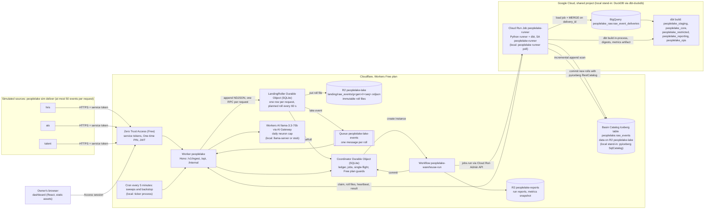

# PeopleLake

Replayable workforce ELT and historical analytics warehouse on the Cloudflare **Workers Free** plan and Google Cloud's free tiers. Three simulated enterprise sources (`hris`, `ats`, `talent`) carrying HR, recruiting, compensation and performance data post events to a Cloudflare Worker. The Worker lands every accepted request in a LandingRoller Durable Object, which writes the records to immutable roll files in R2 once a minute; a Python runner commits those rolls to an Apache Iceberg table on R2 (Basin Catalog in production), loads the lake incrementally into BigQuery, and dbt builds a dimensional model with effective-dated employee history, five workforce metrics and reconciliation checks. Cloudflare Workflows orchestrate every warehouse run so any step can fail, retry or be re-delivered without changing the outputs.

All data is synthetic. The design is in [SPEC.md](SPEC.md) (section 29 for the Workers Free plan); the domain glossary is in [CONTEXT.md](CONTEXT.md); build progress is in [PROGRESS.md](PROGRESS.md).

## Status

v1 is built and verified end to end on the local stack (every item of the build plan, including the ask eval, the dashboard and the MetricFlow layer), and the production path has been redesigned for the Workers Free plan: Basin Pipelines needs Workers Paid, so the LandingRoller lands data in R2 in both environments and the runner commits it to Basin Catalog, every Free allowance has a guard or a measured budget (see Workers Free plan below), and the shared Google Cloud project gets this repo's prefix on every name and resource-scoped grants only. Nothing has run against Cloudflare production or Google Cloud yet: that needs the owner's setup (see Production setup). This table is updated in every commit that changes what works.

| Area | State |
|---|---|
| Repo scaffold, TypeScript configs, generated Worker types, prose check | done |
| Synthetic generator with exact counts and oracle | done: 100,000 events (full) and 10,000 (small) from `hris`, `ats`, `talent`, pinned sha256, committed oracle seeds |
| Contracts and canonical JSON golden | done: zod contracts generate `contracts/*.schema.json`; pydantic mirrors; fixtures and a canonical JSON golden asserted by vitest (in workerd) and pytest |
| DuckDB loader and output digests | done: idempotent load on `delivery_id`, UTC sessions, engine-independent digests for the 10 published models |
| dbt models, five metrics, reconciliation checks | done on DuckDB: staging, spells, SCD2 history with per-model bucket cursors, facts, metrics mart, reporting and ops models, 10 unit tests, reconciliation checks R1 to R11 |
| BigQuery configs and offline compile | done offline: dbt-bigquery profiles (every query capped at 1 GB billed, job labels from the query comment, `app=peoplelake` table labels), policy tags, authorized views, int64 range `insert_overwrite`, both compile branches parse as BigQuery, ORDER BY lint, BigQuery loader tested against a fake client; every name in the shared Google Cloud project starts with `peoplelake` (datasets `peoplelake_*`, service accounts `peoplelake-runner`, `-analyst`, `-dispatcher` and a dedicated `-build`), grants are resource-scoped, and bootstrap refuses to run while billing is off; nothing has run on BigQuery yet |
| Iceberg lake and landing commits | done locally: the runner's load job commits new landing rolls to `peoplelake.raw_events` (one append snapshot per roll whose summary carries the landing cursor `peoplelake.landing-through`, so snapshot expiration can never cause a re-append; conflicts re-read the cursor; only the current generation's rolls are listed; every line validated as a RawRecord), the same code against the pyiceberg SqlCatalog stand-in locally and Basin Catalog through `RestCatalog` in production (`peoplelake lake init --target prod` creates the table); incremental reader with full-scan fallback. Basin Catalog itself is not exercised yet (needs production) |
| Worker: auth, ingest, landing | done locally: fail-closed config, Access JWT verification (RS256, iss, aud, exp) with locally generated dev keys, role gates, `POST /v1/ingest/:source` for three envelopes (zod, all-or-nothing, at most 50 events per request so a request stays well inside the Workers Free plan's 10 ms of CPU, the ingest path prewarmed at isolate startup), RawRecord normalization shared with Python through a golden, and the LandingRoller Durable Object (one SQLite row per request, planned immutable roll files in R2 every 60 s, one Queue message per roll, backpressure), the same code locally and in production; no Basin Pipelines (Workers Paid only) |
| Orchestration: Coordinator, Workflow, dispatchers | done locally (Miniflare Workflows): Coordinator ledger with single-flight runs, attempt-scoped jobs and leases, `WarehouseRunWorkflow` (load, transform or skip, verify, commit, release; a committed run uses 8 steps and records them), poll and Cloud Run dispatchers, lake-events queue consumer (one message per landing roll), the Workers Free plan guards (a 5-minute cron backstop that requests a run only while a landed roll is past the committed landing cursor, heartbeat off, a 240 s minimum interval between automatic runs, failure backoff of 5 minutes doubling to 6 hours, 30 automatic runs a UTC day, a 275 GB monthly BigQuery guard that commits the load and skips the transform), indexed ledger queries with per-day Durable Object row counters and `GET /api/ops/budget`, eval faults; production Workflows not exercised yet |
| Runner and local stack | done locally: `peoplelake runner poll` (in-process dbt, heartbeats, eval fault hooks) and `peoplelake stack up/down` (wrangler dev, runner, ticker in their own process groups, ports checked free) |
| Scenario and freshness evals | done on the local stack and re-recorded on the Free plan design (see Results): scenario equivalence on DuckDB for all six scenarios on both profiles, and the 60-minute local freshness measurement of the full profile; production freshness is measured once by `npm run prod:e2e` |
| CI | `ci.yml` runs on GitHub on every push of `main` and has passed every run so far, the small-profile scenario matrix included; `eval-full.yml` (weekly and on demand) has not run yet |
| Workers AI and `/api/ask` | done: `AiProvider` with a deterministic stub (CI), llama-server (local) and Workers AI through AI Gateway (production, mocked in tests), `POST /api/ask` answering only from the committed metrics snapshot, `/api/ops/ai` gateway check; the 60-question ask eval (`peoplelake eval ask`) scores each provider through the Worker: stub and llama-server results recorded (see Results), Workers AI runs after the production setup |
| Workers Free plan budget | done: `npm run budget` computes every peak-day estimate from the repo's constants and production config against the Free allowances and this repo's planning shares (table below), `--check` runs in CI, `predeploy-check` and the doctor refuse anything that needs Workers Paid |
| Production setup (`setup:prod`, `doctor`, `bootstrap-gcp`) | built for the Workers Free plan and tested offline (dry run against fake runners, fake Google clients, rendered config bundles with `wrangler deploy --dry-run`); not run against real accounts yet, see Production setup |
| MetricFlow semantic layer | done on DuckDB: semantic models over the three facts the mart reads, the five metrics (plus the two offer components), and a parity check that MetricFlow's answers equal `metrics_workforce_monthly` on all 468 rows (both profiles, see Results); the definitions parse for BigQuery too, but no MetricFlow service runs in production |
| Dashboard | done: React 19 + Vite 8 in `web/`, built to `web/dist` and served by the Worker as static assets (Overview, Runs with jobs and attempts, Metrics with a 36-month SVG trend and the 468-row table, Checks); reads only `/api/*`; behind Cloudflare Access in production |

Identical outputs across the five scenarios: proven on DuckDB with the local stack (all six legs, B and S1 to S5, on both the small profile and the full 100,000-event profile); BigQuery pending (needs the production setup below and the BigQuery drill).

## Architecture

Production path on the Workers Free plan, with the local stand-ins in brackets.



Exactly-once effects without Basin Pipelines: a roll is planned before it is written (a retried roll rewrites identical bytes under the same key), the runner's committer appends each new roll as one Iceberg snapshot whose summary carries the landing cursor (so Basin's free snapshot expiration can never cause a re-append), and the warehouse merges on `delivery_id` (ADR 0001), so even a double append changes no published row.

## What runs where

| Concern | Local (offline, CI) | Production |
|---|---|---|
| Plan and limits | Miniflare enforces no CPU or daily limits; `npm run budget -- --check` checks the configured values against the Free plan shares | Cloudflare Workers **Free** plan (10 ms CPU per invocation; daily allowances shared with the other Workers on the account) and Google Cloud free tiers in a project shared by four repos |
| Ingest API | wrangler dev 4.149.0 (workerd via Miniflare) on 127.0.0.1:8791, Worker name `peoplelake-local`; at most 50 events per request | Worker `peoplelake` on workers.dev behind Cloudflare Access; at most 50 events per request |
| Landing | `LandingRoller` Durable Object writes immutable NDJSON roll files to R2 and sends one Queue message per roll (the production code on Miniflare's Durable Object, R2 and Queue) | the same code: Durable Object (SQLite), R2 bucket `peoplelake-lake` under `landing/raw_events/`, Queue `peoplelake-lake-events` |
| Lake catalog | **stand-in**: pyiceberg 0.12 `SqlCatalog` (SQLite) on disk | Basin Catalog (Iceberg REST) on R2 bucket `peoplelake-lake`, table created by `peoplelake lake init --target prod` |
| Lake commits | runner load job (`lake/committer.py`), landing cursor in snapshot summaries | the same code against Basin Catalog through pyiceberg `RestCatalog` |
| New-data trigger | one lake event per roll; backstop on the ticker | one lake event per roll; backstop on the Workers cron `*/5 * * * *` |
| Orchestration | Workflows as implemented by Miniflare | Cloudflare Workflows (Free: 3,000 steps a day per account, 3-day instance retention) |
| Run guards | set wide (`RUN_MIN_INTERVAL_SECONDS=0`, no failure backoff, 100,000 automatic runs a day) so evals stay fast | Free plan values: 240 s minimum interval, backoff from 5 minutes to 6 hours, 30 automatic runs a day, heartbeat off, 275 GB of BigQuery a month |
| Runner | **stand-in**: `peoplelake runner poll` process | Cloud Run Job `peoplelake-runner` (us-central1), started by the Workflow through the Cloud Run Admin API |
| Warehouse | **stand-in**: DuckDB 1.5.6 via dbt-duckdb 1.11.0, session UTC, schemas `peoplelake_*` | BigQuery (US) via dbt-bigquery 1.12.1, datasets `peoplelake_*`, every query capped at 1 GB billed and labeled `app=peoplelake` |
| Load | `INSERT ... WHERE NOT EXISTS` on `delivery_id` | load job (Parquet, free) to a stage table + `MERGE` on `delivery_id` |
| Column security | none (schemas only) | policy tags, data masking policies, authorized views |
| Recovery | replay from the local Iceberg table; Iceberg snapshots | replay from Basin Catalog; BigQuery time travel (48 to 168 h) with SQL restore into `_drill`; 7-day fail-safe via support |
| Auth | locally generated RS256 keys, the same verifier code | Access JWT (RS256) against the team JWKS; One-time PIN for people; service tokens for machines |
| LLM | llama-server (Qwen3-1.7B) on 8150, or a deterministic stub in CI | Workers AI `@cf/meta/llama-3.3-70b-instruct-fp8-fast` through AI Gateway `peoplelake`, `max_tokens` 96, 1,800 neurons a day |
| Cron | ticker process every 300 s | Workers cron `*/5 * * * *` (1 of the account's 5 Cron Triggers) |
| Semantic layer | MetricFlow plans SQL for DuckDB in the parity check (`peoplelake dev metricflow-parity`) | the same definitions ship in the dbt project and parse for BigQuery; nothing serves MetricFlow queries in production, the published read path stays the metrics mart |
| Dashboard | static assets from `web/dist` in `wrangler dev`; a pasted dev token (`peoplelake auth dev-token operator --ttl 3600`) stands in for the Access session | static assets of Worker `peoplelake` behind Cloudflare Access (the browser's Access session; Access adds the JWT header) |
| Scenario equivalence | DuckDB with the local stack (every CI push, small profile) | BigQuery `_drill` datasets with the local Worker, Workflows and lake (`eval scenarios --target prod-drill`, a go-live step, under the 275 GB monthly guard) |
| Freshness | measured on the local stack | measured once from the `prod:e2e` live delivery (sources post every 10 s) |

## Workers Free plan

Production must not depend on Workers Paid anywhere: there is no `pipelines` binding, no `limits` setting, no paid-billing Workers AI model and no Logpush, every Durable Object is a SQLite class, and there is one cron. The Free plan's daily allowances are per account and five other Workers projects may share this account, so this repo plans to use at most 20% of each account-wide Cloudflare allowance; the Google Cloud project is shared by four repos, so at most 25% of each free tier. What enforces it:

- Ingest: at most 50 events per request (measured CPU, see Results), the ingest path prewarmed at isolate startup, production sources posting every 10 s (at most 3,080 requests for a 100,000-event delivery).
- Landing: one SQLite row per request and one R2 object and one Queue message per minute of data; 503 `landing_backpressure` above 64 MiB buffered.
- Coordinator: indexed queries, per-day row counters, a 5-minute cron backstop, a 240 s minimum interval between automatic runs, failure backoff up to 6 hours, 30 automatic runs a UTC day and a 275 GB monthly BigQuery guard; `GET /api/ops/budget` reports the state.
- Workers AI: `max_tokens` 96 and 1,800 neurons a UTC day (429 `ai_budget` past it); the Workers AI ask eval resumes on a later day.
- Google Cloud: every query capped at 1 GB billed and labeled, `peoplelake` names, resource-scoped grants, a dedicated build identity.
- `npm run budget -- --check` (in CI) recomputes the table below from the repo's constants and fails on any estimate past its share or any setting that needs Workers Paid; `predeploy-check` and `npm run doctor` apply the same rules.

<!-- budget:start -->
Computed by `npm run budget` from the repo's constants and `wrangler.jsonc` `env.production` (estimates, not measurements, except the CPU row). The go-live day is the peak: one 60-minute delivery of 100,000 events from three sources posting every 10 s, the runs it triggers, the cron, the doctor and the 60-question Workers AI eval. Planning share: 20% of each account-wide Cloudflare allowance, 25% of each Google free tier.

| Path | Free allowance | Planning share | Peak estimate | Share of the allowance | Within share | Basis |
|---|---|---:|---:|---:|---|---|
| Worker requests | 100,000 requests (a day, account) | 20,000 | 4,290 | 4.3% | yes | ingest 3080 (100000 events / 50 + 360 ticks x 3 sources), runner 400, cron 288, queue 62, Workflow 160, operator 300 |
| Workflow steps | 3,000 steps (a day, account) | 600 | 500 | 16.7% | yes | 20 runs x 25 steps (worst case; a committed run uses 8) |
| Queue operations | 10,000 operations (a day, account) | 2,000 | 744 | 7.4% | yes | 62 rolls x 3 operations x (1 + 3 retries) |
| Durable Object requests | 100,000 requests (a day, account) | 20,000 | 4,958 | 5.0% | yes | ingest 3080, rolls and consumer 310, cron 288, runner and Workflow 880, alarms 100, operator 300 |
| Durable Object rows written | 100,000 rows (a day, account) | 20,000 | 12,254 | 12.3% | yes | LandingRoller 2 x 3080 + 4 x 62, Coordinator 100 x 20 runs + 360 freshness + rolls, AI and flushes, x 1.3 for indexes |
| Durable Object rows read | 5,000,000 rows (a day, account) | 1,000,000 | 29,760 | 0.60% | yes | indexed queries only |
| Durable Object duration | 13,000 GB-s (a day, account) | 2,600 | 1,444 | 11.1% | yes | 2 objects active 70 min + 288 cron activations x 10 s, at 128 MB |
| Workers AI neurons | 10,000 neurons (a day, account) | 2,000 | 1,800 | 18.0% | yes | the daily neuron cap (the ask eval stops there) |
| Workers Logs events | 200,000 events (a day, account) | 40,000 | 9,248 | 4.6% | yes | one event per Worker and Durable Object invocation |
| Cron Triggers | 5 triggers (account) | 1 | 1 | 20.0% | yes | cron expressions in the production config |
| AI Gateway gateways | 10 gateways (account) | 2 | 1 | 10.0% | yes | gateway peoplelake |
| Zero Trust seats | 50 users (account) | 10 | 2 | 4.0% | yes | the owner and the persona addresses |
| Access service tokens | 50 tokens (account) | 10 | 5 | 10.0% | yes | three sources, the runner and the doctor |
| Environment variables | 64 variables (per Worker) | 64 | 32 | 50.0% | yes | production vars and secrets |
| Events per ingest request | 50 events (per request, set by the 10 ms CPU limit) | 50 | 50 | 100.0% | yes | MAX_BATCH_EVENTS (npm run bench:ingest measures the CPU) |
| R2 storage | 10.0 GB (GB-month, account) | 2.0 GB | 85 MB | 0.85% | yes | 100000 records x 632 bytes of landing NDJSON + Iceberg data and reports |
| R2 Class A operations | 1,000,000 operations (a month, account) | 200,000 | 392 | 0.04% | yes | roll puts, Iceberg writes, lists and reports on the peak day |
| R2 Class B operations | 10,000,000 operations (a month, account) | 2,000,000 | 512 | 0.01% | yes | roll reads, Iceberg reads and report reads on the peak day |
| Basin Catalog operations | 1,000,000 operations (a month, account) | 200,000 | 164 | 0.02% | yes | 2 per load and 2 per committed roll on the peak day |
| BigQuery queries | 1 TiB (a month, billing account) | 275 GB | 275 GB | 25.0% | yes | go-live month: 94 transforms x 3 GB (prod:e2e 20, drill 6 x 12), capped by the 275 GB monthly guard |
| BigQuery storage | 10 GiB (a month, billing account) | 2.7 GB | 500 MB | 4.7% | yes | raw table and models of one full delivery |
| Cloud Build minutes | 2,500 build-minutes (a month, billing account) | 625 | 24 | 0.96% | yes | 3 builds of about 8 minutes |
| CPU per ingest request (50 events) | 10 ms per request | 10 ms | warm p99 1.33 ms, first after prewarm 3.86 ms | 38.6% | yes | measured: `evals/results/ingest-cpu-2026-10-11.json` (2026-10-11), the worst of the three sources |

Configuration rules (no `pipelines`, no `limits`, one `*/5 * * * *` cron, SQLite Durable Objects only, the production guard values, a Free plan model): all hold.
<!-- budget:end -->

## Local setup

Requirements: Node 22.18 or newer (CI uses 24), npm, uv 0.12.x, Python 3.12.

```bash
git clone https://github.com/nitishsjsucs/peoplelake && cd peoplelake
npm ci
uv sync --locked --project pipeline
uv run --project pipeline peoplelake auth dev-keys   # .dev/keys and DEV_ACCESS_JWKS in .dev.vars
npm run doctor -- --local-only
npm run typecheck
npm test            # vitest (TZ=UTC)
npm run test:py     # pytest (TZ=UTC)
npm run check:prose
npm run budget -- --check   # Workers Free plan rules and budget estimates (SPEC 29.5)
npm run bench:ingest        # ingest CPU per request at 25 to 500 events (report only)

# synthetic data: exact counts, byte-identical on every platform
uv run --project pipeline peoplelake generate --profile small --out .data/generated/small --check
uv run --project pipeline peoplelake generate --profile full --out .data/generated/full --check
uv run --project pipeline peoplelake generate --write-seeds   # rewrites warehouse/seeds (committed)

# load generated events straight into the local DuckDB stand-in (no Worker, no lake), then dbt
export TZ=UTC PL_PROFILE=small PL_DUCKDB_PATH=$PWD/.data/warehouse/peoplelake.duckdb
uv run --project pipeline peoplelake warehouse load-direct --profile small
uv run --project pipeline peoplelake dbt seed
uv run --project pipeline peoplelake dbt run --empty   # unit tests need the relations to exist
uv run --project pipeline peoplelake dbt build         # models, unit tests and data tests
uv run --project pipeline peoplelake digest     # digests of the 10 published models

# SPEC 15.4 in one command: straight load, incremental build with unit tests, full refresh, equal digests
uv run --project pipeline peoplelake dev reference-digests --profile small --out .data/reference/reference-digests-small.json
uv run --project pipeline peoplelake eval parity --profile small                  # the same, reported as incremental equals full refresh
uv run --project pipeline peoplelake eval oracle --profile small --duckdb <file>  # mart against the oracle seed (after stack down)

# BigQuery SQL without credentials: both compile branches, sqlglot parse, ORDER BY NULLS lint
uv run --project pipeline peoplelake dev bq-compile

# the whole local stack: wrangler dev on 127.0.0.1:8791 (inspector 9241), the runner loop and the cron ticker
uv run --project pipeline peoplelake stack up --reset
uv run --project pipeline peoplelake stack down        # always leaves 8791, 9241 and 8150 free
```

While the stack is up, only the runner process opens the local DuckDB file (ADR 0008).

### Dashboard

`npm run build:web` builds the React dashboard in `web/` into `web/dist`, which the Worker serves as static assets (`assets` in `wrangler.jsonc`; `/v1/*`, `/api/*`, `/internal/*` and `/dev/*` always run the Worker first, other paths fall back to the single-page app). It reads only `/api/*`: Overview (freshness p50 and p95 over 24 hours, pipeline state, latest runs), Runs (each run's load and transform jobs with their attempts, claim waits and durations, output digests), Metrics (the committed snapshot of `metrics_workforce_monthly`: a 36-month SVG trend per metric and department and the full monthly table) and Checks (error and warn totals per run with the non-zero checks named).

Locally there is no Access in front of `wrangler dev`, so the page asks for a dev token:

```bash
npm run build:web
uv run --project pipeline peoplelake stack up --reset
uv run --project pipeline peoplelake sim deliver --target local --profile small --mode chunk
uv run --project pipeline peoplelake auth dev-token operator --ttl 3600   # paste into the page's Dev token field
open http://127.0.0.1:8791/
uv run --project pipeline peoplelake stack down
```

In production the whole hostname sits behind Cloudflare Access: the owner signs in with the email in `PL_OWNER_EMAIL`, Access adds the `Cf-Access-Jwt-Assertion` header to every request, and the Worker verifies it as for any other caller. `npm run deploy` and `setup:prod` build the dashboard before every deploy, and the predeploy check refuses a deploy without `web/dist/index.html`.

### Five metrics and reconciliation

`metrics_workforce_monthly` is the single definition of headcount, FTE, hires, departures and offer acceptance rate (plus rehires, transfers and offer components) by month and department. Reconciliation checks run as dbt tests; error-level checks block a warehouse commit and hold even while late data is in flight, warn-level checks are completeness checks that must be 0 at quiescence.

| Id | Check | Severity |
|---|---|---|
| R1, R2 | headcount roll-forward for the company and per department (with transfers) | error |
| R3 | rehire continuity: spells never overlap, rehires are spell 2 or later | error |
| R4 | retroactive corrections applied in the history, superseded values gone (independent SQL path) | error |
| R5 | rescinded terminations end no spell and count as no departure | error |
| R6 | accepted offer to hire, both directions, within 30 days | warn |
| R7 | unique events by source and type equal the generator manifest | warn |
| R8 | one payload per event id across deliveries | error |
| R9 | effective-dated history contiguous within each spell | error |
| R10 | all five metrics and components equal the oracle on all 468 rows | warn |
| R11 | no open anomalies (orphan corrections, inferred spell ends, events outside spells) | warn |

`pipeline/tests/test_reconciliation_checks.py` breaks each invariant on purpose and asserts that its check fires.

### Semantic layer (MetricFlow)

`warehouse/models/semantic/_semantic.yml` restates the five metrics for MetricFlow over the same facts the mart reads: `workforce_snapshot` (`fct_workforce_monthly`; headcount and FTE are semi-additive over `month_end`), `employment_events` (`fct_employment_events`; hires include rehires, departures are effective terminations), `offers` (`fct_offers` by decision date; the acceptance rate is a ratio of accepted to accepted plus declined) and `departments`, the shared entity that lets every metric group by department. `dim_date` is the time spine. The mart stays the one published definition; the semantic layer has to agree with it:

```bash
uv run --project pipeline peoplelake dev metricflow-parity --profile small   # straight load, dbt build, then MetricFlow against the mart
```

MetricFlow plans the queries (by month and department, and by month for the company) and the generated DuckDB SQL runs on the repo's own UTC connection; counts must be equal, FTE equal to 6 places and the rate equal after the mart's half-up rounding to 6 places, on every one of the 468 rows. `pipeline/tests/test_metricflow_parity.py` runs the same check in the CI dbt job.

### Synthetic data

| Source | Domains | Full profile events | Small profile events |
|---|---|---:|---:|
| `hris` | HR: hires, rehires, terminations, transfers, job and FTE changes, corrections, rescinds | 14,470 | 1,447 |
| `ats` | recruiting: requisitions, applications, stage changes, offers | 55,530 | 5,553 |
| `talent` | compensation changes and performance reviews | 30,000 | 3,000 |
| total | | 100,000 | 10,000 |

The generator (`pipeline/src/peoplelake/generator`) keeps the true world state and computes the expected value of every metric for every month and department from it (the oracle), never from the events. Both profiles' oracle rows are committed as dbt seeds in `warehouse/seeds/oracle/` and a test regenerates and diffs them. True-world totals on the full profile: headcount 4,000 at 2022-12-31 and 4,650 at 2025-12-31, 2,550 hires (150 of them rehires) and 1,900 departures in 2023 to 2025, offer acceptance 2,600 / 3,120 = 0.833333.

### Scenario equivalence

`peoplelake eval scenarios` starts every scenario from empty state (Worker storage, local lake, warehouse), delivers the same dataset through the local stack in chunks (each chunk: deliver, force a landing roll, wait for the run that loads it), ends at quiescence, and requires the 10 published digests to equal the reference digests of a straight load built with `--full-refresh`, the metrics to match the oracle on all 468 rows, and every warn-level check to be 0. Every result records its engine, orchestration, lake and runner.

| Id | Scenario | Perturbation (full profile; the small profile scales event counts by 1/10) |
|---|---|---|
| B | baseline | each event once, canonical order, batches of at most 50 per source (the Worker's limit) |
| S1 | duplicate-client-retries | 10,000 events delivered twice and 1,000 of them three times (111,000 deliveries); 30% of duplicates in the same request, the rest in a later chunk |
| S2 | duplicate-lake-redelivery | the watermark rewound by two snapshots on runs 3, 6 and 9; the 3 latest committed landing rolls appended again as new snapshots on run 5 (without moving the landing cursor) |
| S3 | late-arrival | 5,000 events withheld (300 corrections, 30 rescinds, 200 terminations, 100 hires, 50 accepted offers among them): 3,000 delivered 1 to 3 chunks late, 2,000 after everything else; every request shuffled |
| S4 | recovery-step-failures | runner crash after load (run 2), a dbt model failure (run 4), a duplicate result (run 5), a claimed and dropped job (run 6), a commit step error (run 7) |
| S5 | recovery-warehouse-rebuild | after a clean delivery: delete the warehouse and replay everything from the lake; replay up to the middle run's snapshot into a scratch warehouse and require that run's recorded digests |

```bash
uv run --project pipeline peoplelake eval scenarios --profile small --chunks 10      # all six, about 15 minutes here
uv run --project pipeline peoplelake eval scenarios --profile small --scenarios S4   # one scenario
npm run results:readme                                                                 # renders evals/results into Results
```

### Ingest CPU on the Workers Free plan

The Free plan allows 10 ms of CPU per request. `npm run bench:ingest` runs the Worker's own ingest code path (JSON parse, zod batch parse, normalization with SHA-256, RawRecord parse, NDJSON) in Node on full-profile envelopes at 25, 50, 100, 200 and 500 events per request, with zod jitless as in workerd: warm requests in one process, and the first request of fresh processes with and without the prewarm the Worker runs at startup. It writes `evals/results/ingest-cpu-<date>.json` (see Results) and never gates CI, because Node on this machine is a proxy for workerd on Cloudflare's CPUs. The measured cost is why the Worker accepts at most 50 events per request (422 above that), hashes payloads with the synchronous native `node:crypto` SHA-256, and runs the whole ingest path once at isolate startup (the contract fixtures, one envelope of every event type) so the first request does not pay for zod's lazy setup or V8's first compilation.

### Asking questions

`POST /api/ask {"question": "..."}` (viewer) turns a question into a validated query (one of the five metrics, a department or `ALL`, a month range inside 2023-01 to 2025-12) and answers with the values from the committed metrics snapshot (`reports/metrics/latest.json`); numbers never come from a model. `AI_PROVIDER` picks the translator: `stub` (a deterministic rule parser, the local and CI default), `openai-compatible` (llama-server with Qwen3-1.7B on 127.0.0.1:8150, `llama-server -m <gguf> --host 127.0.0.1 --port 8150 -np 1 -c 8192 -ngl 99` and `--var AI_PROVIDER:openai-compatible` on `wrangler dev`), or `workers-ai` (production: `@cf/meta/llama-3.3-70b-instruct-fp8-fast` through AI Gateway `peoplelake`, JSON schema output with one repair retry, `max_tokens` 96 on every call). On the Workers Free plan the account has 10,000 neurons a day, shared with other Workers, so before every call the Worker reserves the neurons it can cost (at most 34 for a first call and 35 for a repair, from the prompt's size and `max_tokens`) against this repo's cap of 1,800 a UTC day in the Coordinator, and answers 429 `ai_budget` past it; when Workers AI reports token usage the reservation is corrected. `POST /api/ask/query` (viewer) runs only the translation step and returns the provider and the validated query.

`peoplelake eval ask --provider stub|llama|workers-ai` sends the 60 hand-written questions in [evals/ask/questions.jsonl](evals/ask/questions.jsonl) (12 per metric; labeling conventions in [evals/ask/README.md](evals/ask/README.md)) to `/api/ask/query` and scores the answers: exact match on all four fields, accuracy per field, invalid answers and latency. `stub` and `llama` start `wrangler dev` on 127.0.0.1:8791 with that provider (`llama` also starts llama-server on 127.0.0.1:8150 with `-np 1 -c 8192 -ngl 99` and stops it afterwards); `workers-ai` calls the production Worker with the doctor's service token, so it runs only after the production setup; it saves every answered question to `.data/eval/ask-workers-ai.checkpoint.json`, stops when the daily neuron cap answers 429, and `--resume` continues on a later UTC day (typically one day, at most three); the results file is written only when all 60 questions are answered and records the model, the UTC days, the model calls and the neurons reserved. The questions were written before any provider ran on them and the providers are not tuned to them. Results land in `evals/results/ask-<provider>-<date>.json` and the README Results section.

```bash
uv run --project pipeline peoplelake eval ask --provider stub
uv run --project pipeline peoplelake eval ask --provider llama        # needs llama-server and the Qwen3-1.7B GGUF (PL_LLAMA_GGUF)
uv run --project pipeline peoplelake eval ask --provider workers-ai   # production only; add --resume after a 429 stop
```

### Freshness

`peoplelake eval freshness --target local --duration 60m` delivers the full profile at a constant rate (100,000 events over 60 minutes, 27.8 per second) in live mode: the sources post every second (`--tick-seconds`; production sources post every 10 s), at most 50 events per request, 60 s landing rolls, the cron ticker, single-flight runs. Per unique event, freshness is the commit time of the run that published it minus the Worker's first receipt, read from the Coordinator ledger (10 s buckets, so conservative by up to 10 s) and cross-checked against the `ops_event_freshness` histograms the runner returns. The 15-minute p95 is a target that is reported, never asserted. Local numbers describe the local stack on the machine named in the result; the production number comes from the single live delivery of `npm run prod:e2e`. Every committed local result was recorded on the Free plan design (50-event requests, the LandingRoller landing, the 5-minute cron) and names its command, machine and stand-ins.

## CI

GitHub Actions run CI only and hold no cloud credentials (`permissions: contents: read`, `TZ=UTC`).

| Workflow | Job | What it proves |
|---|---|---|
| `ci.yml` | node | generated Worker types current, typecheck (Worker, scripts, dashboard), vitest (Worker tests in workerd, node tests, dashboard tests in happy-dom), dashboard build, contracts current, prose check, the production config rendered from a fixture state bundles (`npm run deploy:dry-run`), the Workers Free plan rules and budget (`npm run budget -- --check`) |
| `ci.yml` | python | ruff, pytest without the dbt and end-to-end markers |
| `ci.yml` | dbt | small profile generated with its pinned sha256, reference digests (straight load, `dbt run --empty`, build with unit tests, full refresh, equal digests), dbt-level tests, offline BigQuery compiles with sqlglot parse and ORDER BY lint; uploads the reference digests |
| `ci.yml` | clean-clone | clones the commit to a temp directory: `uv sync --locked`, `dbt parse`, smoke tests (nothing gitignored is relied on) |
| `ci.yml` | runner-image | `docker build` of the Cloud Run runner image |
| `ci.yml` | e2e (B, S1 to S5) | one scenario per VM on the small profile through the local stack, compared with the reference digests |
| `eval-full.yml` | scenarios | the same matrix on the full profile (100,000 events), weekly and on demand; reports only |

Scenario step timeouts come from measured runs of the Free plan design. Small profile: 5 minutes, twice the slowest scenario step on GitHub's `ubuntu-latest` runner (S4, 148 s; the same scenario takes 99 s on this machine, see Results). Full profile: 8 minutes, twice the slowest full-profile scenario on this machine (S4, 147 s) times the 1.5 slowdown the small profile showed on the runner, because `eval-full.yml` has not run on GitHub yet.

## Production setup

Production runs on the Cloudflare Workers **Free** plan (Workers, Durable Objects, Queues, Workflows, R2, Basin Catalog, Workers AI, AI Gateway, Zero Trust Access) and in a Google Cloud project shared with three other repos (BigQuery and a Cloud Run Job runner). `npm run setup:prod` creates every resource from the CLIs and APIs once the steps below that need a person are done, and `npm run doctor` checks every prerequisite and prints the exact fix for anything missing. Both are idempotent and safe to rerun. Nothing in production has been exercised from this repository yet.

### Accounts and expected cost

| Item | Plan | Expected cost |
|---|---|---|
| Cloudflare Workers | **Free** (no Workers Paid; Basin Pipelines is not used because it needs Paid) | $0 |
| R2 and Basin Catalog | R2 with a payment card on file (Basin Catalog requires it, not Workers Paid) | $0 inside 10 GB-month, 1 million Class A and 10 million Class B operations and 1 million catalog operations a month; compaction off, snapshot expiration (free) on |
| Queues, Workflows, Durable Objects (SQLite), Workers AI, AI Gateway core features | Free | $0 inside the daily allowances (see Workers Free plan) |
| Zero Trust Access | Free (50 seats) | $0 |
| BigQuery | billing enabled on the project (the sandbox rejects DML and expires tables after 60 days), on-demand | $0 inside 1 TiB of queries and 10 GiB of storage a month; the go-live month is estimated near the 275 GB guard, a steady month near 1 GB |
| Cloud Run Job, Cloud Build, Artifact Registry, Secret Manager | pay as you go, a dedicated build identity | about $0; a few cents a month possible for Artifact Registry storage and Secret Manager versions beyond the shared free allowance |

### Steps only a person can do (in order)

Done already: the account stays on the Workers Free plan; R2 is activated with a card; `npx wrangler login` (OAuth) is done and the workers.dev subdomain is registered (Workflows need one); the Zero Trust organization exists on the Free plan; gcloud and bq are installed and logged in with application default credentials; the Google Cloud project has no parent organization, so the dispatcher key can be created.

Cloudflare:
1. Zero Trust, Integrations, Identity providers, Add new identity provider, **One-time PIN** (new organizations do not get it automatically). The owner and the persona addresses sign in with it; each person who signs in takes one of the 50 Free seats.
2. R2, Overview, Manage API tokens, Create API token `peoplelake-catalog-rw` with **Admin Read & Write**. Save it as `PL_R2_CATALOG_TOKEN` in `.prod/secrets.env`. It is the only R2 token: the runner commits to Basin Catalog with it (from Secret Manager), and setup uses it for `lake init` and snapshot expiration. It can reach every bucket on the account, so it lives only in `.prod/secrets.env` and in a secret only `peoplelake-runner` can read.
3. My Profile, API Tokens, Create Custom Token `peoplelake-setup`, scoped to this account, with **Access: Apps and Policies**, **Access: Service Tokens** and **AI Gateway**, each at the edit level. Save it as `PL_CF_SETUP_TOKEN`. Do not name it `CLOUDFLARE_API_TOKEN` (wrangler would use it instead of the OAuth login).

Google Cloud:

4. Enable billing on the project by linking an open billing account (console, Billing, Account management, or `gcloud billing projects link <project> --billing-account=<OPEN_ACCOUNT_ID>`). Bootstrap refuses to run until this is true.
5. (Recommended) A budget with e-mail alerts on that billing account, for example $5 with 50, 90 and 100% thresholds, because four repos share the free tiers.
6. `gcloud auth application-default set-quota-project <project>` (Data Catalog and BigQuery Data Policy calls through application default credentials need a quota project); `npm run doctor` checks it.

Local files (gitignored; setup keeps them mode 600 and refuses to continue if it cannot):

7. `.prod/config.env`:
   ```bash
   PL_CF_ACCOUNT_ID=<account id from npx wrangler whoami>
   PL_WORKERS_SUBDOMAIN=<the account's workers.dev subdomain>
   PL_ACCESS_TEAM_DOMAIN=https://<team>.cloudflareaccess.com
   PL_OWNER_EMAIL=<owner address: viewer and operator>
   PL_PERSONA_EMAILS=<owner>+hr@<domain>:viewer
   PL_GCP_PROJECT=<shared project id>
   PL_GCP_REGION=us-central1
   PL_BQ_LOCATION=US
   ```
   `.prod/secrets.env`:
   ```bash
   PL_R2_CATALOG_TOKEN=<peoplelake-catalog-rw from step 2>
   PL_CF_SETUP_TOKEN=<peoplelake-setup from step 3>
   ```

Then (the owner's operator):

8. `npm run setup:prod -- --dry-run` (prints every command and API call, secrets redacted), then `npm run setup:prod`.
9. `npm run doctor` and `npm run budget -- --check` until every check passes.
10. Go live:
    ```bash
    npm run prod:e2e    # one live 60-minute delivery (sources post every 10 s, at most 50 events per request), prod verify, production freshness
    uv run --project pipeline peoplelake eval scenarios --profile small --chunks 10 --target prod-drill   # the five scenarios on BigQuery _drill datasets; stops before passing the 275 GB monthly guard, resume with --scenarios
    uv run --project pipeline peoplelake prod demo-masking
    uv run --project pipeline peoplelake prod drill-restore --as-of-ms <epoch ms> --expected <run digests>   # docs/runbooks/restore.md
    uv run --project pipeline peoplelake eval ask --provider workers-ai   # 1 to 3 UTC days under the 1,800-neuron cap: rerun with --resume after a 429 stop
    npm run results:readme
    ```
    `prod verify` requires exactly 100,000 unique events in `peoplelake_staging.stg_events`, R7 at 0, the newest landing cursor equal to the last landed roll, and digests equal to the local full-profile reference. Then open `https://peoplelake.<subdomain>.workers.dev/` and sign in through Access with a one-time PIN to see the dashboard.
11. The owner's publishing loop pushes `main`, so CI runs; CI needs no secrets and holds no cloud credentials.

### What `setup:prod` does for you

Preflight (tools, `.prod` files, billing on the Google project, persona addresses), a check of the workers.dev subdomain, R2 buckets `peoplelake-lake` and `peoplelake-reports`, Basin Catalog on the lake bucket, the Iceberg namespace `peoplelake` and table `raw_events` (`peoplelake lake init --target prod`), snapshot expiration (7 days, keep 50; compaction off), Queues `peoplelake-lake-events` and its dead-letter queue, five Access service tokens (`peoplelake-source-hris`, `peoplelake-source-ats`, `peoplelake-source-talent`, `peoplelake-runner`, and `peoplelake-doctor` for the operator checks), AI Gateway `peoplelake` (core features, no Logpush), a fail-closed first deploy (every request 401, no runs, no secrets), the Access application on the workers.dev hostname with an Allow policy for the owner and the persona addresses and a Service Auth policy for the five tokens, everything in Google Cloud through `peoplelake prod bootstrap-gcp` (see [infra/gcp/README.md](infra/gcp/README.md)), and the final deploy with the real Access AUD, the role map (owner viewer and operator, personas from `PL_PERSONA_EMAILS`), the secret `GCP_DISPATCHER_KEY` and `RUNS_ENABLED=true` only if the Google Cloud bootstrap passed. Files it writes: `.prod/state.json`, `.prod/secrets.env` (service token secrets), `.prod/gcp.json`, `.prod/gcp-dispatcher-key.json`, all mode 600. Every name it creates starts with `peoplelake`.

Deploy only with `npm run deploy` (render, safety check, `wrangler deploy --env production`): the top-level Worker in `wrangler.jsonc` is named `peoplelake-local` with `workers_dev: false`, so a plain `wrangler deploy` can never replace production, and the safety check refuses anything that needs Workers Paid or passes the Free plan budget. `npm run deploy:runner` rebuilds the runner image and updates the job.

## Decisions and runbooks

Architecture decision records in [docs/adr](docs/adr): [warehouse-level idempotency](docs/adr/0001-warehouse-level-idempotency.md), [Workflows orchestrate, Cloud Run executes](docs/adr/0002-workflows-orchestrate-cloud-run-executes.md), [labeled local stand-ins](docs/adr/0003-local-stand-ins-are-labeled.md), [bucketed replace with per-model cursors](docs/adr/0004-bucketed-replace-with-per-model-cursors.md), [engine-independent digests](docs/adr/0005-engine-independent-output-digests.md), [Access JWT on every request](docs/adr/0006-verify-access-jwt-on-every-request.md), [metrics against an oracle](docs/adr/0007-metrics-checked-against-an-oracle.md), [one process owns the local warehouse](docs/adr/0008-one-process-owns-the-local-warehouse.md), [production on the Workers Free plan](docs/adr/0009-workers-free-plan-production.md).

Runbooks in [docs/runbooks](docs/runbooks): [replay from the lake](docs/runbooks/replay.md), [restore with BigQuery time travel](docs/runbooks/restore.md), [rotate credentials](docs/runbooks/rotate-tokens.md), [full production reset](docs/runbooks/prod-reset.md). The production ones have not been exercised against real accounts.

## Results

<!-- results:start -->
Rendered by `npm run results:readme` from `evals/results/*.json`. Every number below was produced by the command shown, on the date shown, with the engine and stand-ins named; nothing is estimated.

#### Ask accuracy, llama (2026-10-11)

Command: `peoplelake eval ask --provider llama`. Provider: llama-server on 127.0.0.1:8150 (local stand-in for Workers AI), model `Qwen3-1.7B-Q4_0-rtn.gguf`. Target: local, route `POST /api/ask/query`. Questions: `evals/ask/questions.jsonl` (sha256 `f6b4b0d5e154`). Machine: Darwin arm64. Source: `evals/results/ask-llama-2026-10-11.json`.

| Questions | Exact match | Metric | Department | Start month | End month | Invalid answers | Latency p50 | Latency p95 |
|---:|---:|---:|---:|---:|---:|---:|---:|---:|
| 60 | 44 (73.3%) | 96.7% | 83.3% | 85.0% | 96.7% | 0 | 897 ms | 1164 ms |

#### Ask accuracy, stub (2026-10-11)

Command: `peoplelake eval ask --provider stub`. Provider: deterministic rule parser in the Worker (no model). Target: local, route `POST /api/ask/query`. Questions: `evals/ask/questions.jsonl` (sha256 `f6b4b0d5e154`). Machine: Darwin arm64. Source: `evals/results/ask-stub-2026-10-11.json`.

| Questions | Exact match | Metric | Department | Start month | End month | Invalid answers | Latency p50 | Latency p95 |
|---:|---:|---:|---:|---:|---:|---:|---:|---:|
| 60 | 45 (75.0%) | 93.3% | 100.0% | 91.7% | 88.3% | 0 | 5 ms | 8 ms |

#### Freshness, local, full profile (2026-10-11)

Command: `peoplelake eval freshness --target local --duration 60m`. Method: ledger histograms of first receipt (10 s buckets) against the publishing run's commit time. Engine: duckdb. Stand-ins: pyiceberg SqlCatalog, local runner process, ticker for cron (the LandingRoller landing with 60 s rolls is the production code). Machine: Darwin arm64. Rate: 27.778 events per second. Source: `evals/results/freshness-local-full-2026-10-11.json`.

| Events | Duration | Runs | p50 | p90 | p95 | p99 | max | Within 15 min | p95 excluding first 5 min |
|---:|---:|---:|---:|---:|---:|---:|---:|---:|---:|
| 100000 | 60 min | 60 | 42 s | 66 s | 69 s | 74 s | 79 s | 100.00% | 70 s |

p95 split: first receipt to run start 65 s, run start to commit 10 s. Runs committed: 60 of 60, transforms skipped (the load inserted nothing new): 0. Cross-check against the runner's `ops_event_freshness` histograms: 100000 ledger events, 100000 ops events, 0 mismatched 10 s buckets (agrees). 15-minute p95 target (reported, not asserted): met.

#### Ingest CPU per request (2026-10-11)

Command: `npm run bench:ingest`. Method: Worker code path in Node (JSON parse, zod batch parse, normalization with SHA-256, RawRecord parse, NDJSON) on full-profile envelopes, zod jitless, process.cpuUsage() per request, Node's WebCrypto module (globalThis.crypto) loaded before timing in fresh processes (workerd's is built in); a proxy for workerd CPU time. Runtime: node v25.9.0. Machine: darwin arm64 Apple M5 (load average 10.69). 300 warm requests and 9 fresh processes per size and source; ranges are across the three sources. The Workers Free plan allows 10 ms of CPU per request; the Worker accepts at most 50 events. Source: `evals/results/ingest-cpu-2026-10-11.json`.

| Events per request | Warm p50 (ms) | Warm p99 (ms) | First request, fresh process (ms) | First request after prewarm (ms) | NDJSON per request |
|---:|---|---|---|---|---|
| 25 | 0.23 to 0.25 | 0.77 to 1.74 | 4.74 to 7.99 | 0.71 to 2.33 | 14 to 15 KB |
| 50 (the limit) | 0.47 to 0.83 | 1.13 to 1.33 | 6.26 to 10.9 | 1.43 to 3.86 | 29 to 32 KB |
| 100 | 0.96 to 0.99 | 1.97 to 2.25 | 9.18 to 18.83 | 3.96 to 6.74 | 57 to 64 KB |
| 200 | 2.04 to 2.22 | 3.8 to 4.39 | 11.18 to 17.77 | 6.15 to 10.29 | 114 to 127 KB |
| 500 | 6.21 to 7.05 | 10.43 to 11.99 | 21.75 to 30.09 | 17.22 to 25.97 | 286 to 301 KB |

#### MetricFlow parity, full profile, duckdb (2026-10-11)

Command: `peoplelake dev metricflow-parity --profile full`. Semantic layer: MetricFlow (dbt-metricflow 0.15.0, metricflow 0.213.0) planning DuckDB SQL, compared with `peoplelake_core.metrics_workforce_monthly` after a straight load of 100000 events. Machine: Darwin arm64. Source: `evals/results/metricflow-parity-full-2026-10-11.json`.

| Metrics | Rows compared (months x departments and ALL) | Rows that differ | Identical |
|---|---:|---:|---|
| headcount, fte, hires, departures, offers_accepted, offers_decided, offer_acceptance_rate | 468 | 0 | yes |

#### MetricFlow parity, small profile, duckdb (2026-10-11)

Command: `peoplelake dev metricflow-parity --profile small`. Semantic layer: MetricFlow (dbt-metricflow 0.15.0, metricflow 0.213.0) planning DuckDB SQL, compared with `peoplelake_core.metrics_workforce_monthly` after a straight load of 10000 events. Machine: Darwin arm64. Source: `evals/results/metricflow-parity-small-2026-10-11.json`.

| Metrics | Rows compared (months x departments and ALL) | Rows that differ | Identical |
|---|---:|---:|---|
| headcount, fte, hires, departures, offers_accepted, offers_decided, offer_acceptance_rate | 468 | 0 | yes |

#### Scenario equivalence, full profile, duckdb (2026-10-11)

Command: `peoplelake eval scenarios --profile full --chunks 20 --reference .data/reference/reference-digests-full.json` (the reference digests come from `peoplelake dev reference-digests --profile full`). Orchestration: local (wrangler dev / Miniflare Workflows). Lake: LandingRoller landing (same code as production) + pyiceberg SqlCatalog (local catalog stand-in). Machine: Darwin arm64. Source: `evals/results/scenarios-full-duckdb-2026-10-11.json`.

| Scenario | Identical models (of 10) | Oracle rows mismatched | Warn checks at quiescence | Deliveries | Runs | Duration |
|---|---:|---:|---:|---:|---:|---:|
| B baseline | 10 | 0 | 0 | 100000 | 21 | 129.8 s |
| S1 duplicate-client-retries | 10 | 0 | 0 | 111000 | 21 | 139.7 s |
| S2 duplicate-lake-redelivery | 10 | 0 | 0 | 100000 | 21 | 103 s |
| S3 late-arrival | 10 | 0 | 0 | 100000 | 22 | 106.5 s |
| S4 recovery-step-failures | 10 | 0 | 0 | 100000 | 21 | 145.4 s |
| S5 recovery-warehouse-rebuild | 10 | 0 | 0 | 100000 | 23 | 113.7 s |

All scenarios identical to the reference digests: **yes**.

#### Scenario equivalence, small profile, duckdb (2026-10-11)

Command: `peoplelake eval scenarios --profile small --chunks 10 --reference .data/reference/reference-digests-small.json` (the reference digests come from `peoplelake dev reference-digests --profile small`). Orchestration: local (wrangler dev / Miniflare Workflows). Lake: LandingRoller landing (same code as production) + pyiceberg SqlCatalog (local catalog stand-in). Machine: Darwin arm64. Source: `evals/results/scenarios-small-duckdb-2026-10-11.json`.

| Scenario | Identical models (of 10) | Oracle rows mismatched | Warn checks at quiescence | Deliveries | Runs | Duration |
|---|---:|---:|---:|---:|---:|---:|
| B baseline | 10 | 0 | 0 | 10000 | 11 | 62.2 s |
| S1 duplicate-client-retries | 10 | 0 | 0 | 11100 | 11 | 78.6 s |
| S2 duplicate-lake-redelivery | 10 | 0 | 0 | 10000 | 11 | 64.9 s |
| S3 late-arrival | 10 | 0 | 0 | 10000 | 12 | 60.1 s |
| S4 recovery-step-failures | 10 | 0 | 0 | 10000 | 11 | 98.8 s |
| S5 recovery-warehouse-rebuild | 10 | 0 | 0 | 10000 | 13 | 57.3 s |

All scenarios identical to the reference digests: **yes**.
<!-- results:end -->

## License

MIT
