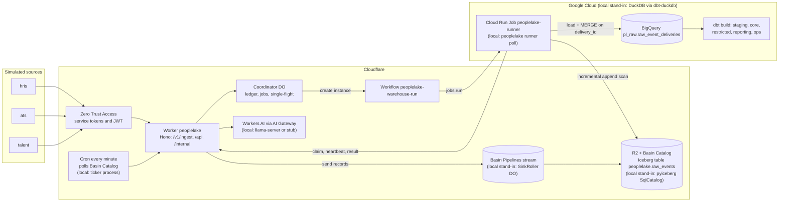

# PeopleLake

Replayable workforce ELT and historical analytics warehouse. Three simulated enterprise sources (`hris`, `ats`, `talent`) carrying HR, recruiting, compensation and performance data post events to a Cloudflare Worker, which streams them through Basin Pipelines into an Iceberg lake on R2. A Python runner loads the lake incrementally into BigQuery and dbt builds a dimensional model with effective-dated employee history, five workforce metrics and reconciliation checks. Cloudflare Workflows orchestrate every warehouse run so any step can fail, retry or be re-delivered without changing the outputs.

All data is synthetic. The design is in [SPEC.md](SPEC.md); the domain glossary is in [CONTEXT.md](CONTEXT.md); build progress is in [PROGRESS.md](PROGRESS.md).

## Status

v1 is under construction and this repository is published while it is built. This table is updated in every commit that changes what works.

| Area | State |
|---|---|
| Repo scaffold, TypeScript configs, generated Worker types, prose check | done |
| Synthetic generator with exact counts and oracle | done: 100,000 events (full) and 10,000 (small) from `hris`, `ats`, `talent`, pinned sha256, committed oracle seeds |
| Contracts and canonical JSON golden | done: zod contracts generate `contracts/*.schema.json`; pydantic mirrors; fixtures and a canonical JSON golden asserted by vitest (in workerd) and pytest |
| DuckDB loader and output digests | done: idempotent load on `delivery_id`, UTC sessions, engine-independent digests for the 10 published models |
| dbt models, five metrics, reconciliation checks | done on DuckDB: staging, spells, SCD2 history with per-model bucket cursors, facts, metrics mart, reporting and ops models, 10 unit tests, reconciliation checks R1 to R11 |
| BigQuery configs and offline compile | done offline: dbt-bigquery profiles, policy tags, authorized views, int64 range `insert_overwrite`, both compile branches parse as BigQuery, ORDER BY lint, BigQuery loader tested against a fake client; nothing has run on BigQuery yet |
| Local Iceberg lake | done locally: pyiceberg SqlCatalog stand-in, committer for sink roll files (idempotent on key and etag), incremental reader with full-scan fallback; Basin Catalog configured through Iceberg REST but not exercised (needs production) |
| Worker: auth, ingest, sinks | done locally: fail-closed config, Access JWT verification (RS256, iss, aud, exp) with locally generated dev keys, role gates, `POST /v1/ingest/:source` for three envelopes (zod, all-or-nothing), RawRecord normalization shared with Python through a golden, Basin stream sink (production) and the SinkRoller stand-in (local) |
| Orchestration: Coordinator, Workflow, dispatchers | done locally (Miniflare Workflows): Coordinator ledger with single-flight runs, attempt-scoped jobs and leases, `WarehouseRunWorkflow` (load, transform or skip, verify, commit, release), poll and Cloud Run dispatchers, Basin Catalog poll, lake-events queue consumer, per-minute cron, eval faults; production Workflows not exercised yet |
| Runner and local stack | not started |
| Scenario and freshness evals | not started |
| CI | not started |
| Workers AI and `/api/ask` | not started |
| Production setup (`setup:prod`, `doctor`, `bootstrap-gcp`) | not started |
| Front end | none in v1 (the dashboard is below the core cut line); `/api/*` is the read interface |

Identical outputs across scenarios: not yet measured on any engine. BigQuery: pending (needs the production setup below).

## Architecture

Production path, with the local stand-ins in brackets.



## What runs where

| Concern | Local (offline, CI) | Production |
|---|---|---|
| Ingest API | wrangler dev 4.149.0 (workerd via Miniflare) on 127.0.0.1:8791, Worker name `peoplelake-local` | Worker `peoplelake` on workers.dev behind Cloudflare Access |
| Stream to lake | **stand-in**: `SinkRoller` Durable Object writes NDJSON roll files to local R2 (Miniflare's Pipeline binding discards data) | Basin Pipelines stream, pipeline and sink (`r2-data-catalog`, roll 60 s) |
| Lake catalog | **stand-in**: pyiceberg `SqlCatalog` (SQLite) on disk | Basin Catalog (Iceberg REST) on R2 bucket `peoplelake-lake` |
| New-data trigger | **stand-in**: SinkRoller enqueues an R2-notification-shaped message on every roll | per-minute cron polls Basin Catalog table metadata; R2 notifications to a Queue as an optimization |
| Orchestration | Workflows as implemented by Miniflare | Cloudflare Workflows |
| Runner | `peoplelake runner poll` process | Cloud Run Job `peoplelake-runner` (us-central1) |
| Warehouse | **stand-in**: DuckDB 1.5.6 via dbt-duckdb 1.11.0, session UTC | BigQuery (US) via dbt-bigquery 1.12.1 |
| Column security | none | policy tags, data masking, authorized views |
| Auth | locally generated RS256 keys, same verifier code | Access JWT (RS256) against the team JWKS |
| LLM | llama-server (Qwen3-1.7B) on 8150, or a deterministic stub in CI | Workers AI through AI Gateway `peoplelake` |
| Cron | ticker process | Workers cron `* * * * *` |

## Local setup

Requirements: Node 22.18 or newer (CI uses 24), npm, uv 0.12.x, Python 3.12.

```bash
git clone https://github.com/nitishsjsucs/peoplelake && cd peoplelake
npm ci
uv sync --locked --project pipeline
uv run --project pipeline peoplelake auth dev-keys   # .dev/keys and DEV_ACCESS_JWKS in .dev.vars
npm run typecheck
npm test            # vitest (TZ=UTC)
npm run test:py     # pytest (TZ=UTC)
npm run check:prose

# synthetic data: exact counts, byte-identical on every platform
uv run --project pipeline peoplelake generate --profile small --out .data/generated/small --check
uv run --project pipeline peoplelake generate --profile full --out .data/generated/full --check
uv run --project pipeline peoplelake generate --write-seeds   # rewrites warehouse/seeds (committed)

# load generated events straight into the local DuckDB stand-in (no Worker, no lake), then dbt
export TZ=UTC PL_PROFILE=small PL_DUCKDB_PATH=$PWD/.data/warehouse/peoplelake.duckdb
uv run --project pipeline peoplelake warehouse load-direct --profile small
uv run --project pipeline peoplelake dbt seed
uv run --project pipeline peoplelake dbt run --empty   # unit tests need the relations to exist
uv run --project pipeline peoplelake dbt build         # models, unit tests and data tests
uv run --project pipeline peoplelake digest     # digests of the 10 published models

# SPEC 15.4 in one command: straight load, incremental build with unit tests, full refresh, equal digests
uv run --project pipeline peoplelake dev reference-digests --profile small --out .data/reference/reference-digests-small.json

# BigQuery SQL without credentials: both compile branches, sqlglot parse, ORDER BY NULLS lint
uv run --project pipeline peoplelake dev bq-compile
```

### Five metrics and reconciliation

`metrics_workforce_monthly` is the single definition of headcount, FTE, hires, departures and offer acceptance rate (plus rehires, transfers and offer components) by month and department. Reconciliation checks run as dbt tests; error-level checks block a warehouse commit and hold even while late data is in flight, warn-level checks are completeness checks that must be 0 at quiescence.

| Id | Check | Severity |
|---|---|---|
| R1, R2 | headcount roll-forward for the company and per department (with transfers) | error |
| R3 | rehire continuity: spells never overlap, rehires are spell 2 or later | error |
| R4 | retroactive corrections applied in the history, superseded values gone (independent SQL path) | error |
| R5 | rescinded terminations end no spell and count as no departure | error |
| R6 | accepted offer to hire, both directions, within 30 days | warn |
| R7 | unique events by source and type equal the generator manifest | warn |
| R8 | one payload per event id across deliveries | error |
| R9 | effective-dated history contiguous within each spell | error |
| R10 | all five metrics and components equal the oracle on all 468 rows | warn |
| R11 | no open anomalies (orphan corrections, inferred spell ends, events outside spells) | warn |

`pipeline/tests/test_reconciliation_checks.py` breaks each invariant on purpose and asserts that its check fires.

### Synthetic data

| Source | Domains | Full profile events | Small profile events |
|---|---|---:|---:|
| `hris` | HR: hires, rehires, terminations, transfers, job and FTE changes, corrections, rescinds | 14,470 | 1,447 |
| `ats` | recruiting: requisitions, applications, stage changes, offers | 55,530 | 5,553 |
| `talent` | compensation changes and performance reviews | 30,000 | 3,000 |
| total | | 100,000 | 10,000 |

The generator (`pipeline/src/peoplelake/generator`) keeps the true world state and computes the expected value of every metric for every month and department from it (the oracle), never from the events. Both profiles' oracle rows are committed as dbt seeds in `warehouse/seeds/oracle/` and a test regenerates and diffs them. True-world totals on the full profile: headcount 4,000 at 2022-12-31 and 4,650 at 2025-12-31, 2,550 hires (150 of them rehires) and 1,900 departures in 2023 to 2025, offer acceptance 2,600 / 3,120 = 0.833333.

More commands are added here as each part lands (see Status).

## Production setup

Production needs a Cloudflare account on Workers Paid with R2 and Zero Trust, and a Google Cloud project with billing for BigQuery and Cloud Run. The idempotent `npm run setup:prod` and `npm run doctor` commands that provision and check every resource are planned in SPEC.md sections 20 and 21 and are not built yet. Until they exist, nothing in this repo runs against Cloudflare production services or BigQuery.

## Results

No results yet. This section only ever contains numbers produced by this repository's scripts, each with its command, date and engine.

## License

MIT
