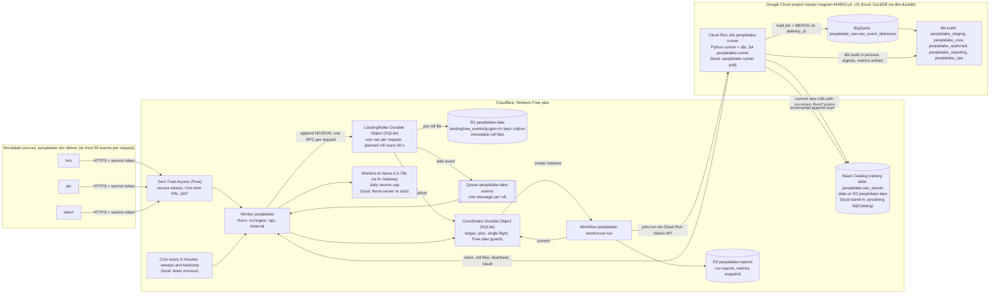
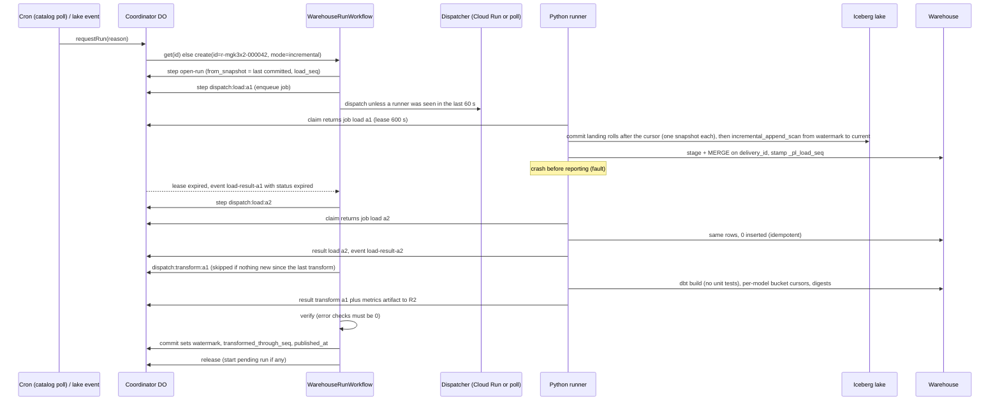
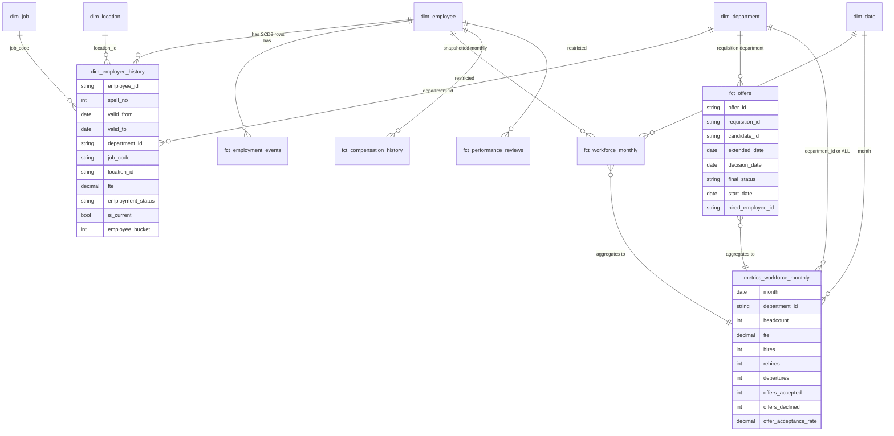

# PeopleLake v1: Build Specification

- Spec date: 2026-10-10 (revision 2, same day: every blocking and important review finding resolved; see section 28)
- Revision 3 (2026-10-10): **production runs on the Cloudflare Workers Free plan** (section 29). Basin Pipelines is Workers Paid only, so production landing becomes the LandingRoller Durable Object writing immutable roll files to R2, and the Python runner commits them to the Iceberg table in Basin Catalog. Section 29 also adds Free plan budgets and guards and the shared Google Cloud project rules. **Where an earlier section conflicts with section 29, section 29 wins**; sections marked "Superseded" point to it.
- Repo: `~/Developer/projects/peoplelake`, published as `github.com/nitishsjsucs/peoplelake` (public; an owner-run loop publishes new commits from the working directory)
- Status of this document: architect's spec. v1 was built from it (PROGRESS.md is the log of record); revision 3 is the next work for builder 3 (section 23.0).
- Every version number, CLI flag and API shape below was checked on 2026-10-10 by `npm view`, PyPI JSON, scratch installs under `/private/tmp/.../scratchpad`, running the tools, or reading official docs. Section 25 is the verification log. Anything not verified is marked **[UNVERIFIED]** (or [U] in the setup tables).

---

## 0. Acceptance criteria (verbatim resume text)

```text
PeopleLake -- Workforce ELT and Historical Analytics Warehouse
Built a replayable workforce data platform that unified simulated HR, recruiting, compensation, and performance data using Cloudflare Workers, Basin Pipelines, and R2. Integrated BigQuery and dbt to support incremental processing, historical employee records, and consistent workforce reporting.
* Built Python/SQL ELT pipelines integrating three simulated enterprise sources and approximately 100,000 workforce events into BigQuery using Cloudflare Workers, Basin Pipelines, and R2.
* Built dbt dimensional models and effective-dated employee history supporting five workforce metrics, including headcount, FTE, hires, departures, and offer acceptance, with reconciliation checks for rehires and retroactive corrections.
* Built retry-safe orchestration with Cloudflare Workflows, targeting 15-minute p95 data freshness and identical warehouse outputs across five duplicate-delivery, late-arrival, and recovery scenarios.
```

Each phrase maps to code plus a test or eval (full map in section 15.6). Summary:

| Claim | Where it becomes true | Proof |
|---|---|---|
| replayable | lake is the source of truth; `replay` run rebuilds the warehouse from Iceberg | scenario S5 (full rebuild and point-in-time replay digests) |
| HR, recruiting, compensation, performance | 3 sources carrying 4 domains, all modeled | per-domain mart tests and manifest counts |
| Cloudflare Workers, Basin Pipelines, R2 | **Superseded (section 29): Basin Pipelines is Workers Paid only and is not used.** Ingest Worker, LandingRoller Durable Object, immutable roll files in R2, Iceberg table in Basin Catalog committed by the runner | production path (needs Nitish, section 20); the resume wording changes (section 0.1) |
| BigQuery and dbt, incremental | dbt-bigquery target, incremental models | offline BigQuery compile in CI; `prod:e2e`; scenarios on BigQuery `_drill` datasets (required go-live step); incremental vs full-refresh digest parity |
| three sources, ~100,000 events | generator emits exactly 100,000 unique events from `hris`, `ats`, `talent` | generator tests, `recon_event_counts_vs_manifest` |
| dimensional models, effective-dated history | star schema plus SCD2 `dim_employee_history` | dbt unit tests, contiguity tests |
| five metrics | headcount, FTE, hires, departures, offer acceptance rate | oracle tests against the generator's ground truth (committed oracle seeds) |
| reconciliation for rehires and retro corrections | dbt data tests R1 to R11 | dbt build in CI |
| retry-safe orchestration with Workflows | `WarehouseRunWorkflow` + Coordinator DO + attempt-scoped events + per-model bucket cursors | vitest Workflow introspection tests, scenario S4, dbt-level fault parity test |
| targeting 15-minute p95 freshness | measured, never assumed | `eval freshness` (local stack); production p95 computed once from the single live `prod:e2e` delivery |
| identical outputs across 5 scenarios | engine-independent output digests | `eval scenarios` on DuckDB (CI) and on BigQuery `_drill` datasets (go-live); each result row labels its engine |

### 0.1 Resume wording under the Free plan (revision 3)
Basin Pipelines needs Workers Paid, which Nitish declined, so the two phrases that name it become untrue. The Free plan design (section 29) makes this wording true once builder 3's migration commits (section 23.0) and the go-live steps (section 20.5) are done:

```text
Summary sentence:  "... performance data using Cloudflare Workers, R2, and Apache Iceberg."
Bullet 1:          "... approximately 100,000 workforce events into BigQuery through Cloudflare Workers and an Apache Iceberg lake on R2."
```

Every other phrase stays as written: Workflows, BigQuery, dbt, the 15-minute p95 target, the five scenarios and the 100,000 events all fit the Free plan budgets in section 29.5. Apache Iceberg names the table format of `peoplelake.raw_events` (pyiceberg locally, Basin Catalog on R2 in production) and is central to this project. Durable Objects and Queues, which the sibling projects' Worker configs on this machine also use, are left out of the wording to keep project stacks distinct.

## 1. Goals and non-goals

### Goals
1. Ingest three simulated enterprise sources (`hris`, `ats`, `talent`) through an authenticated Cloudflare Worker into an append-only Iceberg lake (revision 3: the LandingRoller Durable Object rolls accepted records into R2 and the runner commits them to Basin Catalog on R2, all on the Workers Free plan; section 29).
2. Load the lake incrementally into a warehouse with Python, transform with dbt into a dimensional model with effective-dated employee history and five metrics, guarded by reconciliation checks.
3. Orchestrate every warehouse run with Cloudflare Workflows so any step can fail, retry or be re-delivered without changing outputs.
4. Prove idempotency (five scenarios, identical digests) and measure freshness (p95) with repeatable evals whose numbers come only from this repo's scripts.
5. Two honest paths: a local path that runs offline and in CI, and a production path (Cloudflare + Google Cloud: BigQuery and a Cloud Run Job runner) that runs as soon as Nitish provisions accounts, with an idempotent `npm run setup:prod` and an `npm run doctor`.

### Non-goals (v1)
- Real HR data or real vendor APIs. All data is synthetic; source names are generic (`hris`, `ats`, `talent`), never vendor product names.
- Atomic multi-table publish in BigQuery (dbt writes models in dependency order; consumers read the committed metrics snapshot). Recorded as a risk.
- Correction chains (a correction of a correction) in the generated data. The warehouse implements "latest correction by source_sequence wins" and unit-tests it, but the generator does not emit chains.
- Row-level security policies, OpenLineage emission (openlineage-dbt 1.53.0 installs; deferred), Looker/BI tooling, CDC from databases, streaming inserts into BigQuery, multi-region.
- GitHub Actions as production compute (ADR 0002). Actions run CI only.
- Below the core cut line (section 23): the 60-question ask eval, the React dashboard and the MetricFlow semantic layer. The Workers AI and AI Gateway slice (`AiProvider`, minimal `/api/ask`, setup and doctor checks) is above the cut. If the dashboard is not built, the README says plainly that v1 has no front end.

## 2. Architecture

### 2.1 Component diagram (production path on the Workers Free plan, local stand-ins in brackets; revision 3)



### 2.2 Sequence: one warehouse run with a lost result and a retry



### 2.3 Key design decisions (each becomes an ADR in `docs/adr/`)
1. **ADR 0001 Warehouse-level idempotency.** Every record carries a deterministic `event_id` (from the source) and a Worker-minted `delivery_id`. The loader MERGEs on `delivery_id`; dbt staging is insert-only on `event_id` (first delivery wins). No request-level dedupe in the Worker, so duplicates stay visible and countable. Basin sinks advertise exactly-once from stream to sink (verified in docs), which does not cover client retries or replays; hence warehouse-level idempotency.
2. **ADR 0002 Workflows orchestrate, a Cloud Run Job executes.** Workers cannot run dbt or pyiceberg. The Workflow owns sequencing, retries and commit; work is handed to a runner through attempt-scoped jobs and `step.waitForEvent`. Production runner: Cloud Run Job `peoplelake-runner` in `us-central1` (same cloud as BigQuery; attached service account `pl-runner`, so no keys for data access; instance-based billing with a 1-minute minimum per execution, inside the monthly free tier at this volume). The Worker starts an execution with `jobs.run` (no overrides) using a dispatch-only identity. GitHub-hosted Actions were rejected for production compute: GitHub's Additional Product Terms say Actions should not be used "as part of a serverless application", and GitHub-hosted runners should not be used for activity unrelated to the production, testing, deployment or publication of the repo's software. They also add cold-start queueing. Actions run CI only. Local runner: the same CLI in a polling loop.
3. **ADR 0003 Local stand-ins are labeled stand-ins.** Miniflare's Pipeline binding `send()` is a no-op (read in miniflare source), so locally a `SinkRoller` Durable Object writes NDJSON roll files to local R2 and a Python committer appends them to a pyiceberg `SqlCatalog` table. README and every log line name these as stand-ins.
4. **ADR 0004 Bucketed replace with per-model cursors.** Effective-dated models are rebuilt per affected employee bucket: BigQuery `insert_overwrite` on an int64 range partition `employee_bucket` (0..2047), DuckDB `delete+insert` with `unique_key='employee_bucket'`. dbt-bigquery rejects custom strategies (only `merge`, `insert_overwrite`, `microbatch`; read in its macro source), so this is the portable form. Each bucketed model computes its own affected buckets from its own cursor (`max(_pl_load_seq)` in `{{ this }}`), so a model that failed in an earlier attempt catches up on the next one (reproduced and fixed in scratch, section 28).
5. **ADR 0005 Engine-independent output digests.** "Identical warehouse outputs" means equal SHA-256 digests over 10 published models, computed in Python from canonicalized rows, so DuckDB and BigQuery outputs can also be compared to each other. SQL that feeds digests is written to be engine-neutral: no floats, explicit `NULLS LAST`, total orders, UTC sessions (section 11.8).
6. **ADR 0006 Verify the Access JWT on every request.** The Worker never trusts that Access ran; it verifies RS256, `iss`, `aud`, `exp` with jose against the team JWKS. Locally the same code verifies dev tokens signed by locally generated keys.
7. **ADR 0007 Metrics are checked against an oracle.** The generator keeps the true world state and emits expected metric values, committed as seeds; dbt tests compare the warehouse's five metrics to them exactly.
8. **ADR 0008 One process owns the local warehouse file.** DuckDB allows one read-write process per file, and a second process cannot even open it read-only while the first holds it (reproduced). In-process dbt keeps the file open for the life of the process (reproduced). The runner process is therefore the only process that touches `.data/warehouse/*.duckdb` while the stack is up; it returns digests, check counts and freshness histograms in its results. Evals and `peoplelake digest` open the file only after `stack down`.
9. **ADR 0009 Production on the Workers Free plan (revision 3).** Basin Pipelines is Workers Paid only. The LandingRoller Durable Object (formerly the local `SinkRoller` stand-in) becomes the production landing in both environments: one SQLite row per ingest request, a planned roll every 60 s into an immutable R2 object, one Queue message per roll. The runner commits new rolls to the Iceberg table in Basin Catalog with pyiceberg's `RestCatalog`, keeping its cursor in the snapshot summary of each append. Ingest batches are capped at 50 events (measured CPU), the Coordinator gets indexes, a 5-minute backstop cron, failure backoff, a minimum run interval and daily caps, Workers AI gets a daily neuron cap, and every Google Cloud name in the shared project starts with `peoplelake` with resource-scoped grants. This amends ADR 0003 (the landing is no longer a stand-in) and the identity names in ADR 0002. Section 29.

## 3. Toolchain and pinned versions (verified 2026-10-10)

### 3.1 Node (exact pins in `package.json`, lockfile committed)
| Package | Version | Note |
|---|---|---|
| node | >=22.18 (local 25.9.0, CI 24 LTS "Krypton" 24.21.0) | wrangler 4.149 engines `>=22.0.0`; 22.18+ runs `.ts` scripts natively (strip-only mode: no enums, namespaces or parameter properties) |
| wrangler | 4.149.0 | latest on npm; has `pipelines`, `basin`, `r2 bucket catalog`, `r2 bucket notification`, `workflows`, `types --check --env-file`, `deploy --secrets-file`, `auth token` |
| @cloudflare/vitest-plugin | 1.4.0 | successor of `@cloudflare/vitest-pool-workers` (0.23.0 says "renamed"); peer `vitest ^4.1.0 \|\| ^5.0.0`; ships `./types` |
| vitest | 4.1.11 | vitest 5.0.3 exists; 4.1.11 pinned because sibling repos are proven on it |
| typescript | 6.0.3 | defaults changed: `types` is `[]` and `.ts` imports need `allowImportingTsExtensions` (both reproduced); TypeScript 7.0.2 (Go port) exists, not adopted |
| hono | 4.13.13 | |
| zod | 4.6.5 | request validation |
| jose | 6.2.12 | JWT verification, and RS256 signing of the GCP dispatcher assertion |
| jsonc-parser | 3.3.1 | `render-wrangler` script |
| @types/node | 24.19.1 | |
| Runtime types | generated by `wrangler types` into `worker-configuration.d.ts` (committed) | `@cloudflare/workers-types` 5.20261010.1 exists but is not needed |
| Below cut line | react 19.3.0, react-dom 19.3.0, vite 8.3.4, @vitejs/plugin-react 6.1.2, @types/react 19.3.0, happy-dom 20.14.5, @testing-library/react 16.3.3 | dashboard only |

TypeScript configs (all reproduced on TS 6.0.3):
- `tsconfig.node.json` (scripts and `src/shared`): `{strict, noEmit, module: "nodenext", target: "es2023", types: ["node"], allowImportingTsExtensions: true, erasableSyntaxOnly: true, verbatimModuleSyntax: true, skipLibCheck: true}`. `erasableSyntaxOnly` makes tsc reject what Node's strip-only mode would throw on at runtime (an enum fails with TS1294 in tsc and with an uncaught error under `node`). `src/shared` therefore uses `as const` unions, never enums.
- `tsconfig.worker.json`: `{strict, noUncheckedIndexedAccess, exactOptionalPropertyTypes, skipLibCheck, verbatimModuleSyntax, isolatedModules, module: "es2022", moduleResolution: "bundler", lib: ["es2023"], types: []}` with `include` listing `worker-configuration.d.ts`; the worker test project adds `types: ["@cloudflare/vitest-plugin/types"]`.

### 3.2 Python (`pipeline/pyproject.toml`, `requires-python = ">=3.12,<3.13"`, `uv.lock` committed, `[tool.uv] required-version = ">=0.12.17,<0.13"`)
| Package | Version | Note |
|---|---|---|
| python | 3.12.13 local, 3.12 in CI via setup-uv | pyarrow 26 requires >=3.11 |
| dbt-core | 1.12.5 | requires dbt-adapters >=1.24.5; one uv lock of 134 packages resolves with every pin below |
| dbt-duckdb | 1.11.0 | requires dbt-core >=1.8; ran `dbt build`, unit tests and in-process `dbtRunner` with core 1.12.5 in scratch |
| dbt-bigquery | 1.12.1 | requires dbt-core >=1.10; offline compile verified (section 11.9); profile fields `maximum_bytes_billed` and `impersonate_service_account` exist (read in its credentials class) |
| duckdb | 1.5.6 | session time zone defaults to the machine zone (reproduced); always set to UTC |
| pyarrow | 26.0.0 | |
| pyiceberg[sql-sqlite,pyarrow] | 0.12.0 | `SqlCatalog`, `RestCatalog`, `incremental_append_scan` verified |
| google-cloud-bigquery | 3.46.1 | rejects `max_time_travel_hours` outside 48..168 (verified); used to set it on datasets |
| google-cloud-datacatalog | 3.32.0 | `PolicyTagManagerClient.create_taxonomy/create_policy_tag/set_iam_policy` |
| google-cloud-bigquery-datapolicies | 0.10.1 | `DataMaskingPolicy.PredefinedExpression`: SHA256, ALWAYS_NULL, DEFAULT_MASKING_VALUE, LAST_FOUR_CHARACTERS, FIRST_FOUR_CHARACTERS, EMAIL_MASK, DATE_YEAR_MASK |
| httpx | 0.28.1 | runner to Worker |
| pyjwt[crypto] | 2.15.1 | dev token minting |
| pydantic | 2.14.0 | contracts |
| dev: pytest 9.1.1, ruff 0.17.0, sqlglot 30.22.0 | | sqlglot parses compiled BigQuery SQL offline and lints ORDER BY clauses |
| below cut line: dbt-metricflow[dbt-duckdb] 0.15.0 (requires dbt-core >=1.11,<1.13), metricflow 0.213.0 | | `mf query` verified against dbt-duckdb in scratch |

No dbt packages (`dbt deps` needs network). dbt's built-in cross-database macros (`dbt.date_trunc`, `dbt.datediff`, `dbt.dateadd`, `dbt.last_day`, `dbt.hash`) ship with dbt-adapters and compile for both engines (verified), but they return different types per engine, so the repo wraps them (section 11.8). `dbt.safe_cast` is a plain `cast` on dbt-duckdb (reproduced: it raises on bad input), so it is not used.

### 3.3 Other tools
- llama-server 0.5.0 (build 11146) at `/opt/homebrew/bin/llama-server`, model `~/Developer/projects/_models/Qwen3-1.7B-Q4_0-rtn.gguf`. Started only as `llama-server -m <gguf> --host 127.0.0.1 --port 8150 -np 1 -c 8192 -ngl 99`. JSON-schema constrained output verified on 2026-10-10.
- gh 2.99.0 (installed). gcloud and bq are installed and logged in as the owner's Google account with application default credentials (revision 3; earlier revisions said they were missing). Docker is not required on the Mac: the runner image is built by Cloud Build in production and by `docker build` in CI.
- GitHub Actions (CI only): `actions/checkout@v7`, `actions/setup-node@v7`, `astral-sh/setup-uv@v10.3.0` with `version: "0.12.17"` (the action otherwise installs the latest uv; it has no floating v10 tag), `actions/upload-artifact@v7`, `actions/download-artifact@v7`. Workflows declare `permissions: {contents: read}` and hold no cloud credentials.

### 3.4 Ports (shared machine, three other repos build in parallel)
- `wrangler dev --port 8791 --inspector-port 9241 --ip 127.0.0.1`
- `llama-server --port 8150 -np 1 -c 8192 -ngl 99`
- No other listeners. The Python runner, ticker and eval driver are clients only. Every process started by a script runs in its own process group and is killed (SIGTERM, then SIGKILL after 5 s) on exit; `peoplelake stack down` and the test teardown assert all three ports are free.

### 3.5 Time zone
Every process runs in UTC: `TZ=UTC` in npm scripts, `uv run` wrappers and CI `env`; `settings: {TimeZone: UTC}` in the dbt-duckdb profile; `SET TimeZone='UTC'` on every Python DuckDB connection. Reproduced on this Mac: `CAST(TIMESTAMPTZ '2026-01-01 03:00:00+00' AS DATE)` is 2025-12-31 under the default `America/Los_Angeles` session and 2026-01-01 under UTC (the CI and BigQuery answer). DuckDB views evaluate under the reader's session zone, so readers must set it too. Business dates stay typed `DATE`.

## 4. Exact file tree

```text
peoplelake/
  README.md                         # status, mermaid, local/prod setup, matrix, Results, "no front end" note unless the dashboard lands
  SPEC.md                           # this file
  CONTEXT.md                        # domain glossary (section 26)
  LICENSE                           # MIT
  .gitignore                        # node_modules, .wrangler, .data, .dev, .dev.vars, .prod, wrangler.production.jsonc, warehouse/target, warehouse/logs, web/dist
  .nvmrc                            # 24
  .python-version                   # 3.12
  .dev.vars.example                 # every secret name with an empty value: DEV_ACCESS_JWKS=, GCP_DISPATCHER_KEY=, R2_CATALOG_TOKEN=
  Dockerfile                        # runner image: python:3.12-slim + uv 0.12.17, `uv sync --locked --no-dev`, entrypoint `peoplelake`
  .dockerignore                     # also used as .gcloudignore source list
  package.json
  package-lock.json
  tsconfig.json                     # references the configs below
  tsconfig.worker.json              # section 3.1
  tsconfig.node.json                # section 3.1
  tsconfig.web.json                 # below cut line
  wrangler.jsonc                    # local config at top level (name peoplelake-local), env.production with __PL_*__ placeholders (section 7.1)
  worker-configuration.d.ts         # generated by `npm run typegen`, committed, checked in CI
  vitest.config.ts                  # projects: worker (cloudflareTest), node, web
  vite.config.ts                    # below cut line
  contracts/
    raw-record.schema.json
    source-hris.schema.json
    source-ats.schema.json
    source-talent.schema.json
    job.schema.json
    load-result.schema.json
    transform-result.schema.json
    fixtures/                       # one valid + one invalid example per schema; validated by both TS and Python tests
    golden/canonical-json.json      # payloads and their expected canonical bytes and sha256, asserted by vitest and pytest
  infra/
    cloudflare/
      stream-schema.json            # Basin structured stream schema (section 6.2)
      pipeline.sql                  # INSERT INTO peoplelake_raw_sink SELECT <explicit columns> FROM peoplelake_raw_stream;
      r2-notification.md            # rule definition and rationale (optimization only)
    gcp/
      README.md                     # what bootstrap-gcp creates
      cloudbuild.yaml               # docker build + push, options.logging CLOUD_LOGGING_ONLY
  scripts/
    render-wrangler.ts              # wrangler.jsonc + .prod/state.json -> wrangler.production.jsonc
    predeploy-check.ts              # refuses deploy if any __PL_ placeholder remains or prod vars are unsafe
    setup-prod.ts                   # idempotent provisioning (section 21)
    doctor.ts                       # prerequisite checks (section 21)
    check-prose.ts                  # fails on U+2014, U+2013, or " -- " in Markdown prose outside code
    results-to-readme.ts            # renders evals/results/*.json into the README Results section
  src/
    shared/                         # imported by scripts too: erasable syntax only, no enums
      contracts.ts                  # RawRecord, JobSpec, LoadResult, TransformResult, RunPlan (mirrors contracts/*.json)
      metrics.ts                    # the five metric ids and labels (as const)
      sources.ts                    # SourceId = "hris" | "ats" | "talent"
    worker/
      index.ts                      # default export {fetch, queue, scheduled}; exports Coordinator, SinkRoller, WarehouseRunWorkflow
      app.ts                        # Hono app assembly
      config.ts                     # parseConfig(env, requestHost): AppConfig, fail-closed rules
      auth/access.ts                # verifyAccessJwt(), keyset selection (remote JWKS or DEV_ACCESS_JWKS)
      auth/roles.ts                 # Principal, Role, requireRole()
      ingest/routes.ts              # POST /v1/ingest/:source
      ingest/normalize.ts           # per-source envelope -> RawRecord
      ingest/canonical-json.ts      # canonical JSON (integers only) + sha256
      lake/sink.ts                  # LakeSink, BasinStreamSink, LocalRollingSink
      lake/sink-roller.ts           # SinkRoller Durable Object (local stand-in)
      lake/lake-events.ts           # queue consumer for R2-notification-shaped messages
      lake/catalog-poll.ts          # Iceberg REST loadTable against Basin Catalog (production trigger)
      orchestration/coordinator.ts  # Coordinator Durable Object (SQLite)
      orchestration/coordinator-sql.ts
      orchestration/warehouse-run.ts# WarehouseRunWorkflow
      orchestration/dispatcher.ts   # RunnerDispatcher, PollDispatcher, CloudRunDispatcher
      orchestration/gcp-token.ts    # service-account JWT bearer grant with jose, token cache
      orchestration/triggers.ts     # scheduled() logic
      api/public.ts                 # /v1/health, /api/runs, /api/metrics, /api/freshness, /api/replay
      api/ops.ts                    # /api/ops/* operator checks used by doctor
      api/internal.ts               # /internal/jobs/*, /internal/runs/:id/artifacts
      api/dev.ts                    # /internal/dev/* (only when ENVIRONMENT=local)
      ai/providers.ts               # AiProvider: stub, openai-compatible, workers-ai (above cut)
      ai/ask.ts                     # minimal /api/ask: question -> MetricQuery -> answer from snapshot (above cut)
      reports.ts                    # R2 report writers
    web/                            # below cut line: React dashboard
  test/
    setup/worker-vars.ts
    worker/*.test.ts                # runs in workerd via @cloudflare/vitest-plugin
    node/*.test.ts                  # scripts, contracts, prose check, config names
    web/*.test.tsx                  # below cut line
  pipeline/
    pyproject.toml
    uv.lock
    src/peoplelake/
      __init__.py
      cli.py                        # argparse entry point `peoplelake`
      config.py                     # env -> Settings (pydantic)
      prng.py                       # SplitMix64 PRNG (platform and version stable)
      canonical.py                  # canonical JSON shared with the Worker golden
      generator/
        profiles.py                 # exact counts for "full" and "small"
        reference.py                # departments, jobs, locations (also committed as seeds)
        world.py                    # true world: employees, spells, timelines, offers
        hris.py, ats.py, talent.py  # source envelopes from the world (incl. recorded errors, corrections, rescinds)
        oracle.py                   # expected metrics and expected R6/R11 results from the true world
        manifest.py                 # counts + dataset sha256
      sim/
        plan.py                     # delivery plans: baseline + S1..S5 perturbations
        client.py                   # posts batches to /v1/ingest/:source
      lake/
        schema.py                   # Arrow/Iceberg schema mirroring infra/cloudflare/stream-schema.json
        catalog.py                  # local SqlCatalog or Basin RestCatalog
        committer.py                # local stand-in: sink files -> Iceberg snapshots (recommit flag for S2)
        reader.py                   # incremental reads with full-scan fallback
      warehouse/
        base.py                     # Warehouse protocol
        duckdb_wh.py                # open_duckdb(): default config, read-write, SET TimeZone='UTC'
        bigquery_wh.py
        loader.py                   # load job orchestration, load_log
        digest.py                   # canonical digests (ADR 0005)
        dbt_runner.py               # in-process dbtRunner + run_results parsing
      runner/
        client.py                   # WorkerClient (claim, heartbeat, result, artifact)
        jobs.py                     # LoadJob, TransformJob, fault hooks
        main.py                     # poll loop and --until-idle mode
      auth/dev_tokens.py            # dev keys + RS256 tokens; Access service-token headers for prod
      stack.py                      # local stack manager (wrangler dev, runner, ticker) with process-group cleanup
      devtools/
        lint_sql.py                 # sqlglot lint: ORDER BY and window ORDER BY need explicit NULLS
        clean_clone.py              # git clone HEAD to a temp dir, uv sync, dbt parse, smoke tests
      evals/
        scenarios.py
        freshness.py
        report.py
      prod/
        bootstrap_gcp.py
        doctor_gcp.py
        drills.py                   # restore drill, scenario drill (into *_drill datasets)
        demo_masking.py
        reset.py                    # guarded full production reset (lake table, datasets, Coordinator)
    tests/
      test_generator_counts.py, test_generator_determinism.py, test_generator_world_rules.py, test_oracle.py,
      test_oracle_seeds_committed.py, test_canonical_json_golden.py, test_contracts.py, test_lake_committer.py,
      test_reader.py, test_loader_duckdb.py, test_single_owner.py, test_timezone_utc.py, test_bigquery_loader_sql.py,
      test_bq_manifest.py, test_bucket_cursors.py, test_digest.py, test_dev_tokens.py, test_plan_scenarios.py,
      test_stack_cleanup.py, test_bootstrap_plan.py, test_restore_drill_sql.py
  warehouse/                        # dbt project "peoplelake"
    dbt_project.yml                 # vars: pl_profile (default from env PL_PROFILE)
    profiles.yml                    # env-var driven, no secrets
    macros/                         # section 11.8
    models/
      sources.yml
      staging/   stg_events.sql, stg_hris__worker_events.sql, stg_ats__requisitions.sql, stg_ats__applications.sql, stg_ats__offers.sql, stg_talent__compensation_changes.sql, stg_talent__reviews.sql, _staging.yml
      intermediate/ int_hris__effective_events.sql, int_hris__spells.sql, int_hris__attribute_timeline.sql, _intermediate.yml
      core/      dim_date.sql, dim_department.sql, dim_job.sql, dim_location.sql, dim_employee_history.sql, dim_employee.sql, fct_employment_events.sql, fct_offers.sql, fct_workforce_monthly.sql, metrics_workforce_monthly.sql, _core.yml
      restricted/ fct_compensation_history.sql, fct_performance_reviews.sql, _restricted.yml
      reporting/ rpt_workforce_monthly.sql, rpt_offer_acceptance_monthly.sql, _reporting.yml
      ops/       ops_delivery_stats.sql, ops_event_freshness.sql, ops_anomalies.sql, _ops.yml
    seeds/
      reference/ ref_departments.csv, ref_jobs.csv, ref_locations.csv   # committed
      oracle/    oracle_workforce_monthly.csv (936 rows: 468 per profile, `profile` column), expected_event_counts.csv (`profile` column)  # committed, regenerated and diffed by pytest
    tests/reconciliation/  R1..R11 singular tests (section 11.6)
  evals/
    ask/questions.jsonl             # below cut line
    results/                        # committed JSON outputs of runs made in a session (README cites these)
  docs/
    adr/0001..0008-*.md
    runbooks/restore.md, replay.md, rotate-tokens.md, prod-reset.md
  .github/workflows/
    ci.yml
    eval-full.yml
```

## 5. Synthetic data generator

### 5.1 Determinism
- PRNG: in-repo SplitMix64 (`prng.py`) seeded with `20261010`, so outputs do not depend on Python's `random` implementation or platform.
- IDs: `event_id = uuid5(NAMESPACE_PL, f"{profile}/{source}/{source_sequence}")` with a fixed namespace UUID. Employees `E000001..`, candidates `C000001..`, requisitions `Q000001..`, applications `A000001..`, offers `O000001..`.
- Canonical output: one JSONL file per source sorted by `source_sequence`, canonical JSON (sorted keys, no spaces, UTF-8). `manifest.json` records per-source and per-type counts and `dataset_sha256` (sha256 over the three files in source order). A test pins the sha256 for both profiles, so macOS and ubuntu CI must agree byte for byte.
- Simulated time: business dates 2010-01-01 to 2025-12-31 (initial population hire dates 2012-01-01 to 2022-12-31; activity window 2023-01-01 to 2025-12-31; 50 accepted offers start 2026-01-05 to 2026-01-30). `data_as_of = 2025-12-31`.
- Reference data: 12 departments `D01..D12`, 30 job codes `J01..J30` with levels, 6 locations `L1..L6` (committed seeds).

### 5.2 Exact counts (the generator asserts these and raises if any eligibility pool is too small)

**Profile `full` (100,000 events)**

| Source | Event type | Count | Construction |
|---|---|---:|---|
| hris | worker.hired | 6,400 | 4,000 initial population (`hire_source=initial_load`) + 2,400 external hires dated 2023-02-01..2025-12-31 |
| hris | worker.rehired | 150 | among effectively terminated employees, at least 90 days after termination, same `employee_id`, `spell_no` 2 |
| hris | worker.terminated | 1,960 | 1,900 effective + 60 later rescinded; all dated in window |
| hris | worker.transferred | 1,500 | department change |
| hris | worker.job_changed | 3,000 | 1,800 `promotion`, 1,200 `lateral` |
| hris | worker.fte_changed | 800 | FTE in {1.0, 0.8, 0.6, 0.5} |
| hris | worker.event_corrected | 600 | 250 hire-date, 150 termination-date, 120 transfer-department, 80 fte-change value; recorded 1..60 days after the original |
| hris | worker.event_rescinded | 60 | all target terminations; recorded 1..30 days after |
| **hris total** | | **14,470** | |
| ats | requisition.opened | 2,900 | |
| ats | requisition.closed | 2,700 | 2,600 `filled` + 100 `cancelled` (200 remain open) |
| ats | application.submitted | 30,000 | |
| ats | application.stage_changed | 13,530 | 3 per offered application (9,600) + 1,965 rejected applications x 2 |
| ats | offer.extended | 3,200 | |
| ats | offer.accepted | 2,600 | 2,400 external hires + 150 rehires + 50 pending starts in 2026-01 |
| ats | offer.declined | 520 | |
| ats | offer.rescinded | 80 | withdrawn before decision; excluded from acceptance rate |
| **ats total** | | **55,530** | |
| talent | compensation.changed | 19,500 | 4,000 initial + 2,400 hire + 150 rehire + 10,500 merit (3 cycles x 3,500, effective 04-01 of 2023/2024/2025, tenure >= 90 days) + 1,800 promotion + 650 adjustment |
| talent | review.submitted | 10,500 | 3 annual cycles x 3,500, effective 12-15 of 2023/2024/2025, tenure >= 180 days |
| **talent total** | | **30,000** | |
| **all** | | **100,000** | |

True-world totals the oracle and tests rely on: 6,400 employee ids; 6,550 employment spells; 2,550 hires in window (2,400 external + 150 rehires); 1,900 departures in window; headcount 4,000 at 2022-12-31 and 4,650 at 2025-12-31; overall offer acceptance 2,600 / 3,120 = 0.833333.

**Profile `small` (10,000 events, used by PR CI)**: hris 1,447 (hired 640 = 400 + 240; rehired 15; terminated 196 = 190 + 6; transferred 150; job_changed 300 = 180 + 120; fte_changed 80; corrected 60 = 25/15/12/8; rescinded 6), ats 5,553 (opened 290; closed 270 = 260 + 10; applications 3,000; stage changes 1,353 = 960 + 196 x 2 + 1 x 1; extended 320; accepted 260 = 240 + 15 + 5; declined 52; rescinded 8), talent 3,000 (compensation 1,950 = 400 + 240 + 15 + 3 x 350 + 180 + 65; reviews 1,050 = 3 x 350). Total 10,000. Headcount 400 then 465.

### 5.3 World rules (keep histories unambiguous; every rule is asserted by `test_generator_world_rules.py`)
- At most one HRIS event per employee per calendar day (corrections preserve this).
- A corrected date stays strictly between the neighbouring events of the same employee.
- Hire-date corrections (250 full, 25 small) apply only to in-window hires and rehires, shift the date by 1 to 20 days, and never move the hire on or before the accepted offer's decision date. Exactly 125 of the 250 (12 of the 25 on the small profile) cross a month boundary so restatements are exercised; the generator picks originals near month ends to make this possible and raises if it cannot.
- Termination-date corrections never move a termination before the employee's last talent event or before the spell's last other HRIS event.
- Every talent event tied to a hire or rehire uses the true (corrected) hire date: initial comp for the initial population, the hire or rehire comp event, and tenure eligibility for merit (>= 90 days) and reviews (>= 180 days). Promotions have a comp event on the promotion date.
- In-window hires and rehires carry `ats_candidate_id`; the accepted offer's `start_date` equals the original recorded hire date, so the 250 corrected hires need the 30-day offer-to-hire tolerance in R6, and the 1..20 day bound keeps them inside it.
- Each accepted offer fills one requisition; requisitions open 30..90 days before start; offers are decided 14..45 days before start; external hires begin 2023-02-01 so their offers fall inside the window.
- `oracle.py` computes the expected results of R6 (offer to hire) and R11 (open anomalies) from the true world; pytest asserts both are empty on both profiles. This test is written before any dbt model.

### 5.4 Source envelopes (three shapes on purpose; parsing happens in dbt staging, which is the T in ELT)

```json
// POST /v1/ingest/hris
{"events":[{"eventId":"<uuid>","eventType":"worker.hired","workerId":"E000123","sequence":1234,
  "recordedAt":"2023-02-01T15:04:05Z","effectiveDate":"2023-02-01","schemaVersion":1,
  "data":{"spell_no":1,"department_id":"D04","job_code":"J12","location_id":"L2","fte_bp":10000,
          "ats_candidate_id":"C001777","hire_source":"external"}}]}
// POST /v1/ingest/ats
{"records":[{"id":"<uuid>","type":"offer.accepted","object":{"kind":"offer","id":"O000321"},"seq":555,
  "occurred_at":"2023-01-10T09:00:00Z","effective_on":"2023-01-10","v":1,
  "attributes":{"offer_id":"O000321","start_date":"2023-02-06"}}]}
// POST /v1/ingest/talent
{"items":[{"uuid":"<uuid>","kind":"compensation.changed","subject":"E000123","revision":42,
  "updated":"2024-03-20T12:00:00Z","asOf":"2024-04-01","version":1,
  "body":{"change_id":"K004567","reason":"merit","base_salary":123400,"currency":"USD","bonus_target_bp":1000}}]}
```

Payload numbers are integers only: FTE in basis points (`fte_bp`: 10000, 8000, 6000, 5000) and bonus target in basis points (`bonus_target_bp`). `JSON.stringify(1.0)` prints `1` while Python prints `1.0`, so non-integral numbers would make the Worker's `payload_sha256` differ from a Python canonicalization of the same payload. Canonical JSON = sorted keys, no whitespace, ASCII only, integers only; zod and pydantic reject non-integers; `contracts/golden/canonical-json.json` is asserted byte for byte by both vitest and pytest.

Payload fields per type:
- hris: hired/rehired `{spell_no, department_id, job_code, location_id, fte_bp, ats_candidate_id|null, hire_source}`; terminated `{termination_type: voluntary|involuntary, reason_code}`; transferred `{from_department_id, to_department_id}`; job_changed `{from_job_code, to_job_code, change_type}`; fte_changed `{from_fte_bp, to_fte_bp}`; event_corrected `{corrects_event_id, corrected_fields: {effective_date?|to_department_id?|to_fte_bp?}}`; event_rescinded `{rescinds_event_id}`.
- ats: requisition.opened `{requisition_id, department_id, job_code}`; requisition.closed `{requisition_id, close_reason}`; application.submitted `{application_id, requisition_id, candidate_id}`; application.stage_changed `{application_id, from_stage, to_stage}`; offer.extended `{offer_id, application_id, requisition_id, candidate_id, proposed_start_date}`; offer.accepted `{offer_id, start_date}`; offer.declined/rescinded `{offer_id}`.
- talent: compensation.changed `{change_id, reason, base_salary, currency, bonus_target_bp}`; review.submitted `{review_id, cycle, rating (1..5), reviewer_id}`.

### 5.5 Oracle
`oracle.py` computes, from the true world (not from events), for every month 2023-01..2025-12 and every department plus `ALL` (36 x 13 = 468 rows per profile): `headcount`, `fte`, `hires`, `rehires`, `departures`, `transfers_in`, `transfers_out`, `offers_extended`, `offers_accepted`, `offers_declined`, `offer_acceptance_rate`. Both profiles are written to the committed seed `warehouse/seeds/oracle/oracle_workforce_monthly.csv` (936 rows, `profile` column, a few tens of KB), and the manifest counts to `warehouse/seeds/oracle/expected_event_counts.csv` (`profile` column). R7 and R10 filter on `profile = '{{ var("pl_profile") }}'`; `pl_profile` defaults to env `PL_PROFILE`, which the prod runner job sets to `full`. Nothing the warehouse needs is gitignored. `test_oracle_seeds_committed.py` regenerates both files and diffs them against the committed ones.

### 5.6 CLI
```bash
uv run --project pipeline peoplelake generate --profile full  --out .data/generated/full
uv run --project pipeline peoplelake generate --profile small --out .data/generated/small --check   # verifies pinned sha256
uv run --project pipeline peoplelake generate --write-seeds     # rewrites warehouse/seeds/oracle/* for both profiles
```

## 6. Data contracts

### 6.1 RawRecord (one row per accepted delivery; identical in stream, Iceberg and warehouse raw table)
| Column | Type | Source |
|---|---|---|
| event_id | string | source envelope |
| source | string | `hris` \| `ats` \| `talent` |
| event_type | string | envelope |
| entity_id | string | workerId / object.id / subject |
| source_sequence | int64 | sequence / seq / revision |
| source_updated_at | timestamp (UTC, RFC 3339 on the wire) | recordedAt / occurred_at / updated |
| effective_date | string `YYYY-MM-DD` | effectiveDate / effective_on / asOf |
| schema_version | int32 | schemaVersion / v / version |
| payload | string (canonical JSON of data/attributes/body) | envelope |
| payload_sha256 | string (hex) | Worker |
| received_at | timestamp | Worker clock |
| delivery_id | string (uuid v4) | Worker, one per record per request |
| ingest_request_id | string | Worker |
| producer | string | `peoplelake-ingest/<git sha or version>` |

Warehouse-only columns added by the loader: `_pl_snapshot_id` (string), `_pl_load_run_id`, `_pl_load_job_id`, `_pl_loaded_at` (timestamp), `_pl_load_seq` (int64: the Coordinator's monotonic load sequence for the run, `generation_epoch_s * 1,000,000 + run_seq`, so it keeps increasing even if Coordinator storage is ever reset).

### 6.2 Basin stream schema (`infra/cloudflare/stream-schema.json`)
**Superseded (section 29.4.1): there is no Basin stream, pipeline or sink. `stream-schema.json` and `pipeline.sql` are deleted; the schema of record is `contracts/raw-record.schema.json`, mirrored by `lake/schema.py`, and `peoplelake lake init --target prod` creates the Iceberg table with it.** The text below records the revision 2 design.

Structured stream using only verified types (`string`, `int32`, `int64`, `timestamp`): the 14 columns above, all `"required": true`. Invalid records on a structured stream are "accepted at ingestion but dropped during processing" (docs), so the Worker validates before `send()`. Schemas cannot be modified after stream creation (docs); a schema change means a new stream + sink + table (runbook).

`infra/cloudflare/pipeline.sql`:
```sql
INSERT INTO peoplelake_raw_sink
SELECT event_id, source, event_type, entity_id, source_sequence, source_updated_at, effective_date,
       schema_version, payload, payload_sha256, received_at, delivery_id, ingest_request_id, producer
FROM peoplelake_raw_stream;
```
Names use underscores because SQL references them. The sink auto-creates namespace `peoplelake` and table `raw_events`; "Sinks cannot be created for existing Iceberg tables" (docs), so setup never pre-creates the production table.

### 6.3 Job contracts (`contracts/*.schema.json`, mirrored by `src/shared/contracts.ts` and pydantic models)
```ts
type JobKind = "load" | "transform";
interface JobSpec { job_id: string; run_id: string; load_seq: number; kind: JobKind; attempt: number; mode: "incremental" | "replay";
  input: { from_snapshot: string | null; to_snapshot?: string | null; full_refresh: boolean; dataset_suffix?: string };
  lease_seconds: number; faults?: FaultSpec[] }            // faults only when EVAL_FAULTS_ENABLED
interface LoadResult { job_id: string; run_id: string; attempt: number; status: "succeeded" | "failed" | "expired";
  lake: { table: "peoplelake.raw_events"; from_snapshot: string | null; to_snapshot: string | null; snapshots_read: number; fallback_full_scan: boolean };
  rows_read: number; rows_inserted: number; duplicate_deliveries_skipped: number; unique_new_events: number;
  raw_max_load_seq: number | null;                         // max _pl_load_seq present in the raw table after the load
  min_effective_date_new: string | null; received_histogram_10s: [number, number][]; warehouse: "duckdb" | "bigquery";
  duration_ms: number; error?: string }
interface TransformResult { job_id: string; run_id: string; attempt: number; status: "succeeded" | "failed" | "expired";
  dbt: { success: boolean; models_ok: number; models_error: number; tests_pass: number; tests_warn: number; tests_error: number; elapsed_ms: number; bytes_billed?: number };
  checks: { error: Record<string, number>; warn: Record<string, number> };
  digests: Record<PublishedModel, string>; digest_version: 1; engine: "duckdb" | "bigquery";
  transformed_through_seq: number;                         // max _pl_load_seq in stg_events after the build
  ops_freshness_histogram_10s: [number, number][];         // from ops_event_freshness, computed by the runner (ADR 0008)
  metrics_artifact: { key: string; sha256: string; rows: number };   // uploaded first via /internal/runs/:id/artifacts/metrics
  duration_ms: number; error?: string }
```
Event payloads stay far below the verified 1 MiB Workflow event limit because the metrics snapshot travels through R2, not through the event.

## 7. Cloudflare Worker

### 7.1 `wrangler.jsonc` (shape the build writes)
**Partly superseded (section 29.6):** no `pipelines` binding anywhere; production binds `LAKE_BUCKET`, the `LAKE_EVENTS` producer and the `LANDING_ROLLER` Durable Object; the cron is `*/5 * * * *`; `BASIN_CATALOG_*` vars and the `R2_CATALOG_TOKEN` secret leave the Worker; new Free plan budget vars. The shape below is revision 2.

```jsonc
{
  "$schema": "./node_modules/wrangler/config-schema.json",
  "name": "peoplelake-local",            // never the production name: a plain `wrangler deploy` cannot replace production
  "workers_dev": false,
  "main": "src/worker/index.ts",
  "compatibility_date": "2026-10-01",
  "compatibility_flags": ["nodejs_compat"],
  "observability": { "enabled": true },
  "vars": {
    "ENVIRONMENT": "local", "AUTH_MODE": "dev", "LAKE_MODE": "local", "RUNNER_DISPATCH": "poll", "RUNS_ENABLED": "true",
    "ACCESS_TEAM_DOMAIN": "https://peoplelake-dev.local", "ACCESS_AUD": "peoplelake-dev",
    "ACCESS_ROLE_MAP": "{\"emails\":{\"dev@peoplelake.local\":[\"viewer\",\"operator\"]},\"service_tokens\":{\"src-hris.access\":\"source:hris\",\"src-ats.access\":\"source:ats\",\"src-talent.access\":\"source:talent\",\"runner.access\":\"runner\"}}",
    "JOB_LEASE_SECONDS": "60", "JOB_CLAIM_TIMEOUT_SECONDS": "30", "JOB_MAX_ATTEMPTS": "3", "RUN_TIMEOUT_MINUTES": "10",
    "SINK_ROLL_SECONDS": "60", "LOCAL_SINK_MAX_RECORDS": "50000", "HEARTBEAT_MINUTES": "0",
    "EVAL_FAULTS_ENABLED": "true", "AI_PROVIDER": "stub", "LLM_BASE_URL": "http://127.0.0.1:8150/v1"
  },
  "r2_buckets": [
    { "binding": "LAKE_BUCKET", "bucket_name": "peoplelake-lake-local" },
    { "binding": "REPORTS_BUCKET", "bucket_name": "peoplelake-reports-local" }
  ],
  "queues": {
    "producers": [{ "binding": "LAKE_EVENTS", "queue": "peoplelake-lake-events" }],
    "consumers": [{ "queue": "peoplelake-lake-events", "max_batch_size": 50, "max_batch_timeout": 2, "max_retries": 5, "dead_letter_queue": "peoplelake-lake-events-dlq" }]
  },
  "durable_objects": { "bindings": [
    { "name": "COORDINATOR", "class_name": "Coordinator" },
    { "name": "SINK_ROLLER", "class_name": "SinkRoller" } ] },
  "migrations": [{ "tag": "v1", "new_sqlite_classes": ["Coordinator", "SinkRoller"] }],
  "workflows": [{ "name": "peoplelake-warehouse-run", "binding": "WAREHOUSE_RUN", "class_name": "WarehouseRunWorkflow" }],
  "pipelines": [{ "binding": "RAW_STREAM", "stream": "00000000000000000000000000000000" }],
  "triggers": { "crons": ["* * * * *"] },
  "env": {
    "production": {
      "name": "peoplelake",
      "workers_dev": true,
      "preview_urls": false,
      "vars": {
        "ENVIRONMENT": "production", "AUTH_MODE": "access", "LAKE_MODE": "basin", "RUNNER_DISPATCH": "cloudrun",
        "RUNS_ENABLED": "__PL_RUNS_ENABLED__",
        "ACCESS_TEAM_DOMAIN": "__PL_ACCESS_TEAM_DOMAIN__", "ACCESS_AUD": "__PL_ACCESS_AUD__",
        "ACCESS_ROLE_MAP": "__PL_ACCESS_ROLE_MAP__",
        "GCP_PROJECT": "__PL_GCP_PROJECT__", "GCP_REGION": "us-central1", "CLOUD_RUN_JOB": "peoplelake-runner",
        "BASIN_CATALOG_URI": "__PL_CATALOG_URI__", "BASIN_CATALOG_PREFIX": "__PL_CATALOG_PREFIX__",
        "JOB_LEASE_SECONDS": "600", "JOB_CLAIM_TIMEOUT_SECONDS": "300", "JOB_MAX_ATTEMPTS": "3", "RUN_TIMEOUT_MINUTES": "45",
        "SINK_ROLL_SECONDS": "60", "HEARTBEAT_MINUTES": "360", "RUNNER_SEEN_WINDOW_SECONDS": "60", "EVAL_FAULTS_ENABLED": "false",
        "AI_PROVIDER": "workers-ai", "AI_MODEL": "@cf/meta/llama-3.3-70b-instruct-fp8-fast", "AI_GATEWAY_ID": "peoplelake"
      },
      "ai": { "binding": "AI" },
      "r2_buckets": [{ "binding": "REPORTS_BUCKET", "bucket_name": "peoplelake-reports" }],
      "queues": { "consumers": [{ "queue": "peoplelake-lake-events", "max_batch_size": 50, "max_batch_timeout": 5, "max_retries": 5, "dead_letter_queue": "peoplelake-lake-events-dlq" }] },
      "durable_objects": { "bindings": [
        { "name": "COORDINATOR", "class_name": "Coordinator" },
        { "name": "SINK_ROLLER", "class_name": "SinkRoller" } ] },
      "workflows": [{ "name": "peoplelake-warehouse-run", "binding": "WAREHOUSE_RUN", "class_name": "WarehouseRunWorkflow" }],
      "pipelines": [{ "binding": "RAW_STREAM", "stream": "__PL_STREAM_ID__" }],
      "triggers": { "crons": ["* * * * *"] }
    }
  }
}
```
Facts behind this shape (all verified in this session with wrangler 4.149.0 in a scratch project):
- An `ai` binding makes `wrangler dev` "Establishing remote connection..." and it never became ready without login; so `ai` exists only in `env.production`, and vitest injects a mocked `AI` binding.
- A `pipelines` binding with a dummy stream id runs offline (mode `local`), and its `send()` discards data.
- `wrangler types` on this layout emits `AI?: Ai` in the base Env and `LAKE_MODE: "basin" | "local"`; `RAW_STREAM` is typed `Pipeline<PipelineRecord>` from `cloudflare:pipelines`.
- `wrangler types` reads `.dev.vars` when it exists and adds those names to `Env` and to a `ProcessEnv` Pick. Reproduced: types generated with a local `.dev.vars` fail `wrangler types --check` on a machine without one ("Types at worker-configuration.d.ts are out of date", exit 1). Hence `npm run typegen` and `typegen:check` both run `wrangler types worker-configuration.d.ts --strict-vars=false --env-file .dev.vars.example`; with that flag `--check` passes with `.dev.vars` present (even with extra keys) and absent (reproduced).
- `wrangler deploy` with no `--env` on a config that has environments only warns ("Multiple environments are defined ... no target environment was specified") and targets the top-level name. With the top level named `peoplelake-local` and `workers_dev: false`, an accidental plain deploy can never replace the production Worker `peoplelake`; `test/node/config-names.test.ts` asserts the two names differ. The README says to deploy only with `npm run deploy`.
- `wrangler deploy --env production --dry-run` bundles offline. `wrangler deploy --secrets-file <file>` uploads secrets with the version (used by setup:prod so secret values never reach argv or logs).
- `"stream"` is the current binding key; `"pipeline"` is deprecated (docs).
- Local cron does not auto-fire. wrangler 4.149 prints `/cdn-cgi/local/scheduled`; `GET /cdn-cgi/handler/scheduled?cron=...` also worked. The ticker calls the printed path and falls back to the other.
- Deploying a Worker that has Workflows requires a registered workers.dev subdomain (wrangler source: "You need to register a workers.dev subdomain before deploying Workflows"); setup:prod registers one (section 21.1).
- `preview_urls` is a valid config key (in wrangler's config schema); previews are off in production so no uncovered hostname exists.

`scripts/render-wrangler.ts` copies `wrangler.jsonc` to `wrangler.production.jsonc` (gitignored) replacing `__PL_*__` from `.prod/state.json`; `scripts/predeploy-check.ts` refuses to deploy if placeholders remain, if `AUTH_MODE` is not `access`, if `EVAL_FAULTS_ENABLED` is not `false`, or if `RUNS_ENABLED=true` while `.prod/state.json` lacks a passing GCP bootstrap. `ACCESS_AUD=pending` is accepted only with `RUNS_ENABLED=false` (the fail-closed first deploy, section 21.1). Production secrets (never in config): `GCP_DISPATCHER_KEY`, `R2_CATALOG_TOKEN`. Local secret in `.dev.vars`: `DEV_ACCESS_JWKS`. `.dev.vars.example` lists all three names with empty values.

### 7.2 `AppConfig` (`src/worker/config.ts`)
`parseConfig(env, requestHost)` returns a frozen object or throws `ConfigError`. Fail-closed rules: when `ENVIRONMENT=production`, then `AUTH_MODE` must be `access`, `LAKE_MODE` must be `basin`, `RUNNER_DISPATCH` must be `cloudrun`, `EVAL_FAULTS_ENABLED` must be `false`, dev routes are not mounted, and `ACCESS_TEAM_DOMAIN` must match `^https://[a-z0-9-]+\.cloudflareaccess\.com$`; when `RUNS_ENABLED=true` in production, `GCP_DISPATCHER_KEY`, `R2_CATALOG_TOKEN`, `BASIN_CATALOG_URI` and `BASIN_CATALOG_PREFIX` must be non-empty. When `ENVIRONMENT=local`, the request host must be `127.0.0.1` or `localhost` (so a stray deploy of the local config serves nothing). A config error turns every request into 500 `{"error":"config"}`, scheduled handlers do nothing, and a test covers each rule.

### 7.3 HTTP API
| Method + path | Role | Behavior |
|---|---|---|
| GET `/v1/health` | none | `{ok, version, environment, lake_mode}` only |
| GET `/v1/health/auth` | any authenticated | echoes the principal and roles (doctor uses it) |
| POST `/v1/ingest/:source` | `source:<source>` | validates whole batch (max 500 events, max 1 MiB body) with zod; all-or-nothing: 422 with per-index reasons, or 202 `{request_id, accepted}` after `LakeSink.send` resolves; then `Coordinator.noteIngest(count, max_received_at)` |
| GET `/api/runs?limit=&format=summary\|full` | viewer, runner | run ledger |
| GET `/api/runs/:run_id` | viewer, runner | run + jobs |
| POST `/api/runs` | operator | `requestRun("manual")` |
| POST `/api/replay` | operator | `requestRun("replay", mode="replay")` |
| GET `/api/metrics/latest` | viewer | committed metrics snapshot from `REPORTS_BUCKET` |
| GET `/api/freshness?window=24h` | viewer | per-run freshness from ledger histograms |
| POST `/api/ask` | viewer | minimal: question to validated `MetricQuery`, answer from the committed snapshot (section 13) |
| GET `/api/ops/lake` | operator | catalog current snapshot, newest append snapshot, committed watermark, last lake event, last poll error |
| GET `/api/ops/dispatch` | operator | mints a GCP access token (never returned) and reports `{ok, expires_in}`; `?execute=1` also starts one runner execution |
| GET `/api/ops/ai` | operator | one tiny Workers AI call through the gateway; returns `{ok, gateway_log_id_present}` |
| POST `/internal/jobs/claim` `{worker_id}` | runner | 200 JobSpec (oldest queued job) or 204; records `runner_last_seen_at` |
| POST `/internal/jobs/:job_id/heartbeat` | runner | extends lease, 409 if not the holder |
| POST `/internal/jobs/:job_id/result` | runner | idempotent; 200 `{duplicate: boolean}` |
| PUT `/internal/runs/:run_id/artifacts/metrics` | runner | writes `reports/metrics/<run_id>.json` (sha256 checked) |
| GET `/internal/dev/sink/files?after=` | runner (local only) | lists roll files `{key, etag, size}` |
| GET `/internal/dev/sink/files/:key` | runner (local only) | file body |
| POST `/internal/dev/sink/flush` | operator (local only) | force roll |
| POST `/internal/dev/faults` | operator (local only) | install a fault schedule |

### 7.4 Ingest and sinks
**Superseded (sections 29.4.1 and 29.4.2):** one `LakeSink` implementation (`LandingRollerSink`) in both environments; at most 50 events per request; no Coordinator call per request; the roller writes one SQLite row per request and planned, immutable roll files. The text below is revision 2.

```ts
interface LakeSink { send(records: RawRecord[]): Promise<void> }
class BasinStreamSink implements LakeSink { constructor(stream: Pipeline<PipelineRecord>) }   // production
class LocalRollingSink implements LakeSink { constructor(ns: DurableObjectNamespace<SinkRoller>) } // local stand-in
```
`normalize.ts` maps each envelope to RawRecord, canonicalizes the payload (section 5.4) and computes `payload_sha256`. `delivery_id` is minted per record per request, so a client retry yields a new delivery of the same event (by design, ADR 0001).

`SinkRoller` (Durable Object, SQLite, singleton `local-sink`): `append(records)` inserts into `buffer(seq INTEGER PRIMARY KEY AUTOINCREMENT, record_json TEXT)` and arms an alarm at `now + SINK_ROLL_SECONDS`; `roll(force)` writes `local-sink/raw_events/<roll_seq:08d>.ndjson` to `LAKE_BUCKET`, then deletes the rolled rows and increments `roll_seq` in one transaction, then sends `{account:"local", action:"PutObject", bucket:"peoplelake-lake-local", object:{key, size, eTag}, eventTime}` to `LAKE_EVENTS`, which mirrors the verified R2 notification fields. A crash between put and delete rewrites the same key with a superset; the committer treats `(key, etag)` as identity and the loader dedupes by `delivery_id`.

### 7.5 Queue consumer (`lake-events.ts`)
**Superseded (section 29.4.1):** only keys under `landing/` are lake events (one message per roll, in both environments); the `.metadata.json` path and the R2 notification rule are removed; `max_batch_size 10`, `max_batch_timeout 5`, `max_retries 3`. The text below is revision 2.

Accepts messages whose `object.key` ends with `.metadata.json` (production, Iceberg commits, optimization only because notifications for Basin-written objects are **[UNVERIFIED]**) or starts with `local-sink/` (local, the primary local trigger). For each batch: `Coordinator.markNewData(eventTime)` then `requestRun("lake-event")`; ack all. Malformed messages are acked and counted (`ops` counter) rather than retried forever; real failures retry (max 5) then go to `peoplelake-lake-events-dlq`.

### 7.6 Scheduled (`triggers.ts`)
**Superseded (section 29.4.3):** the cron runs every 5 minutes and does only sweeps and the backstop (request a run when the landed roll cursor is ahead of the committed one and no guard holds). The catalog poll, the local timing rule and the heartbeat are removed. The text below is revision 2.

Every minute, unless `RUNS_ENABLED` is false:
- **Production trigger (primary): catalog poll.** `GET {BASIN_CATALOG_URI}/v1/{BASIN_CATALOG_PREFIX}/namespaces/peoplelake/tables/raw_events` with `Authorization: Bearer {R2_CATALOG_TOKEN}` (Iceberg REST `loadTable`, the same endpoint pyiceberg's `RestCatalog` uses; the prefix value is recorded by setup:prod from `GET /v1/config?warehouse=...` and is **[UNVERIFIED]** until then). If the metadata lists an `append` snapshot with a sequence number above the committed watermark's, `requestRun("catalog")`. Compaction (`replace`) snapshots never trigger a run. This makes the trigger independent of Basin's commit latency and of R2 notifications. About 43,200 catalog reads a month against the 1M included.
- **Local trigger:** every SinkRoller roll enqueues a lake event (exact locally); the cron additionally starts a run when `last_ingest_at > last_run_started_at - (SINK_ROLL_SECONDS + 30 s)`.
- **Heartbeat:** when `HEARTBEAT_MINUTES > 0` (production 360, local 0 = off) and no run started in that window, start a load-only run. A run whose load inserts nothing and whose `raw_max_load_seq` is not above `transformed_through_seq` skips the transform and commits as a no-op (section 8.2), so heartbeats never run dbt or bill BigQuery queries beyond the load.
- Sweeps expired leases and timed-out runs (backed by the DO alarm).

## 8. Orchestration

### 8.1 Coordinator Durable Object (singleton `global`, SQLite)
```sql
CREATE TABLE runs (run_id TEXT PRIMARY KEY, seq INTEGER UNIQUE NOT NULL, load_seq INTEGER UNIQUE NOT NULL,
  mode TEXT NOT NULL CHECK (mode IN ('incremental','replay')),
  reason TEXT NOT NULL, status TEXT NOT NULL CHECK (status IN ('active','committed','failed')),
  requested_at INTEGER, started_at INTEGER, finished_at INTEGER, published_at INTEGER,
  from_snapshot TEXT, to_snapshot TEXT, rows_inserted INTEGER, duplicates_skipped INTEGER, transform_skipped INTEGER DEFAULT 0,
  load_attempts INTEGER DEFAULT 0, transform_attempts INTEGER DEFAULT 0,
  digests_json TEXT, checks_json TEXT, metrics_key TEXT, error TEXT);
CREATE TABLE jobs (job_id TEXT PRIMARY KEY, run_id TEXT NOT NULL, kind TEXT NOT NULL CHECK (kind IN ('load','transform')),
  attempt INTEGER NOT NULL, status TEXT NOT NULL CHECK (status IN ('queued','claimed','succeeded','failed','expired')),
  input_json TEXT NOT NULL, created_at INTEGER, claimed_at INTEGER, claimed_by TEXT, lease_until INTEGER,
  finished_at INTEGER, result_json TEXT, dispatch_ref TEXT, UNIQUE (run_id, kind, attempt));
CREATE TABLE watermarks (name TEXT PRIMARY KEY, value TEXT, run_id TEXT, updated_at INTEGER);  -- raw_events, transformed_through_seq
CREATE TABLE run_freshness (run_id TEXT, bucket_start_s INTEGER, events INTEGER, PRIMARY KEY (run_id, bucket_start_s));
CREATE TABLE ingest_minutes (minute INTEGER PRIMARY KEY, requests INTEGER, records INTEGER);
CREATE TABLE state (key TEXT PRIMARY KEY, value TEXT);
  -- generation (epoch seconds at first init), run_seq, active_run_id, pending_mode, last_ingest_at, last_lake_event_at,
  -- runner_last_seen_at, last_dispatch_at, gcp_token_json, catalog_last_poll_json, faults_json
```
RPC methods (all idempotent where noted):
- `requestRun(reason, mode = "incremental"): {run_id, started: boolean}`: single-flight. If a run is active, sets `pending` (replay wins over incremental) and returns the active id. Run ids are `r-<generation base36>-<seq:06d>` (for example `r-mgk3x2-000042`), so ids are never reused even if Coordinator storage is reset while Workflow instances are retained. It calls `WAREHOUSE_RUN.get(id)` before `create`, so a retried request is idempotent.
- `openRun(run_id): RunPlan` (idempotent): `from_snapshot = watermarks['raw_events'].value` (null in replay mode), `load_seq` of the run.
- `enqueueJob(run_id, kind, attempt, input): JobSpec` (idempotent on `(run_id, kind, attempt)`).
- `shouldDispatch(now): boolean`: false when a runner claimed or heartbeated within `RUNNER_SEEN_WINDOW_SECONDS` (a live runner in its idle window will claim the job), or when a dispatch happened within the last 90 s with no claim since; true otherwise.
- `claimJob(worker_id): JobSpec | null`: oldest queued job; sets `lease_until` and `runner_last_seen_at`.
- `heartbeat(job_id, worker_id)`; `completeJob(job_id, result): {duplicate}`: if the job is already terminal returns `duplicate: true` and sends nothing; otherwise stores the result and calls `env.WAREHOUSE_RUN.get(run_id).sendEvent({type: `${kind}-result-a${attempt}`, payload: result})`, catching and recording errors from instances that already finished.
- `alarm()`: queued jobs older than `JOB_CLAIM_TIMEOUT_SECONDS` and claimed jobs past `lease_until` become `expired`, and an `expired` result event is sent; runs older than `RUN_TIMEOUT_MINUTES` are failed and released.
- `commitRun(run_id, commit)`: idempotent; advances `raw_events` and `transformed_through_seq` only if the run is `active`; stores `published_at`, digests, checks, metrics key.
- `failRun(run_id, error)`, `releaseRun(run_id)`: starts the pending run if any.
- `noteIngest`, `markNewData`, `tick`, `pollCatalog`, `listRuns`, `getRun`, `getGcpToken`, `installFaults` (local only).

Event types follow the verified rules (letters, digits, `-`, `_`; no periods): `load-result-a1`, `transform-result-a2`. Attempt-scoped types guarantee a stale result from attempt 1 can never satisfy the wait for attempt 2. Events sent before the Workflow reaches `waitForEvent` are buffered (docs).

### 8.2 `WarehouseRunWorkflow extends WorkflowEntrypoint<Env, RunParams>`
`RunParams = { run_id: string; mode: "incremental" | "replay"; reason: string }`. Instance id = `run_id`. Steps (names are stable; tests address them):

1. `open-run`: `Coordinator.openRun` -> RunPlan.
2. For `kind` in [`load`, `transform`], `attempt` 1..`JOB_MAX_ATTEMPTS`:
   - `dispatch:<kind>:a<n>` (retries 5, exponential from 5 s): `enqueueJob`, then `dispatcher.dispatch()` only if `shouldDispatch`.
   - `wait:<kind>:a<n>`: `step.waitForEvent(<kind>-result-a<n>, { type, timeout })` with `timeout = lease + claim timeout + 60 s`; a thrown timeout is caught and treated as `expired`.
   - `succeeded` moves on. `failed` or `expired` tries the next attempt. After the last attempt the run fails with `NonRetryableError`.
   - The transform input carries `full_refresh = (mode === "replay")`.
   - Transform skip: in `incremental` mode, when the load inserted 0 rows and `raw_max_load_seq <= transformed_through_seq`, the run records `transform_skipped` and goes to commit with the previous committed digests and metrics key. The second condition matters: if an earlier run loaded rows but failed every transform attempt, the next run's load inserts nothing new yet the transform must still run.
3. `verify`: requires `dbt.success`, `dbt.tests_error === 0`, every `checks.error[*] === 0`, a digest for each of the 10 published models, and a matching metrics artifact sha256 (or a valid skip). Warn-level checks (completeness while data is still arriving) are recorded, not blocking.
4. `commit` (retries 5): `Coordinator.commitRun`, then writes `reports/runs/<run_id>.json` and copies the metrics artifact to `reports/metrics/latest.json` in `REPORTS_BUCKET` (deterministic keys; overwrite is harmless).
5. `release`: `Coordinator.releaseRun`.

The body is wrapped in `try/catch`: on any error a `fail-run` step records it, `release` runs, and the error is rethrown. Step CPU is I/O-bound. Revision 3: the Workers Free plan allows 10 ms of CPU per step (not the 30 s Paid default); the heaviest step, a dispatch that mints the GCP assertion, measured 0.55 ms warm and 2.4 ms on first use (section 29.4.4). A committed run uses 8 steps (6 when the transform is skipped).

### 8.3 Dispatchers
```ts
interface RunnerDispatcher { dispatch(): Promise<{ mode: "poll" | "cloudrun"; ref?: string }> }
class PollDispatcher implements RunnerDispatcher {}   // no-op; the local runner polls /internal/jobs/claim
class CloudRunDispatcher implements RunnerDispatcher { // production
  constructor(o: { project: string; region: string; job: string; key: ServiceAccountKey; tokens: TokenCache; fetch?: typeof fetch }) {}
}
```
`CloudRunDispatcher`:
1. Access token from the cache (Coordinator `state.gcp_token_json`, refreshed 5 minutes before expiry), else mint: jose `importPKCS8(key.private_key, "RS256")`, `new SignJWT({scope: "https://www.googleapis.com/auth/cloud-platform"}).setProtectedHeader({alg: "RS256", kid: key.private_key_id, typ: "JWT"}).setIssuer(key.client_email).setSubject(key.client_email).setAudience("https://oauth2.googleapis.com/token").setIssuedAt().setExpirationTime("1h")`, then `POST https://oauth2.googleapis.com/token` with `grant_type=urn:ietf:params:oauth:grant-type:jwt-bearer&assertion=<jwt>` (the standard Google service-account JWT bearer grant).
2. `POST https://run.googleapis.com/v2/projects/{project}/locations/{region}/jobs/{job}:run` with an empty body (no overrides) [V endpoint, docs]. The returned long-running operation name is stored as `jobs.dispatch_ref`.
3. The runner execution claims whatever job is queued, so no run id travels in the request. Without overrides, a leaked dispatcher key can only start the job as configured; it cannot change its arguments, environment or Worker URL.

Identity: service account `pl-dispatcher` with `roles/run.jobsExecutor` on the job only (permissions `run.jobs.run`, `run.executions.cancel`; verified in the Cloud Run roles reference). Its JSON key is the Worker secret `GCP_DISPATCHER_KEY`. Organizations created on or after 2024-05-03 enforce `iam.managed.disableServiceAccountKeyCreation` by default (verified); a project with no organization (a personal Gmail account) is unaffected. doctor checks this before setup creates the key; the fallback for a blocked project is in section 24 (risk 14).

A duplicate dispatch after a step retry is harmless: at most one runner holds a job lease, and an execution that finds no work exits after 15 s idle.

### 8.4 Fault injection (local and eval only)
`FaultSpec = { run_seq: number; kind: "crash_after_load" | "fail_transform_model" | "duplicate_result" | "skip_claim" | "commit_step_error" | "rewind_watermark" | "recommit_sink_files"; model?: string; snapshots?: number; count?: number }`. Installed through `POST /internal/dev/faults`, embedded into `JobSpec.faults`, and honored by:
- the runner (`jobs.py`): `crash_after_load`, `fail_transform_model` (sets env `PL_FAULT_FAIL_MODEL=<model>` for that dbt invocation; the `pl_fault_guard()` macro makes the model's SQL raise with `error()` in DuckDB or `ERROR()` in BigQuery; reproduced on DuckDB), `duplicate_result`, `skip_claim`;
- the Workflow: `commit_step_error` throws once, via a Coordinator flag;
- the Coordinator: `rewind_watermark{snapshots}` makes `openRun` use the `to_snapshot` committed `snapshots` runs earlier, so the loader re-reads data it already loaded;
- the committer: `recommit_sink_files{count}` sets a flag that bypasses the `(key, etag)` skip for the `count` most recent committed files and appends them again as new snapshots tagged `peoplelake.recommit=true`.
`parseConfig` refuses `EVAL_FAULTS_ENABLED=true` in production, a test asserts the production render has it `false`, and each fault kind has a unit test.

## 9. Lake

### 9.1 Iceberg table
Namespace `peoplelake`, table `raw_events`, schema = RawRecord (section 6.1). Locally `lake/schema.py` creates it with Arrow types `string`, `int64`, `int32`, `timestamp[us, tz=UTC]`. Revision 3: in production `peoplelake lake init --target prod` creates it through `RestCatalog` with the same schema (no sink creates it any more), so the physical types are known; the reader still casts to the canonical Arrow schema.

### 9.2 Catalogs
```python
class LakeCatalog(Protocol):
    def current_snapshot_id(self) -> int | None: ...
    def read_appends(self, from_exclusive: int | None, to_inclusive: int | None) -> tuple[pa.Table, ReadInfo]: ...
def local_catalog(root: Path) -> SqlCatalog      # SqlCatalog("local", uri=f"sqlite:///{root}/catalog.db", warehouse=f"file://{root}/warehouse")
def basin_catalog(uri: str, warehouse: str, token: str) -> RestCatalog   # RestCatalog(name="basin", uri=..., warehouse=..., token=...)
```
`read_appends` uses `table.incremental_append_scan(from_snapshot_id_exclusive=..., to_snapshot_id_inclusive=...)` (verified in pyiceberg 0.12.0; it considers only `APPEND` snapshots, so compaction `replace` snapshots are skipped, verified in source). If the from-snapshot no longer exists (Basin snapshot expiration defaults to older than 30 days and at least 5 kept, per docs), it falls back to a full scan of the current snapshot and reports `fallback_full_scan: true`; the MERGE on `delivery_id` keeps this idempotent. Basin Catalog vends SigV4 credentials to engines (docs), so only the token is configured. `peoplelake lake catalog-info --target prod` prints the catalog URI, warehouse and REST prefix for setup:prod and the Worker's catalog poll.

### 9.3 Local committer (stand-in for the Basin sink's Iceberg commits)
**Superseded (section 29.4.1):** the committer is now the production committer too (Basin Catalog through `RestCatalog`), it reads its cursor from the newest snapshot summary that carries `peoplelake.landing-through` instead of collecting `(key, etag)` pairs from every snapshot (snapshot expiration would otherwise cause re-appends), and it lists rolls through `/internal/lake/files`, which is mounted in production. The text below is revision 2.

`committer.commit_pending(worker, catalog, recommit=0)`: lists `/internal/dev/sink/files?after=`, skips `(key, etag)` pairs already present in snapshot summaries (`peoplelake.source-file`, `peoplelake.source-etag`), parses NDJSON into the canonical Arrow table, and appends with those snapshot properties (snapshot properties verified). `recommit > 0` (fault `recommit_sink_files`, eval only) re-appends that many already committed files. It runs at the start of every local `load` job. It never runs in production.

## 10. Python pipeline (`pipeline/`)

### 10.1 Warehouse protocol
```python
class Warehouse(Protocol):
    kind: Literal["duckdb", "bigquery"]
    def ensure_raw(self) -> None: ...
    def load_deliveries(self, batch: pa.Table, *, run_id: str, job_id: str, load_seq: int, snapshot_id: str | None) -> LoadStats: ...
    def fetch_model(self, model: PublishedModel) -> pa.Table: ...
    def reset(self, *, dataset_suffix: str | None = None) -> None: ...   # eval and drill only
```
- DuckDB (`.data/warehouse/peoplelake.duckdb`, ADR 0008): every connection goes through `open_duckdb(path)`, which calls `duckdb.connect(path)` with the default config, read-write, then `SET TimeZone='UTC'`. Never `read_only=True` and never a `config=` dict: dbt-duckdb opens the same file in the same process with `read_only=False, config={}` and DuckDB refuses a second in-process connection with a different configuration ("Can't open a connection to same database file with a different configuration", reproduced). Load: `INSERT INTO pl_raw.raw_event_deliveries SELECT b.*, ... FROM batch b WHERE NOT EXISTS (SELECT 1 FROM pl_raw.raw_event_deliveries r WHERE r.delivery_id = b.delivery_id)` inside a transaction, plus a `pl_ops.load_log` row; the connection is closed before dbt runs.
- BigQuery: Arrow to Parquet in memory; `load_table_from_file` into `pl_raw._stage_<job_id>` (`WRITE_TRUNCATE`, table expiration 1 day; batch loads are free per BigQuery pricing); then `MERGE pl_raw.raw_event_deliveries T USING pl_raw._stage_<job_id> S ON T.delivery_id = S.delivery_id WHEN NOT MATCHED THEN INSERT ROW` (sqlglot parses this as BigQuery); then `pl_ops.load_log`; then drop the stage table. `raw_event_deliveries` is partitioned by `DATE(_pl_loaded_at)` and clustered by `source, event_type, event_id`.
- `received_histogram_10s` is computed over newly inserted rows only.

### 10.2 Runner
```bash
uv run --project pipeline peoplelake runner poll --worker-url http://127.0.0.1:8791 --target local     # local loop
peoplelake runner run --until-idle 15 --target prod                                                    # Cloud Run Job container args
```
- Auth headers: local sends `Cf-Access-Jwt-Assertion: <dev RS256 token, role runner>` minted per request (5 min expiry); prod sends `CF-Access-Client-Id` and `CF-Access-Client-Secret` on every request and Access injects the JWT (compatible with strict service token authentication, which Zero Trust organizations created on or after 2026-10-05 have on by default: no `CF_Authorization` cookie is issued or honored, failures return 401/403 instead of a redirect).
- Load job: (local only) `committer.commit_pending`; then `read_appends(from_snapshot, current)`; then `Warehouse.load_deliveries` stamping `_pl_load_seq = JobSpec.load_seq`; then post the LoadResult with `raw_max_load_seq`.
- Transform job: dbt runs in-process through `dbtRunner` (one process owns the DuckDB file; partial parsing stays on). If seed checksums changed (or replay), `dbt seed`; then `dbt build --target <local|prod|prod-drill> --exclude-resource-type unit_test` (plus `--full-refresh` in replay). Unit tests run only in CI (section 17): they need the model relations to exist, and on an empty warehouse `dbt build` fails with "Not able to get columns for unit test ... because the relation doesn't exist" (reproduced on dbt-core 1.12.5 + dbt-duckdb 1.11.0); excluding them also avoids paying BigQuery for them. No per-run `--vars` (changed vars force a full re-parse): profile and dataset suffix come from env vars fixed for the process (`PL_PROFILE`, `PL_DATASET_SUFFIX`), faults from `PL_FAULT_FAIL_MODEL`. Then parse `target/run_results.json`; map test names to `checks.error` and `checks.warn`; compute digests and the `ops_event_freshness` histogram with its own connection; upload the metrics artifact; post the TransformResult. BigQuery transforms also report `bytes_billed` summed from the job statistics.
- Heartbeat every `lease/3`. A SIGTERM or exception posts `status: failed` with the error message (counts only, never row data; Cloud Run logs are private to the project but the rule stays).
- `--until-idle 15`: after the last job, keep polling `claim` every 2 s for 15 s, then exit 0.

### 10.3 Digests (ADR 0005)
Published models (10): `dim_department`, `dim_job`, `dim_employee_history`, `dim_employee`, `fct_employment_events`, `fct_offers`, `fct_workforce_monthly`, `metrics_workforce_monthly`, `fct_compensation_history`, `fct_performance_reviews`. For each: select the declared business columns (never `_pl_*` metadata, `received_at` or `delivery_id`) ordered by the declared primary key with explicit `NULLS LAST`; canonicalize (dates `YYYY-MM-DD`, timestamps ISO UTC with microseconds, numerics as decimal strings with 6 places, booleans `true`/`false`, null `null`); hash JSON lines with SHA-256. `digest_version: 1`. Tests pin a digest for a tiny fixture so DuckDB and a BigQuery-shaped Arrow table canonicalize identically.

### 10.4 Local stack manager
`peoplelake stack up` starts `npx wrangler dev --port 8791 --inspector-port 9241 --ip 127.0.0.1` (eval mode adds `--var JOB_LEASE_SECONDS:20 --var JOB_CLAIM_TIMEOUT_SECONDS:10` so S4 waits stay short), waits for `/v1/health`, starts the runner loop and (live mode only) a ticker calling the scheduled path every 60 s. `stack down` kills the process groups and asserts the ports are free. While the stack is up, only the runner process opens the DuckDB file (ADR 0008); eval drivers read digests, checks and freshness histograms from the ledger and open the file only after `stack down`. Used by evals and CI; `atexit` and signal handlers guarantee cleanup.

## 11. dbt project (`warehouse/`)

### 11.1 Profiles (`warehouse/profiles.yml`, no secrets)
```yaml
peoplelake:
  target: local
  outputs:
    local:
      type: duckdb
      path: "{{ env_var('PL_DUCKDB_PATH', '../.data/warehouse/peoplelake.duckdb') }}"
      threads: 4
      settings: {TimeZone: UTC}           # verified: a table model built with this reads UTC on this Mac
    prod:                                 # Cloud Run Job: attached SA pl-runner through the metadata server
      type: bigquery
      method: oauth
      project: "{{ env_var('PL_GCP_PROJECT') }}"
      dataset: pl_core
      location: "{{ env_var('PL_BQ_LOCATION', 'US') }}"
      threads: 8
      job_execution_timeout_seconds: 300
      job_retries: 2
      maximum_bytes_billed: 5000000000    # 5 GB per query; the whole raw table is about 0.1 GB
    prod-drill:                           # laptop: Nitish's ADC impersonating pl-runner, *_drill datasets only
      type: bigquery
      method: oauth
      project: "{{ env_var('PL_GCP_PROJECT') }}"
      dataset: pl_core_drill
      location: "{{ env_var('PL_BQ_LOCATION', 'US') }}"
      threads: 8
      job_execution_timeout_seconds: 300
      job_retries: 2
      maximum_bytes_billed: 5000000000
      impersonate_service_account: "{{ env_var('PL_RUNNER_SA') }}"
    bq_offline:                           # CI compile only; never connects
      type: bigquery
      method: oauth-secrets
      token: offline-compile-only
      project: peoplelake-offline
      dataset: pl_core
      location: US
      threads: 4
```
`generate_schema_name` maps custom schemas to `pl_staging`, `pl_core`, `pl_restricted`, `pl_reporting`, `pl_ops` (plus `<name>_<suffix>` when env `PL_DATASET_SUFFIX` is set, always `drill` for prod-drill). The same schema names exist in DuckDB.

Revision 3 (section 29.4.6): the Google Cloud project is shared by four repos, so the prefix becomes `peoplelake_` in both engines (`peoplelake_raw`, `peoplelake_staging`, `peoplelake_core`, `peoplelake_restricted`, `peoplelake_reporting`, `peoplelake_ops`, plus `_drill`), `maximum_bytes_billed` drops to `1000000000` (1 GB) on `prod` and `prod-drill`, and `dbt_project.yml` sets `query-comment: {job-label: true}` and `+labels: {app: peoplelake}`.

### 11.2 Models and materializations
| Model | Grain / key | Local (DuckDB) | Production (BigQuery) |
|---|---|---|---|
| `stg_events` | event_id | incremental `merge` on `event_id`, insert-only in effect: new raw rows with `_pl_load_seq > max(_pl_load_seq)` in `{{ this }}`, anti-joined on `event_id` against `{{ this }}`, deduplicated within the batch keeping the earliest `received_at` (ties by `delivery_id`), so a later duplicate never overwrites the first delivery and never marks buckets dirty (prototype verified) | same; clustered by source, event_type |
| `stg_hris__worker_events`, `stg_ats__*`, `stg_talent__*` | event_id | view, JSON parsed with `pl_json_str` / `pl_json_int` (DuckDB `json_extract_string`, BigQuery `JSON_VALUE`) | view |
| `int_hris__effective_events` | event_id | table: latest correction by source_sequence applied; rescinded events removed; orphan corrections kept aside with `anomaly_code` | table |
| `int_hris__spells` | employee_id, spell_no | table: total construction; a rehire with an open prior spell closes it provisionally (`is_inferred_end`, anomaly) | table |
| `int_hris__attribute_timeline` | employee_id, valid_from | table | table |
| `dim_employee_history` (SCD2) | employee_id, valid_from | incremental `delete+insert`, unique_key `employee_bucket`; affected buckets from its own cursor `pl_affected_buckets(this)`; rows stamped with `_pl_load_seq` | incremental `insert_overwrite`, `partition_by {field: employee_bucket, data_type: int64, range: {start: 0, end: 2048, interval: 1}}`, cluster employee_id; same cursor |
| `fct_workforce_monthly` (periodic snapshot) | employee_id, month_end | bucketed replace with its own cursor | bucketed replace with its own cursor |
| `fct_compensation_history` (restricted) | employee_id, valid_from | bucketed replace with its own cursor | bucketed replace, policy tag on `base_salary`, `bonus_target_pct` |
| `fct_performance_reviews` (restricted) | review_id | table | table, policy tag on `rating` |
| `dim_employee` | employee_id | table (current row) | table |
| `fct_employment_events` | event_id | table: hires, rehires, terminations, transfers, job changes (effective, corrected) | table |
| `fct_offers` (accumulating snapshot) | offer_id | table | table |
| `dim_date`, `dim_department`, `dim_job`, `dim_location` | natural keys | table (date spine macro: DuckDB `range`, BigQuery `GENERATE_DATE_ARRAY`; both compiled in scratch) | table |
| `metrics_workforce_monthly` | month, department_id (`ALL` = company) | table, 468 rows | table |
| `rpt_workforce_monthly`, `rpt_offer_acceptance_monthly` | month, department_id | view; cells with headcount < 5 nulled | view in `pl_reporting`, `grant_access_to: [{project: <gcp project>, dataset: pl_core<suffix>}]` (authorized view) |
| `ops_delivery_stats`, `ops_event_freshness`, `ops_anomalies` | various | table / incremental append | same |

Per-model bucket cursors (replaces the earlier shared `int_affected_buckets`): `pl_affected_buckets(cursor_relation)` selects the buckets of employees with `stg_events._pl_load_seq > coalesce(max(_pl_load_seq), -1)` in the model's own relation, and each bucketed model stamps its rows with the max `_pl_load_seq` it consumed. A model that failed in attempt 1 keeps its old cursor and catches up in attempt 2 even though upstream models already advanced theirs. Reproduced in scratch on dbt-duckdb: with a shared upstream cursor, a downstream model forced to fail and then rebuilt stayed stale (`[(E001, 10), (E002, 20)]` against full refresh `[(E001, 60), (E002, 20), (E005, 70)]`); with its own cursor it matched the full refresh exactly. Bucket = `mod(cast(substr(employee_id, 2) as int64), 2048)`; incremental runs emit full histories for every employee in an affected bucket, so replacing whole buckets is exact. 2,048 partitions stays under the BigQuery per-table partition limit and the per-job modified-partition limit (both **[UNVERIFIED]**, from memory 10,000 and 4,000).

### 11.2.1 Dimensional model



### 11.3 Effective-dated history semantics
- Employment spell `[hire_date, termination_date]` inclusive of the last day worked. A rescinded termination never ends a spell.
- Headcount at month end `m`: employees with `hire_date <= last_day(m)` and (`termination_date is null` or `termination_date > last_day(m)`). Departures in `m`: terminations dated in `m`. This keeps roll-forward exact: `HC(m) = HC(m-1) + hires(m) - departures(m)` for the company, plus `transfers_in(m) - transfers_out(m)` per department.
- `dim_employee_history` rows carry `valid_from`, `valid_to` (exclusive; `9999-12-31` open), `department_id`, `job_code`, `location_id`, `fte`, `employment_status`, `spell_no`, `is_current`, `employee_bucket`. The `pl_employee_as_of(date)` macro gives as-of queries.

### 11.4 The five metrics (`metrics_workforce_monthly`, one definition used everywhere)
| Metric | Definition | Additivity |
|---|---|---|
| headcount | active at month end (section 11.3) | additive across departments, not across months |
| fte | sum of `fte_bp` of those counted in headcount, as `DECIMAL(18,6)` = integer sum times `0.0001` | same |
| hires | hire + rehire spells starting in the month, department at hire (`rehires` also reported) | additive |
| departures | effective terminations in the month, department on the last day | additive |
| offer_acceptance_rate | `offers_accepted / (offers_accepted + offers_declined)` by decision month and requisition department; rescinded excluded; null when the denominator is 0; computed exactly as integer parts per million rounded half up, `pl_int_div(2 * 1000000 * accepted + total, 2 * total)` on INT64 casts, then times `DECIMAL '0.000001'` | ratio |

Components `offers_extended`, `offers_accepted`, `offers_declined`, `transfers_in`, `transfers_out` are stored alongside. No floats anywhere in published models (verified why: DuckDB `DECIMAL / DECIMAL` returns `DOUBLE`, and integer literals overflow INT32 without explicit `BIGINT` casts; both reproduced).

### 11.5 dbt unit tests (`unit_tests:` in YAML, DuckDB in CI only)
Rehire after termination; rescinded termination; hire-date correction across a month boundary; correction arriving before its base event; FTE correction; transfer and termination ordering; two corrections (latest wins); offer accepted then hire with corrected date; bucketed model with `pl_is_incremental` overridden through `overrides.macros` and `this` given (works, verified). They need existing relations, so CI runs `dbt run --empty` before `dbt build`; the runner always excludes them.

Plus one dbt-level orchestration test, `test_bucket_cursors.py` (pytest driving `dbtRunner` on the small profile): load half the data and build; load the rest and build with `PL_FAULT_FAIL_MODEL=fct_workforce_monthly` (fails); rebuild; assert digests equal a `--full-refresh` build.

### 11.6 Reconciliation tests (`tests/reconciliation/`, each returns violating rows)
| Id | Name | Severity | Checks |
|---|---|---|---|
| R1 | `recon_headcount_roll_forward_company` | error | company identity holds every month |
| R2 | `recon_headcount_roll_forward_department` | error | department identity with transfers |
| R3 | `recon_rehire_continuity` | error | rehire spells have `spell_no > 1`, keep `employee_id`, start strictly after the prior spell's effective end, never overlap |
| R4 | `recon_retro_corrections_applied` | error | for every applied correction, history at the corrected date shows the corrected value (independent SQL path vs history) and the superseded value appears nowhere for that range |
| R5 | `recon_rescinded_terminations_excluded` | error | no spell ends at a rescinded termination; departures exclude them |
| R6 | `recon_offer_to_hire` | warn | each accepted offer with `start_date <= data_as_of` has exactly one hire or rehire for its candidate within 30 days; each in-window hire has exactly one accepted offer |
| R7 | `recon_event_counts_vs_manifest` | warn (error-level in `prod verify` at quiescence, which also catches records Basin dropped after a 202) | unique events by source and type equal `expected_event_counts` for `var('pl_profile')` |
| R8 | `recon_no_event_id_conflicts` | error | one `payload_sha256` per `event_id` |
| R9 | `recon_history_contiguity` | error | SCD2 intervals non-overlapping and contiguous within a spell |
| R10 | `recon_metrics_vs_oracle` | warn | all five metrics and components equal the oracle for all 468 rows of `var('pl_profile')` |
| R11 | `recon_anomalies_open` | warn | `ops_anomalies` (orphan corrections, inferred ends, talent events before hire or after termination) is empty |

Error-level checks block a commit. Warn-level checks are completeness checks that may legitimately fail while late data is still in flight; every eval asserts they are 0 at quiescence, and the generator tests prove R6 and R11 are empty on the true world (section 5.3).

### 11.7 BigQuery-specific semantics (production only)
Revision 3: read every `pl_*` dataset, `pl-*` service account and `pl_mask_*` policy below with the `peoplelake` prefix of section 29.4.6. Bootstrap refuses to create datasets while billing is disabled (sandbox datasets get a 60-day default expiration) and clears default table and partition expiration on every dataset it owns.
- **Datasets** (created by `bootstrap-gcp`, location US): `pl_raw`, `pl_staging`, `pl_ops` with time travel 48 h; `pl_core`, `pl_restricted`, `pl_reporting` with 168 h; the same six with suffix `_drill` and the same settings. Time travel is set with the pinned client (`Dataset.max_time_travel_hours`, which validates 48..168 and rejected 36 in scratch), not with DDL.
- **Restricted data**: taxonomy `peoplelake-sensitivity` (location `us`, `FINE_GRAINED_ACCESS_CONTROL`) with policy tags `compensation` and `performance`. dbt sets `policy_tags: ["{{ var('pl_pt_compensation') }}"]` on restricted columns with `persist_docs: {columns: true}` (both required per dbt docs; var rendering in `policy_tags` verified via `dbt parse` and the manifest).
- **Data masking**: data policies `pl_mask_compensation` (`DEFAULT_MASKING_VALUE`) and `pl_mask_performance` (`ALWAYS_NULL`) on those tags. `pl-analyst` gets `roles/bigquerydatapolicy.maskedReader`; `pl-runner` gets `roles/datacatalog.categoryFineGrainedReader` because digests need raw values. Dynamic data masking and column-level access control are available on on-demand pricing (verified in the editions table). `peoplelake prod demo-masking` impersonates `pl-analyst` and shows masked values.
- **Authorized views**: `pl_reporting.rpt_*` are views authorized on `pl_core` via dbt `grant_access_to`; analysts need only `roles/bigquery.dataViewer` on `pl_reporting` plus `roles/bigquery.jobUser` (verified roles).
- **Time travel and the restore drill**: after dbt's `CREATE OR REPLACE TABLE`, `FOR SYSTEM_TIME AS OF` still reads the previous version (docs). The documented restore is a copy job (`bq cp table@<epoch_ms> new_table`), but per the docs it does not copy partitioning information or tags to the destination, so a copied `dim_employee_history`, `fct_workforce_monthly` or `fct_compensation_history` would be unpartitioned and unusable by the int64-range `insert_overwrite`. `peoplelake prod drill-restore` therefore restores with SQL into `_drill`: `CREATE OR REPLACE TABLE pl_core_drill.<t> PARTITION BY RANGE_BUCKET(employee_bucket, GENERATE_ARRAY(0, 2048, 1)) CLUSTER BY employee_id AS SELECT * FROM pl_core.<t> FOR SYSTEM_TIME AS OF TIMESTAMP_MILLIS(<ms>)`, copies the source schema's policy tags onto the restored columns with `Client.update_table(schema)` before reading anything, and passes only when the restored digests equal the digests the ledger recorded for the run committed at that time. `pl_restricted_drill` grants nothing to `pl-analyst`, so an untagged moment never exposes raw values. Fail-safe keeps deleted data 7 more days and is recoverable only through Cloud Customer Care (verified). Whole tables only, not partitions (docs).
- **Recovery path two**: replay from Basin Catalog (`POST /api/replay`); drills replay into `_drill` datasets.

### 11.8 Local versus production SQL differences handled by macros
- From dbt (built in, no package): `dbt.date_trunc`, `dbt.datediff`, `dbt.dateadd`, `dbt.last_day`, `dbt.hash`, all compiled for both engines in scratch. They return engine-specific types (`dbt.date_trunc` gives TIMESTAMP on both; `dbt.dateadd` gives TIMESTAMP on DuckDB and DATETIME on BigQuery), so the repo only calls them through wrappers that cast to DATE: `pl_month_start(d)`, `pl_add_days(d, n)`, `pl_month_end(d)`, `pl_days_between(a, b)`.
- In-repo: `pl_json_str`, `pl_json_int`, `pl_employee_bucket`, `pl_date_spine`, `pl_try_cast` (DuckDB `try_cast`, BigQuery `safe_cast`; `dbt.safe_cast` is a plain cast on DuckDB), `pl_int_div` (DuckDB `//`, BigQuery `DIV`), `pl_bp_to_decimal` (integer basis points to `DECIMAL(18,6)`/`NUMERIC` by multiplication), `pl_ppm_rate`, `pl_is_incremental` (false when `var('pl_offline_compile')`; true when `var('pl_force_incremental_compile')`), `pl_affected_buckets`, `pl_fault_guard`.
- Ordering: every `ORDER BY` and every window `ORDER BY` states `NULLS LAST` explicitly and ends in a total order (`event_id`, then `delivery_id` where deliveries are involved). DuckDB sorts NULLs last for both ASC and DESC (reproduced) while BigQuery sorts them first for ASC. `peoplelake dev lint-sql` (sqlglot over compiled SQL, run in CI) rejects any ORDER BY without an explicit NULLS clause in `warehouse/models`.
- Numerics: no FLOAT64 or DOUBLE in published models (BigQuery float SUM order is nondeterministic); FTE and rates are exact decimals.

### 11.9 Offline BigQuery compile (verified in scratch)
`dbt compile --target bq_offline --no-introspect --no-populate-cache --vars '{pl_offline_compile: true}'` renders BigQuery SQL without credentials (`method: oauth-secrets`, placeholder token). `is_incremental()` needs a live connection, hence `pl_is_incremental`. CI compiles twice: once as above (full-build branch) and once with `--vars '{pl_offline_compile: true, pl_force_incremental_compile: true}'` (incremental branch: cursors, anti-joins, bucket filters). It parses every compiled model with `sqlglot.parse_one(sql, read="bigquery")`, and `test_bq_manifest.py` asserts from the manifest that restricted columns carry `policy_tags` with `persist_docs.columns`, every `rpt_*` view has `grant_access_to`, and the three bucketed models have the int64 range `partition_by` with `insert_overwrite`. `dbt parse --target prod` also works without credentials; `dbt compile` with ADC or a dummy service-account key does not. None of this renders the materialization DDL (MERGE scripts, partition replacement, policy-tag application), so it proves the SQL compiles and parses, not that it runs on BigQuery; the BigQuery drill scenarios are the runtime proof (section 20.5).

## 12. Auth model

Revision 3 (section 29.4.7): team domain `https://old-truth-a7dc.cloudflareaccess.com` (Zero Trust Free); hostname application on `peoplelake.nitish-ratakonda.workers.dev`; login method One-time PIN; the Allow policy names the owner's address `PL_OWNER_EMAIL` (viewer, operator) and the persona `<owner>+hr@<domain>` (viewer), a plus-address of the same inbox; service tokens are named `peoplelake-source-hris`, `peoplelake-source-ats`, `peoplelake-source-talent`, `peoplelake-runner` and `peoplelake-doctor`; the Worker no longer holds `R2_CATALOG_TOKEN`; Google identities are `peoplelake-runner`, `peoplelake-analyst`, `peoplelake-dispatcher` and `peoplelake-build`.

- **Production**: Worker-level Cloudflare Access. setup:prod creates the Access application through the API with `destinations: [{type: "worker", worker_id}]`, which the Workers docs say covers the workers.dev hostname, routes and previews (the API field that holds `worker_id` is **[UNVERIFIED]**; fallback: a `self_hosted` app with `domain: peoplelake.<subdomain>.workers.dev`, with previews disabled). Policies: (1) Allow, Emails = Nitish's email; (2) Service Auth (`decision: "non_identity"`), Include = service tokens `pl-source-hris`, `pl-source-ats`, `pl-source-talent`, `pl-runner` by `token_id` (shape from Cloudflare's common-policies docs). The Worker verifies `Cf-Access-Jwt-Assertion` on every request with `createRemoteJWKSet(new URL(ACCESS_TEAM_DOMAIN + "/cdn-cgi/access/certs"))` and `jwtVerify(token, jwks, {issuer: ACCESS_TEAM_DOMAIN, audience: ACCESS_AUD, algorithms: ["RS256"]})`. The cookie is ignored in production (docs recommend the header). Keys rotate every 6 weeks and old keys stay valid for 7 days (docs); remote JWKS handles `kid` rotation.
- **Strict service token authentication**: Zero Trust organizations created on or after 2026-10-05 have it on and cannot turn it off (Cloudflare changelog, 2026-10-02). Only Service Auth policies authorize token requests, no `CF_Authorization` cookie is issued or honored, and failures are 401/403 rather than a redirect. The design already sends both headers on every machine request and uses a Service Auth policy, so nothing changes; doctor expects 401/403 for a bad token.
- **Principal mapping**: service-token JWTs have `common_name` = the token's Client ID and empty `sub` (verified example); human JWTs have `email`. `ACCESS_ROLE_MAP` maps emails to roles (`viewer`, `operator`) and Client IDs to exactly one of `source:hris`, `source:ats`, `source:talent`, `runner`. A source token can post only to its own source.
- **Local and CI**: `AUTH_MODE=dev`. `peoplelake auth dev-keys` writes an RS256 keypair to `.dev/keys/` and `DEV_ACCESS_JWKS` to `.dev.vars`; tokens use `iss = https://peoplelake-dev.local` and `aud = peoplelake-dev`. The same `verifyAccessJwt` code runs; only the keyset source differs. Vitest generates ephemeral keys in `vitest.config.ts`. PyJWT-minted tokens verified with jose in this session, and a wrong `aud` is rejected.
- **Outbound and cross-cloud credentials**: the Worker holds `GCP_DISPATCHER_KEY` (can only run the Cloud Run job, section 8.3) and `R2_CATALOG_TOKEN` (R2 Admin Read only, for the catalog poll). The Cloud Run Job runs as `pl-runner` (BigQuery through the metadata server, no key) and reads three Secret Manager secrets: the R2 read token and the `pl-runner` service token's Client ID and Secret. GitHub holds no cloud credentials at all.
- **Tests**: missing token 401; bad signature, wrong `iss`, wrong `aud`, expired all 401; wrong role 403; cross-source post 403; dev routes 404 in production config; `AUTH_MODE=dev` with `ENVIRONMENT=production` gives a config error; `ENVIRONMENT=local` with a non-local host gives a config error.

## 13. AI: `AiProvider` and minimal `/api/ask` (above the cut; the eval is below it)
`POST /api/ask {question}` maps a question to a validated `MetricQuery {metric: one of 5, department_id?: D01..D12|ALL, start_month, end_month}`, then answers only from the committed metrics snapshot (numbers never come from the model). `AiProvider` has three implementations behind one interface:
- `workers-ai` (production): `env.AI.run(AI_MODEL, {messages, response_format: {type: "json_schema", json_schema}}, {gateway: {id: AI_GATEWAY_ID}})` through AI Gateway `peoplelake` (created by setup:prod). JSON mode may fail with "JSON Mode couldn't be met", so one repair retry then 422. The runtime types expose `GatewayOptions.id` and `Ai.aiGatewayLogId` (read in the generated types), which `/api/ops/ai` uses to prove the call went through the gateway.
- `openai-compatible` (local): llama-server on `127.0.0.1:8150` (`-np 1 -c 8192 -ngl 99`), `response_format` json_schema.
- `stub` (CI default): deterministic rule parser, labeled as such.

Revision 3 (section 29.4.5): every Workers AI call sends `max_tokens: 96`; the Coordinator enforces a daily cap of 1,800 neurons (429 `ai_budget`); the Workers AI ask eval is resumable across UTC days and its results name the model `@cf/meta/llama-3.3-70b-instruct-fp8-fast`.

Above the cut: the three providers, `/api/ask`, `ai.test.ts` (mocked `AI` binding asserting model, `response_format` and the gateway option; stub goldens; openai-compatible request shape with injected fetch), AI Gateway creation in setup:prod and the doctor check. Below the cut: `evals/ask/questions.jsonl` (60 hand-written questions) and `peoplelake eval ask`, which reports exact-match and per-field accuracy per provider. A smoke test on 2026-10-10 showed Qwen3-1.7B mapping "Q2 2024" to 2024-02..2024-04, which is why the eval exists.

## 14. Dashboard (below core cut line)
React 19 + Vite 8, built to `web/dist`, served as Workers static assets with `run_worker_first` for `/v1/*`, `/api/*`, `/internal/*`, `/dev/*`. Pages: Overview (freshness p50/p95 over 24 h, last runs), Runs (steps, attempts, durations), Metrics (468-row table plus SVG trend), Checks (error and warn counts per run). Reads only `/api/*`. Until it lands, the README states that v1 has no front end and that `/api/*` is the read interface.

## 15. Test plan

### 15.1 Worker (`test/worker`, workerd via `@cloudflare/vitest-plugin`)
- `config.test.ts`: every fail-closed rule, including the local-host rule and `RUNS_ENABLED` prerequisites.
- `auth.test.ts`: the matrix in section 12 using in-process jose keys.
- `ingest.test.ts`: per-source normalization goldens; 422 all-or-nothing; size limits; `payload_sha256` equals `contracts/golden/canonical-json.json`; non-integer payload numbers rejected; `delivery_id` unique per request; `LakeSink` selection by `LAKE_MODE`.
- `sink-roller.test.ts`: `runInDurableObject` + `runDurableObjectAlarm`: roll on alarm and on max records; crash between put and delete; lake-event message shape.
- `coordinator.test.ts`: single-flight; pending replay wins; run ids carry the generation; `requestRun` calls `get` before `create`; job claim and lease; `shouldDispatch` window; duplicate result returns `duplicate: true` and sends one event; `sendEvent` to a finished instance is caught; lease expiry sends `expired`; claim timeout; watermark and `transformed_through_seq` advance only on commit; commit idempotent; `rewind_watermark` fault.
- `workflow.test.ts` (introspection API verified: `introspectWorkflowInstance`, `mockEvent`, `forceEventTimeout`, `mockStepError`, `waitForStatus`, `getOutput`): happy path; load attempt 1 times out and attempt 2 succeeds; transform fails then succeeds; three failures end in `errored` with the run failed and released; commit step error retried; verify rejects error-level checks; duplicate events for an old attempt are ignored; transform skipped when nothing is new; transform not skipped when `raw_max_load_seq > transformed_through_seq`.
- `dispatcher.test.ts`: Cloud Run: the JWT assertion's header and claims (verified with jose against a generated key), the token request body, the `jobs/{job}:run` URL and empty body, token caching and refresh, 4xx surfaced; poll dispatcher no-op. Injected `fetch`.
- `catalog-poll.test.ts`: loadTable URL and bearer header; append snapshot after the watermark triggers a run; replace-only snapshots do not; poll errors recorded.
- `queue.test.ts`: `createMessageBatch` + `getQueueResult` for lake events, malformed messages acked.
- `ai.test.ts`: mocked `AI` binding (model, `response_format`, `gateway.id`); stub goldens; openai-compatible request shape.
- `api.test.ts`: role gates, dev routes absent in production config, ops routes operator-only.

### 15.2 Node (`test/node`)
Contracts fixtures validate under zod; canonical JSON golden; `render-wrangler` substitutes all placeholders; `predeploy-check` refuses unsafe configs; `config-names.test.ts` asserts the top-level Worker name differs from `env.production.name` and that top-level `workers_dev` is false; `check-prose` catches an em dash in a fixture; `worker-configuration.d.ts` is current (`npm run typegen:check` in CI, which passes with or without a local `.dev.vars`).

### 15.3 Python (`pipeline/tests`)
- Generator: exact counts for both profiles (every row of section 5.2), pinned sha256 per profile, world rules (section 5.3, including hire-date shift bounds, the decision-date rule and comp on true dates), oracle totals (4,000 to 4,650; 2,550 hires; 1,900 departures; 0.833333 acceptance), expected R6 and R11 results empty on both profiles.
- Oracle seeds: regenerated files equal the committed `warehouse/seeds/oracle/*.csv`.
- Contracts: fixtures validate under pydantic; stream schema JSON matches `lake/schema.py` field by field; canonical JSON golden byte for byte.
- Lake: committer idempotent on `(key, etag)`; recommit flag; incremental reads; fallback full scan when the from-snapshot is missing.
- Loader: DuckDB idempotency (load the same batch twice, row count unchanged); BigQuery loader builds the expected SQL and job configs against a fake client.
- Single owner: load, in-process dbt build and digest back to back in one process succeed; a second process cannot open the file meanwhile (documents ADR 0008).
- Time zone: every connection from `open_duckdb` reports `current_setting('TimeZone') = 'UTC'`, and the dbt profile's session does too.
- dbt: `test_bucket_cursors.py` (section 11.5); `test_bq_manifest.py` (section 11.9).
- Digest: canonicalization goldens; column order and row order independence; metadata excluded.
- Dev tokens: claims shape, expiry, `kid`.
- Scenario planner: each scenario's perturbation counts (section 16.1) are exact and deterministic.
- Stack: cleanup leaves 8791, 9241 and 8150 free.
- Bootstrap: `bootstrap_gcp --plan` prints the expected idempotent actions against fake clients; the restore drill SQL parses as BigQuery and carries the range partition and clustering (`test_restore_drill_sql.py`).

### 15.4 dbt
On the small profile loaded straight into DuckDB (no Worker): `dbt seed`, `dbt run --empty`, `dbt build` (models, unit tests, R1 to R11), digests; then `dbt build --full-refresh --exclude-resource-type unit_test`, digests again; both digest sets must be equal and become the CI reference digests. Then the offline BigQuery compiles and `peoplelake dev lint-sql`.

### 15.5 End to end
`e2e` (CI matrix, one leg per scenario B, S1..S5 on the small profile, each from empty state on its own VM): stack up; run the scenario in chunk mode; assert digests equal the reference digests from the dbt job, oracle match and zero warn-level checks at quiescence; stack down.

### 15.6 Resume claim to verification map
| Claim fragment | Verification | Runs where |
|---|---|---|
| three simulated enterprise sources | `test_generator_counts.py::test_three_sources`; ingest routes exist for exactly 3 | CI |
| approximately 100,000 workforce events | generator asserts 100,000; R7 at quiescence on the full profile; `peoplelake prod verify` counts 100,000 unique `event_id` in BigQuery `pl_staging.stg_events` | CI (local), prod after setup |
| into BigQuery | `prod verify` + digest parity DuckDB vs BigQuery; BigQuery drill scenarios | prod only (needs Nitish) |
| Workers, R2, Apache Iceberg (revision 3; was "Basin Pipelines") | landing-roller and committer tests (section 15.7); `doctor` checks buckets, the catalog and the table; `prod verify` reads `peoplelake.raw_events` snapshots whose summaries name the landing rolls | CI (local), prod after setup |
| Python/SQL ELT | loader + dbt tests | CI |
| dbt dimensional models | `_core.yml` tests (unique, not_null, relationships) | CI |
| effective-dated employee history | unit tests + R9 | CI |
| five workforce metrics | `test_metric_catalog_has_exactly_five`; R10 oracle | CI |
| reconciliation for rehires | R3 + unit tests | CI |
| reconciliation for retroactive corrections | R4, R5 + unit tests | CI |
| incremental processing | reference digests from the dbt job (incremental-on-empty equals full refresh); every scenario leg equals them; `test_bucket_cursors.py` | CI |
| historical employee records | `dim_employee_history` + `pl_employee_as_of` test | CI |
| consistent workforce reporting | metrics mart is the single definition; reporting views and `/api/*` read it; R10 | CI |
| retry-safe orchestration with Cloudflare Workflows | `workflow.test.ts`, `coordinator.test.ts`, S4 | CI (Miniflare Workflows); prod Workflows after deploy |
| targeting 15-minute p95 freshness | `eval freshness` measured p95 (local); prod p95 from the single `prod:e2e` delivery | local session + prod |
| identical outputs across five scenarios | `eval scenarios` S1..S5 | CI (DuckDB, small), eval-full (DuckDB, full, on demand), BigQuery drill (go-live) |
| replayable | S5 full rebuild + point-in-time replay | CI |

### 15.7 Free plan budget tests (revision 3, section 29)
These pin the Workers Free plan and the shared-project rules so a later change cannot quietly exceed an allowance. `src/shared/free-budget.ts` holds every allowance from section 29.2 with its source URL, the planning shares (20% of each account-wide Cloudflare daily allowance, 25% of each Google free tier) and the peak-day estimators of section 29.5; `npm run budget` prints the table from the repo's own constants and `npm run budget -- --check` exits 1 when any estimate passes its share.

Node (`test/node`):
- `free-budget.test.ts`: fed with the repo's constants (`MAX_BATCH_EVENTS`, production source tick 10 s, 3 sources, 60-minute delivery, roll 60 s, consumer `max_retries`, run guards, AI cap and `max_tokens`), every peak-day estimate stays under its share: ingest requests `100,000 / 50 + 360 x 3 = 3,080`; Queue operations `3 x rolls x (1 + max_retries)` at most 2,000; Durable Object rows written at most 20,000; Workflow steps at most 600; neurons per UTC day at most 2,000; BigQuery bytes per month at most 275 GB. Raising the batch size, adding a cron, shortening the run interval or raising the AI cap past the share fails the test.
- `deploy-config.test.ts` additions: no `pipelines` key in any environment; exactly one cron expression, `*/5 * * * *`, in every environment; every Durable Object class under `new_sqlite_classes`; no `limits` key (Paid only); production binds `LAKE_BUCKET` to `peoplelake-lake`, the `LAKE_EVENTS` producer and `LANDING_ROLLER`; production vars equal the budget constants (`HEARTBEAT_MINUTES=0`, `RUN_MIN_INTERVAL_SECONDS=240`, `AUTO_RUNS_MAX_PER_DAY=30`, `AI_MAX_TOKENS=96`, `AI_DAILY_NEURON_CAP=1800`, `BQ_MONTHLY_BYTES_CAP=275000000000`); `AI_MODEL` is not on the paid-billing list of section 29.2 and not a deprecated id.
- `setup-doctor.test.ts` additions: the setup dry run contains no `pipelines`, `notification` or `compaction` command and no `PL_R2_SINK_TOKEN`; every Cloudflare resource and service token name starts with `peoplelake`; doctor reports `GET /api/ops/budget` and fails when a `pipelines` binding exists.

Worker (`test/worker`, workerd):
- `landing-roller.test.ts` (replaces `sink-roller.test.ts`): an append writes exactly 1 row (summed `SqlStorageCursor.rowsWritten`); a roll writes at most 6 rows plus one delete per buffered request; a crash after the put repeats the same key with byte-identical content (same etag); two concurrent roll triggers produce one roll; keys are strictly increasing and carry the Coordinator generation; one Queue message and one `noteRoll` per roll; 503 `landing_backpressure` above `LANDING_MAX_BUFFER_BYTES`; an immediate roll at `LANDING_ROLL_MAX_BYTES`.
- `ingest.test.ts` additions: 51 events give 422; 50 pass; one LandingRoller RPC and no Coordinator RPC per request; the prewarm module parses one envelope of every event type at import.
- `coordinator.test.ts` additions: with 10,000 historical runs and 20,000 jobs, `tick()` reads at most 100 rows and a committed run writes at most 100 rows (cursor counters); the backstop requests a run only when `landed_through > committed_through`; failure backoff of 5, 10, 20, 40 minutes up to 360 for automatic triggers, operator runs bypass it, a commit resets it; automatic run starts at least `RUN_MIN_INTERVAL_SECONDS` apart (the pending run starts from the alarm); `AUTO_RUNS_MAX_PER_DAY` per UTC day; the BigQuery monthly guard skips the transform with `bq_budget` and the next month transforms; the AI neuron ledger refuses a reservation past the cap.
- `workflow.test.ts` additions: a committed run uses exactly 8 steps, a skipped transform 6, and a run whose every attempt times out uses at most 25 before the run timeout.
- `queue.test.ts`: keys under `landing/` are lake events; `.metadata.json` keys are ignored.
- `ai.test.ts` additions: `max_tokens: 96` on every call; 429 `ai_budget` once the reservation would pass the cap; the reservation equals the section 29.4.5 arithmetic for llama-3.3-70b-instruct-fp8-fast.
- `api.test.ts` additions: `/api/runs?format=full` returns at most 200 runs and honors `since`; `/internal/lake/files` is runner or operator only in production; `GET /api/ops/budget` is operator only.
- Removed: `catalog-poll.test.ts` (no catalog poll in the Worker).

Python (`pipeline/tests`):
- `test_lake_committer.py` additions: the cursor comes from the newest snapshot summary carrying `peoplelake.landing-through`; removing old snapshots from the history (pyiceberg snapshot expiration if 0.12 offers it, else a table whose history starts after the files) never causes a re-append; a commit conflict refreshes and re-reads the cursor; only the current generation prefix is listed; a malformed line fails the job; `recommit_sink_files` keeps the cursor.
- `test_contracts.py`: the stream-schema comparison becomes `contracts/raw-record.schema.json` against `lake/schema.py`, field by field.
- `test_bq_caps.py` (new): every query issued through `bigquery_client()` carries `maximum_bytes_billed <= 1000000000` and the label `app=peoplelake` (fake client); no other `bigquery.Client(` call in `pipeline/src`; the dbt `prod` and `prod-drill` profiles cap at most 1 GB.
- `test_bootstrap_plan.py` additions: every created name starts with `peoplelake`; the only project-level roles are `roles/bigquery.jobUser` (runner, analyst) and `roles/logging.logWriter` (build); no grant to the Cloud Build default service account; datasets have no default table or partition expiration; the plan refuses while billing is disabled.
- `test_ask_eval.py` additions: a checkpoint per answered question; a 429 `ai_budget` stops and `--resume` continues; the results file is written only when all 60 are answered and records the model id, days and estimated neurons.
- `test_plan_scenarios.py`: `MAX_BATCH == 50`; a production live plan at a 10 s tick makes at most 3,080 requests for the full profile.
- `test_drill_guard.py` (new): the BigQuery drill stops before a scenario whose estimate would pass the monthly cap and resumes with `--scenarios`.

## 16. Evals

### 16.1 Scenario equivalence (`peoplelake eval scenarios --profile full|small --chunks 20|10 [--scenarios B,S1,...] [--target local|prod-drill]`)
Each scenario starts from empty state (wrangler `.wrangler/state` for this repo, local lake, warehouse), uses the same generated dataset, delivers in chunk mode (driver delivers chunk i, forces a sink roll, requests a run, waits for commit), and ends at quiescence. `--target prod-drill` keeps the Worker, Workflows and lake as local stand-ins and points the runner at BigQuery `_drill` datasets (Nitish's ADC impersonating `pl-runner`); its results are labeled `engine: bigquery, orchestration: local`.

| Id | Name | Perturbation (full profile; for the small profile event counts are scaled by 1/10 while run numbers and file counts stay the same) |
|---|---|---|
| B | baseline | each event once, canonical order, batches of 500 |
| S1 | duplicate-client-retries | 10,000 events re-delivered once and 1,000 of them a third time (111,000 deliveries); 30% of duplicates in the same request, 70% at least one chunk later |
| S2 | duplicate-lake-redelivery | faults `rewind_watermark{snapshots: 2}` on runs 3, 6 and 9 (the loader re-reads data it already loaded) and `recommit_sink_files{count: 3}` on run 5 (the committer re-appends 3 committed sink files as new snapshots) |
| S3 | late-arrival | 5,000 events withheld: 3,000 delivered 1 to 3 chunks late, 2,000 after everything else; the withheld set contains exactly 300 corrections, 30 rescinds, 200 terminations, 100 hires and 50 accepted offers; every request is shuffled |
| S4 | recovery-step-failures | faults: run 2 `crash_after_load`, run 4 `fail_transform_model` (`fct_workforce_monthly`, attempt 1), run 5 `duplicate_result`, run 6 `skip_claim`, run 7 `commit_step_error` |
| S5 | recovery-warehouse-rebuild | after a clean delivery: delete the warehouse, reset the watermark, run `replay`; also replay up to run k's `to_snapshot` (k = middle run) into a scratch warehouse (`dataset_suffix: pit`, a separate DuckDB file) and require run k's recorded digests |

Reference: the digests of a straight load of the same profile built with `--full-refresh` (section 15.4). Every scenario, B included, must equal them. Metrics per scenario: digests of the 10 published models; `identical_to_reference` per model; oracle match (468 rows); warn-level counts at quiescence; observed perturbations (duplicates delivered and skipped, late events, faults fired, attempts per job, lease expirations, duplicate results ignored, step retries, transforms skipped). Pass = all five scenarios identical on all 10 models. Output `evals/results/scenarios-<profile>-<engine>-<YYYY-MM-DD>.json` with `engine`, `orchestration`, `lake` and `runner` fields.

### 16.2 Freshness (`peoplelake eval freshness --target local --duration 60m --rate auto`)
- Local live mode: the full profile delivered at a constant rate (`auto` = 100,000 / duration; 27.8 events/s for 60 min) in canonical order; ticker every 60 s; local sink roll 60 s matching the Basin minimum roll interval of 60 s (docs); runs single-flight.
- Per unique event: `freshness = published_at(first committed run with seq >= the run that first loaded it) - first received_at`. `received_at` is the Worker stamp; `published_at` is the commit time, which is no earlier than when dbt made rows visible, so this is conservative.
- Reported: p50, p90, p95, p99, max, share within 15 min, run count, run duration p50/p95, stage breakdown (sink wait, trigger wait, dispatch, load, transform, commit). Also reported excluding the first 5 minutes. The ledger histograms are cross-checked against the `ops_event_freshness` histogram the runner returns in each TransformResult (must agree within 10 s); the eval never opens the warehouse file itself (ADR 0008).
- Production: measured exactly once, from the single live delivery that `npm run prod:e2e` makes (`peoplelake eval freshness --target prod --from-delivery <delivery_run_id>` reads the ledger and BigQuery `ops_event_freshness`; it delivers nothing). The results JSON records `method: "single-live-delivery"` and the delivery id. A second live delivery of the same profile would re-send the same 100,000 event ids: it would time duplicates that change no published row and double the lake and raw table, so `prod:e2e` refuses to run when production already holds events unless `peoplelake prod reset --confirm peoplelake` ran first (runbook `prod-reset.md`).
- The 15-minute number is a target that is reported, never asserted in CI. Local results describe the local stack only.

### 16.3 Oracle accuracy, incremental parity
Both are part of 16.1 and also run standalone: `peoplelake eval oracle`, `peoplelake eval parity` (after `stack down`).

### 16.4 Ask eval (below cut line)
`peoplelake eval ask --provider stub|llama|workers-ai`.

### 16.5 Results policy
README Results contains only numbers from `evals/results/*.json` produced in a session by these commands, each with command, date and engine, rendered by `npm run results:readme`. Nothing is copied from this spec's estimates. Until the BigQuery drill has run, README Status says "identical outputs proven on DuckDB; BigQuery pending".

## 17. CI (`.github/workflows/`, ubuntu-latest, no macOS assumptions, no local SHAs, `env: {TZ: UTC}`, `permissions: {contents: read}`)

`ci.yml` (push and pull_request):
1. `node`: setup-node from `.nvmrc`, `npm ci`, `npm run typegen:check`, `npm run typecheck`, `npx vitest run --project worker --project node`, `npm run deploy:dry-run` (renders with fixture state, `wrangler deploy --env production --dry-run -c wrangler.production.jsonc`), `npm run check:prose`.
2. `python`: setup-uv 10.3.0 with `version: "0.12.17"` and Python 3.12, `uv sync --locked --project pipeline`, `ruff check`, `pytest -m "not e2e"`.
3. `dbt`: generate the small profile, load straight into DuckDB, the sequence in section 15.4 (`dbt run --empty` before the first `dbt build`), `test_bucket_cursors.py`, the two offline BigQuery compiles, sqlglot parse, `test_bq_manifest.py`, `peoplelake dev lint-sql`; uploads `reference-digests-small.json`.
4. `clean-clone`: `peoplelake dev clean-clone-check` clones the checked-out commit into a temp dir and runs `uv sync --locked`, `dbt parse` and `pytest -m smoke` there, so nothing gitignored is ever relied on.
5. `runner-image`: `docker build .` (no push).
6. `e2e` (needs 1 to 3; matrix `scenario: [B, S1, S2, S3, S4, S5]`, `fail-fast: false`): downloads the reference digests, stack up on 8791, runs one scenario on the small profile, uploads its JSON, stack down. `timeout-minutes` is set to twice the time measured for the slowest scenario in the build session (measured before the value is written; never guessed).

`eval-full.yml` (`workflow_dispatch` and a weekly schedule only, never on push): the same matrix on the full profile with `--chunks 20`, plus an optional freshness run (input `freshness_minutes`, default 20) that reports only. Uploads JSON artifacts. Does not commit results. Timeouts set from a measured full-profile scenario.

There is no production workflow in GitHub (ADR 0002). Optional hardening noted for later: pin third-party actions to commit SHAs.

## 18. Local versus production matrix (copied into README; revision 3)

| Concern | Local (offline, CI) | Production |
|---|---|---|
| Plan and limits | Miniflare enforces no CPU or daily limits; `npm run budget -- --check` checks the configured values against the Free plan shares | Cloudflare Workers **Free** plan (10 ms CPU per invocation; daily allowances shared with the other Workers on the account) and Google Cloud free tiers in the shared project `master-magnet-444903-u4` |
| Ingest API | wrangler dev 4.149.0 (workerd via Miniflare) on 127.0.0.1:8791, Worker name `peoplelake-local`; at most 50 events per request | Worker `peoplelake` on `peoplelake.nitish-ratakonda.workers.dev` behind Cloudflare Access; at most 50 events per request |
| Landing | `LandingRoller` Durable Object writes immutable NDJSON roll files to R2 and sends one Queue message per roll (same code; Miniflare's DO, R2 and Queue) | same code on Cloudflare: Durable Object (SQLite), R2 bucket `peoplelake-lake` under `landing/raw_events/`, Queue `peoplelake-lake-events` |
| Lake catalog | **stand-in**: pyiceberg 0.12 `SqlCatalog` (SQLite) on disk | Basin Catalog (Iceberg REST) on R2 bucket `peoplelake-lake`, table created by `peoplelake lake init --target prod` |
| Lake commits | runner load job, `committer.py`, cursor in snapshot summaries | same code against Basin Catalog through pyiceberg `RestCatalog` |
| New-data trigger | one lake event per roll; backstop on the ticker | one lake event per roll; backstop on the Workers cron `*/5 * * * *` |
| Orchestration | Workflows as implemented by Miniflare | Cloudflare Workflows (Free: 3,000 steps a day per account, 3-day instance retention) |
| Ledger | Coordinator DO (SQLite) in Miniflare; guards set wide (`RUN_MIN_INTERVAL_SECONDS=0`) so evals stay fast | Coordinator DO with the Free plan guards of section 29.4.3 |
| Runner | `peoplelake runner poll` process | Cloud Run Job `peoplelake-runner` (us-central1), started by the Workflow through the Cloud Run Admin API |
| Warehouse | DuckDB 1.5.6 via dbt-duckdb 1.11.0, session UTC, schemas `peoplelake_*` | BigQuery (US) via dbt-bigquery 1.12.1, datasets `peoplelake_*`, every query capped at 1 GB and labeled `app=peoplelake` |
| Load | `INSERT ... WHERE NOT EXISTS` on `delivery_id` | load job (Parquet, free) to stage table + `MERGE` on `delivery_id` |
| Column security | none (schemas only) | policy tags, data masking policies, authorized views |
| Recovery | replay from local Iceberg; Iceberg snapshots | replay from Basin Catalog; BigQuery time travel (48..168 h) with SQL restore into `_drill`; 7-day fail-safe via support |
| Auth | locally generated RS256 keys, same verifier | Access JWT (RS256) against the `old-truth-a7dc` team JWKS; One-time PIN for people; service tokens for machines |
| LLM | llama-server Qwen3-1.7B on 8150, or the deterministic stub (CI) | Workers AI `@cf/meta/llama-3.3-70b-instruct-fp8-fast` through AI Gateway `peoplelake`, `max_tokens` 96, 1,800 neurons a day |
| Cron | ticker process every 300 s | Workers cron `*/5 * * * *` (1 of the account's 5 Cron Triggers) |
| Front end | React dashboard as Worker static assets; a pasted dev token | same, behind Access |
| Freshness numbers | measured on the local stack | measured once from the `prod:e2e` live delivery (sources post every 10 s) |
| Scenario equivalence | DuckDB, every push (small) | BigQuery `_drill` datasets with local orchestration stand-ins, go-live step, under the 275 GB monthly guard |

## 19. Local setup (README)
```bash
git clone https://github.com/nitishsjsucs/peoplelake && cd peoplelake
npm ci
uv sync --locked --project pipeline
uv run --project pipeline peoplelake auth dev-keys          # .dev/keys + .dev.vars
npm run doctor -- --local-only
npm test                                                    # vitest (TZ=UTC)
npm run test:py                                             # TZ=UTC uv run --project pipeline pytest
npm run eval:scenarios -- --profile small --chunks 10
npm run eval:scenarios -- --profile full --chunks 20
npm run eval:freshness -- --target local --duration 60m
uv run --project pipeline peoplelake stack down             # always leaves 8791/9241/8150 free
```

npm scripts (`package.json`; every script that runs node, vitest, uv or dbt is prefixed with `TZ=UTC`):
| Script | Command |
|---|---|
| `dev` | `wrangler dev --port 8791 --inspector-port 9241 --ip 127.0.0.1` |
| `typegen` / `typegen:check` | `wrangler types worker-configuration.d.ts --strict-vars=false --env-file .dev.vars.example` / same with `--check` |
| `typecheck` | `tsc -p tsconfig.worker.json && tsc -p tsconfig.node.json` (+ web below the cut) |
| `test` | `vitest run` |
| `test:py` | `uv run --project pipeline pytest` |
| `check:prose` | `node scripts/check-prose.ts` |
| `deploy:dry-run` | render with fixture state, `predeploy-check`, `wrangler deploy -c wrangler.production.jsonc --env production --dry-run` |
| `deploy` | render, `predeploy-check`, `wrangler deploy -c wrangler.production.jsonc --env production --secrets-file <temp file, mode 600>`; the only supported way to deploy |
| `deploy:runner` | `uv run --project pipeline peoplelake prod deploy-runner` (Cloud Build image + `gcloud run jobs deploy`) |
| `setup:prod` | `node scripts/setup-prod.ts` (flags `--only cloudflare\|gcp\|worker`, `--dry-run`) |
| `doctor` | `node scripts/doctor.ts` (flag `--local-only`) then `peoplelake prod doctor-gcp` unless local-only |
| `prod:e2e` | `peoplelake sim deliver --target prod --profile full --scenario baseline --mode live --duration 60m --tick-seconds 10` (revision 3: sources post every 10 s, at most 50 events per request), then `peoplelake prod verify`, then `peoplelake eval freshness --target prod --from-delivery <id>` |
| `eval:scenarios` / `eval:freshness` | thin wrappers over the `peoplelake eval` commands |
| `results:readme` | `node scripts/results-to-readme.ts` |
| `budget` (revision 3) | `node scripts/budget.ts` prints the Free plan budget table of section 29.5 from the repo's constants; `--check` exits 1 when an estimate passes its planning share |
| `bench:ingest` (revision 3) | `node scripts/bench-ingest.ts` measures ingest CPU per request at 25, 50, 100, 200 and 500 events and writes `evals/results/ingest-cpu-<date>.json` (report only) |

Python CLI (`peoplelake`): `generate`, `auth dev-keys`, `auth dev-token`, `lake init|commit|scan|catalog-info`, `sim deliver`, `runner poll|run`, `stack up|down`, `digest`, `dev lint-sql|clean-clone-check`, `eval scenarios|freshness|oracle|parity|ask`, `prod bootstrap-gcp|doctor-gcp|deploy-runner|verify|drill-restore|demo-masking|reset`.

## 20. Production setup Nitish must do

Revision 3 (2026-10-10). Production runs on the Cloudflare **Workers Free** plan and in the shared Google Cloud project `master-magnet-444903-u4`. Legend: **[done]** already true on 2026-10-10 (with how it was checked), **[todo]** still needed; [V] verified against official docs, the CLI or its source; [U] unverified, doctor checks the result and setup prints the dashboard path if it differs. Do not run any production step until builder 3's migration commits (section 23.0) are in and CI is green: the revision 2 `setup:prod` still tries to create Basin Pipelines resources, which fail on Free with code 1021.

### 20.1 Accounts, plans and costs
The full table is section 29.7. In short: Cloudflare $0 (Workers Free, R2 inside its free tier with the card on file, Basin Catalog inside its included operations, Zero Trust Free); Google Cloud about $0 inside the free tiers (BigQuery about 281 GB of the 1 TiB monthly query allowance in the go-live month, then about 0), with a few cents a month possible for Artifact Registry storage and Secret Manager versions beyond the shared free allowance. No Workers Paid, no Basin Pipelines.

### 20.2 The only steps that need a human (in order)
Cloudflare (the account wrangler is logged in to; its id goes in `.prod/config.env` only):
1. **[done]** Stay on the Workers Free plan. Do not subscribe to Workers Paid. (Nitish's decision; creating a Basin Pipelines resource on this account returns "This feature requires a Workers Paid plan [code: 1021]".)
2. **[done]** R2 is activated with a payment card (enabling Basin Catalog on an R2 bucket worked on Free, 2026-10-10).
3. **[done]** `npx wrangler login` (OAuth): `wrangler whoami` shows the owner's account (checked in this session).
4. **[done]** workers.dev subdomain `nitish-ratakonda` is registered (Workflows need one) [V requirement].
5. **[done]** Zero Trust organization `old-truth-a7dc` on the Free plan; team domain `https://old-truth-a7dc.cloudflareaccess.com`. Organizations created on or after 2026-10-05 have strict service token authentication on; the design is compatible [V].
6. **[todo]** Zero Trust, Integrations, Identity providers, Add new identity provider, **One-time PIN** (new organizations do not get it automatically) [V path from the One-time PIN docs]. Needed for the owner and persona sign-ins.
7. **[todo]** R2, Overview, Manage API tokens, Create API token `peoplelake-catalog-rw` with **Admin Read & Write** [V path]. Save it as `PL_R2_CATALOG_TOKEN` in `.prod/secrets.env`. It is the only R2 token now: the runner commits to Basin Catalog with it, and setup uses it for `lake init` and snapshot expiration. (Revision 2's `PL_R2_SINK_TOKEN` and its read-only catalog token are gone.)
8. **[todo]** My Profile, API Tokens, Create Custom Token `peoplelake-setup`, scoped to this account, with **Access: Apps and Policies**, **Access: Service Tokens** and **AI Gateway**, each at the edit level [V names from the API reference; dashboard labels U]. Save it as `PL_CF_SETUP_TOKEN`. Do not name it `CLOUDFLARE_API_TOKEN` (wrangler would use it instead of the OAuth login). wrangler's OAuth login has no Access or AI Gateway scopes [V wrangler source].

Google Cloud (project `master-magnet-444903-u4`, shared by four repos):
9. **[todo]** Enable billing. On 2026-10-10 `gcloud billing projects describe master-magnet-444903-u4` returned `billingEnabled: false` (a billing account is attached but not enabled), so the project is still in sandbox mode (DML rejected, 60-day table expiration). Link an open billing account in the console (Billing, Account management) or with `gcloud billing projects link master-magnet-444903-u4 --billing-account=<OPEN_ACCOUNT_ID>` [V syntax]. Bootstrap refuses to run until this is true.
10. **[todo, recommended]** A budget with e-mail alerts on that billing account (for example $5 with 50, 90 and 100% thresholds), because four repos share the free tiers. Costs nothing.
11. **[done]** gcloud and bq installed, logged in as the owner's Google account, application default credentials present; `gcloud config` points at the project (checked in this session).
12. **[todo, verify]** `gcloud auth application-default set-quota-project master-magnet-444903-u4` (ADC calls to Data Catalog and BigQuery Data Policy need a quota project) [V]. Not checked in this session (the ADC file was not read); doctor checks it.
13. **[done]** The project has no parent organization, so `iam.managed.disableServiceAccountKeyCreation` does not apply and the dispatcher key can be created (checked with `gcloud projects describe` in this session).

Config and run (Nitish's operator, after section 23.0 lands):
14. **[todo]** `.prod/config.env` (mode 600): `PL_CF_ACCOUNT_ID=<account id from wrangler whoami>`, `PL_WORKERS_SUBDOMAIN=nitish-ratakonda`, `PL_ACCESS_TEAM_DOMAIN=https://old-truth-a7dc.cloudflareaccess.com`, `PL_OWNER_EMAIL=<owner address>`, `PL_PERSONA_EMAILS=<owner>+hr@<domain>:viewer`, `PL_GCP_PROJECT=master-magnet-444903-u4`, `PL_GCP_REGION=us-central1`, `PL_BQ_LOCATION=US`. `.prod/secrets.env` (mode 600): `PL_R2_CATALOG_TOKEN`, `PL_CF_SETUP_TOKEN`.
15. **[todo]** `npm run setup:prod -- --dry-run`, then `npm run setup:prod` (section 21.0).
16. **[todo]** `npm run doctor` until every check passes, including `npm run budget -- --check` and the Free plan checks.
17. **[todo]** The go-live sequence in 20.5.
18. **[done]** GitHub: the owner's publishing loop pushes `main` every 20 minutes, so CI runs without action. CI needs no secrets.

### 20.3 What Nitish never has to do by hand
Create service tokens, copy an AUD tag, create an Access application or policy, create buckets, queues, the Iceberg namespace or table, create a GitHub token, set GitHub secrets, create service accounts, datasets, policy tags or data policies, build an image or deploy a Worker. setup:prod does all of it idempotently, and every name it creates starts with `peoplelake`.

### 20.4 Files setup writes (all gitignored, mode 600)
`.prod/state.json` (resource ids, catalog URI and warehouse, Access app id and AUD), `.prod/secrets.env` (adds the five service tokens' Client IDs and Secrets), `.prod/gcp.json` (service account emails, tag and policy names, image digest), `.prod/gcp-dispatcher-key.json`. doctor warns if any is group- or world-readable and never prints values, only names.

### 20.5 Go live and verify
```bash
npm run doctor
npm run budget -- --check
npm run prod:e2e                     # one live 60-minute delivery (10 s source ticks, at most 50 events per request), prod verify, production freshness
uv run --project pipeline peoplelake eval scenarios --profile small --chunks 10 --target prod-drill   # required; stops before passing the 275 GB monthly guard, resume with --scenarios
uv run --project pipeline peoplelake prod demo-masking
uv run --project pipeline peoplelake prod drill-restore
uv run --project pipeline peoplelake eval ask --provider workers-ai --resume   # 1 to 3 UTC days under the 1,800-neuron daily cap
npm run results:readme               # adds the prod, BigQuery and Workers AI numbers with command, date, engine and model
```
`prod verify` requires exactly 100,000 unique events in `peoplelake_staging.stg_events`, R7 at 0 (error-level here), every landing roll of the delivery committed (the newest snapshot cursor equals the last landed roll) and digests equal to the local full-profile reference digests. The Basin pipeline dropped-record check of revision 2 is gone with the pipeline. The BigQuery drill takes an estimated 1.5 to 3.5 hours (about 70 dbt builds, about 216 GB of the monthly query allowance) and can run one scenario at a time with `--scenarios`.

## 21. `setup:prod` and `doctor`

### 21.0 Revision 3 changes (Workers Free plan; these win over 21.1 to 21.3)
`setup:prod` steps after builder 3's commit 7 (section 23.0), each check-then-create and idempotent as before:
1. Preflight, plus: billing enabled on `master-magnet-444903-u4`; `PL_PERSONA_EMAILS` parses; `.prod/secrets.env` has `PL_R2_CATALOG_TOKEN` and `PL_CF_SETUP_TOKEN` (no `PL_R2_SINK_TOKEN`).
2. workers.dev subdomain: check only (`nitish-ratakonda` exists).
3. R2 buckets `peoplelake-lake` and `peoplelake-reports`.
4. `wrangler basin catalog enable peoplelake-lake` if not enabled; record the catalog URI and warehouse (the REST prefix is no longer needed: nothing in the Worker calls the catalog).
5. `peoplelake lake init --target prod`: namespace `peoplelake` and table `raw_events` through `RestCatalog` with `PL_R2_CATALOG_TOKEN`, schema from `lake/schema.py`.
6. `wrangler basin catalog snapshot-expiration enable peoplelake-lake --token <PL_R2_CATALOG_TOKEN> --older-than-days 7 --retain-last 50` (free). Compaction stays off (billed beyond 10 GB a month and unnecessary at this volume).
7. Queues `peoplelake-lake-events` and `peoplelake-lake-events-dlq` (Free plan; checked on the account on 2026-10-10).
8. Access service tokens `peoplelake-source-hris`, `peoplelake-source-ats`, `peoplelake-source-talent`, `peoplelake-runner`, `peoplelake-doctor` (`PL_CF_SETUP_TOKEN`).
9. AI Gateway `peoplelake` (core features only; no Logpush, which is Workers Paid).
10. First deploy, fail closed (`ACCESS_AUD=pending`, `RUNS_ENABLED=false`, no secrets).
11. Access application on `peoplelake.nitish-ratakonda.workers.dev`: Allow policy for `PL_OWNER_EMAIL` and every `PL_PERSONA_EMAILS` address, Service Auth policy for the five tokens; read the AUD.
12. `peoplelake prod bootstrap-gcp` (21.2 with the section 29.4.6 names, grants, build identity, byte caps and expiration rules).
13. Final deploy with the real AUD and role map (owner: viewer and operator; the `+hr` persona: viewer), `RUNS_ENABLED=true` only after a passing bootstrap, secret `GCP_DISPATCHER_KEY` only.
14. `npm run doctor -- --quick` and `npm run budget -- --check`.

Removed from setup: Basin Pipelines streams, sinks and pipelines (revision 2 steps 7 to 9), the R2 notification rule (step 10), compaction, `PL_R2_SINK_TOKEN`, the Worker secret `R2_CATALOG_TOKEN`, the REST prefix lookup, and the project creation commands of revision 2 (the project exists and is shared).

`bootstrap-gcp` changes: refuse while billing is disabled; every name from section 29.4.6; datasets created or updated with no default table or partition expiration; a dedicated build service account `peoplelake-build` and bucket `gs://peoplelake-build-master-magnet-444903-u4` replace every grant to the Cloud Build default service account; secrets `peoplelake-r2-catalog-token` (now the Admin Read & Write token), `peoplelake-runner-client-id`, `peoplelake-runner-client-secret`; the Cloud Run job reads those three and keeps `--args runner,run,--until-idle,15,--target,prod`.

doctor changes: no "Workers Paid" probe; FAIL if the rendered production config has a `pipelines` or `limits` key or more than one cron; the Basin Catalog table exists and its newest `peoplelake.landing-through` cursor is reported; `GET /api/ops/budget` (this repo's Durable Object rows read and written today, automatic runs today, failure backoff state, neurons today, BigQuery bytes this month) is printed against the planning shares; Google checks cover the `peoplelake` names, that this repo's service accounts hold no project-level role other than `roles/bigquery.jobUser` and `roles/logging.logWriter`, no default expiration on `peoplelake_*` datasets, and bytes billed this month by the `peoplelake-*` service accounts (`region-us.INFORMATION_SCHEMA.JOBS_BY_PROJECT` as the owner, itself capped at 1 GB).

### 21.1 `npm run setup:prod` (`scripts/setup-prod.ts`, idempotent, `--dry-run` prints every command and API call with secrets redacted)
Reads `.prod/config.env` and `.prod/secrets.env`, writes `.prod/state.json`. Each step is check-then-create. Secret values are passed on stdin or in temp files with mode 600, never in argv.
1. Preflight: tool versions; `.prod` file modes; `wrangler whoami`; `gcloud` installed, logged in, ADC present with `quota_project_id` equal to `PL_GCP_PROJECT`; required keys present.
2. workers.dev subdomain: `GET /accounts/{id}/workers/subdomain` with the token from `wrangler auth token --json`; if none, `PUT` with `PL_WORKERS_SUBDOMAIN`. wrangler does the same interactively, and its OAuth scope `workers_scripts:write` covers subdomains [V wrangler source].
3. `wrangler r2 bucket create peoplelake-lake` and `peoplelake-reports` if absent (default jurisdiction; Basin Catalog does not support others [V]).
4. `wrangler basin catalog get peoplelake-lake`; if not enabled, `wrangler basin catalog enable peoplelake-lake`; parse Catalog URI and Warehouse (output format **[U]**; overridable with `PL_R2_CATALOG_URI` and `PL_R2_WAREHOUSE`); `peoplelake lake catalog-info --target prod` records the REST prefix.
5. `wrangler basin catalog snapshot-expiration enable peoplelake-lake --token $PL_R2_SINK_TOKEN --older-than-days 7 --retain-last 50` and `wrangler basin catalog compaction enable peoplelake-lake --target-size 128 --token $PL_R2_SINK_TOKEN` [V syntax from docs].
6. `wrangler queues create peoplelake-lake-events` and `peoplelake-lake-events-dlq`.
7. `wrangler pipelines streams get peoplelake_raw_stream --json`, else `wrangler pipelines streams create peoplelake_raw_stream --schema-file infra/cloudflare/stream-schema.json --http-enabled false` (record the stream id) [V flags].
8. Sink, else `wrangler pipelines sinks create peoplelake_raw_sink --type r2-data-catalog --bucket peoplelake-lake --namespace peoplelake --table raw_events --catalog-token $PL_R2_SINK_TOKEN --roll-interval 60 --compression zstd` [V flags in 4.149; docs now name the type `basin-catalog` and say `r2-data-catalog` still works].
9. Pipeline, else `wrangler pipelines create peoplelake_raw_pipeline --sql-file infra/cloudflare/pipeline.sql` [V flags].
10. `wrangler r2 bucket notification create peoplelake-lake --event-type object-create --queue peoplelake-lake-events --suffix .metadata.json --description "peoplelake iceberg commits"` [V flags; optimization only].
11. Access service tokens with `PL_CF_SETUP_TOKEN`: list by name; create missing ones with `POST /accounts/{id}/access/service_tokens {name, duration: "8760h"}` and save `client_id` and `client_secret` (shown once) to `.prod/secrets.env` [V endpoint, permission, response fields]. If a token exists but its secret is not on disk, rotate it [U rotate endpoint] and save.
12. AI Gateway with `PL_CF_SETUP_TOKEN`: `POST /accounts/{id}/ai-gateway/gateways {id: "peoplelake", cache_invalidate_on_update: true, cache_ttl: 0, collect_logs: true, rate_limiting_interval: 0, rate_limiting_limit: 0}` if absent [V endpoint, permission AI Gateway Write].
13. First deploy (only while no Access application exists): render with `ACCESS_AUD=pending` and `RUNS_ENABLED=false`, `predeploy-check`, deploy with `--secrets-file` (`R2_CATALOG_TOKEN`). Every request returns 401 (fail closed) and no run can start.
14. Access application with `PL_CF_SETUP_TOKEN`: `POST /accounts/{id}/access/apps` `{type: "self_hosted", name: "peoplelake", destinations: [{type: "worker", worker_id}], policies: [allow email PL_OWNER_EMAIL, {decision: "non_identity", include: [{service_token: {token_id}} x4]}]}` [V endpoint, permission, worker destination, non_identity and token_id shapes; worker_id lookup U, hostname fallback]. Read the AUD from the response or `GET` of the app.
15. `peoplelake prod bootstrap-gcp` (section 21.2).
16. Final deploy: render with the real AUD, the role map built from the four Client IDs, and `RUNS_ENABLED=true` only if step 15 passed; `predeploy-check`; deploy with `--secrets-file` (`GCP_DISPATCHER_KEY`, `R2_CATALOG_TOKEN`).
17. `npm run doctor -- --quick`.
Flags: `--only cloudflare` (2 to 14), `--only gcp` (15), `--only worker` (16). `npm run deploy` is step 16 alone; `npm run deploy:runner` rebuilds the image and updates the job.

### 21.2 `peoplelake prod bootstrap-gcp` (Python clients + gcloud, idempotent, `--plan`)
1. Check project, billing enabled (`gcloud billing projects describe`), ADC quota project, and the effective `iam.managed.disableServiceAccountKeyCreation` policy when the project has an organization.
2. `gcloud services enable bigquery.googleapis.com bigquerystorage.googleapis.com datacatalog.googleapis.com bigquerydatapolicy.googleapis.com iam.googleapis.com iamcredentials.googleapis.com cloudresourcemanager.googleapis.com run.googleapis.com artifactregistry.googleapis.com cloudbuild.googleapis.com secretmanager.googleapis.com`.
3. Datasets (location US): `pl_raw`, `pl_staging`, `pl_core`, `pl_restricted`, `pl_reporting`, `pl_ops` and the six `_drill` twins, time travel set through `Dataset.max_time_travel_hours` (section 11.7), labels.
4. Taxonomy and policy tags (`PolicyTagManagerClient`), data policies (`DataPolicyServiceClient`, `DATA_MASKING_POLICY`).
5. Service accounts and roles:
   - `pl-runner`: project `roles/bigquery.jobUser`; `roles/bigquery.dataOwner` on all twelve datasets (pre-creating the drill datasets means it never needs `create schema`); `roles/datacatalog.categoryFineGrainedReader` on both tags; `roles/datacatalog.viewer` on the taxonomy (doctor runs `testIamPermissions` for `datacatalog.taxonomies.get` and `bigquery.tables.setCategory` [U exact need]); `roles/secretmanager.secretAccessor` on the three secrets.
   - `pl-analyst`: project `roles/bigquery.jobUser`; `roles/bigquery.dataViewer` on `pl_reporting` and `pl_restricted` (not on drill datasets); `roles/bigquerydatapolicy.maskedReader` on both data policies.
   - `pl-dispatcher`: `roles/run.jobsExecutor` on job `peoplelake-runner` only [V role contents]; one JSON key written to `.prod/gcp-dispatcher-key.json` (mode 600), never re-created while it exists and works.
   - The caller (Nitish): `roles/iam.serviceAccountTokenCreator` on `pl-runner` and `pl-analyst` (drills and the masking demo impersonate them).
   - Cloud Build's default service account (`gcloud builds get-default-service-account`; new projects use the Compute Engine default service account, which organizations created after 2024-05-03 no longer auto-grant Editor) [V change]: `roles/artifactregistry.writer` on the repo, `roles/logging.logWriter`, `roles/storage.objectViewer` on the `<project>_cloudbuild` bucket [U minimal set; doctor runs a build].
6. Secret Manager secrets `pl-r2-catalog-token`, `pl-runner-client-id`, `pl-runner-client-secret`, values piped from `.prod/secrets.env`; a new version only when the value changed.
7. Artifact Registry repo `peoplelake` (docker, us-central1) with a cleanup policy keeping 3 images.
8. `gcloud builds submit --config infra/gcp/cloudbuild.yaml --substitutions _IMAGE=us-central1-docker.pkg.dev/<project>/peoplelake/runner:<git sha>` (refuses a dirty working tree).
9. `gcloud run jobs deploy peoplelake-runner --image <image> --region us-central1 --service-account pl-runner@<project>.iam.gserviceaccount.com --tasks 1 --max-retries 0 --task-timeout 45m --cpu 1 --memory 2Gi --set-env-vars TZ=UTC,PL_TARGET=prod,PL_PROFILE=full,PL_WORKER_URL=https://peoplelake.<subdomain>.workers.dev,PL_GCP_PROJECT=<project>,PL_BQ_LOCATION=US,PL_R2_CATALOG_URI=...,PL_R2_WAREHOUSE=...,PL_PT_COMPENSATION=...,PL_PT_PERFORMANCE=... --set-secrets PL_R2_CATALOG_TOKEN=pl-r2-catalog-token:latest,PL_CF_ACCESS_CLIENT_ID=pl-runner-client-id:latest,PL_CF_ACCESS_CLIENT_SECRET=pl-runner-client-secret:latest --args runner,run,--until-idle,15,--target,prod --labels git-sha=<sha>` [V flags in the gcloud reference].
10. Write `.prod/gcp.json`.

### 21.3 `npm run doctor` (`scripts/doctor.ts` plus `peoplelake prod doctor-gcp`)
Prints PASS, FAIL, MISSING or UNKNOWN per check, and for every non-pass the exact command or console step from section 20:
- Local: node >= 22.18, npm, uv 0.12.x, Python 3.12, wrangler 4.149.0 from `node_modules`, `TZ=UTC` in scripts, ports 8791/9241/8150 free, `.dev.vars` and dev keys, llama-server binary and GGUF (optional).
- Secrets on disk: `.prod/*` mode 600; names present; values never printed.
- Cloudflare: logged in, account id, workers.dev subdomain registered, Workers Paid (PASS only when a paid-only resource such as the Basin stream exists, otherwise UNKNOWN "could not confirm plan"), buckets, catalog enabled, REST prefix recorded, stream, sink, pipeline, queues, notification rule, Worker deployed (`wrangler deployments list`), secrets present (`wrangler secret list`, names only), `RUNS_ENABLED`, Access active (unauthenticated `GET /v1/health` is answered by Access, not the Worker), each service token gets the right role from `/v1/health/auth` and a wrong secret gets 401/403, `/api/ops/lake` shows the catalog poll working and both signals (catalog snapshot and last R2 notification), `/api/ops/ai` shows a gateway log id, `/api/ops/dispatch` mints a token (`--with-dispatch` also starts one execution).
- Google Cloud: gcloud installed, login, ADC with the right quota project, project, billing enabled, APIs enabled, key-creation policy, SAs and roles (`testIamPermissions`), datasets including drill twins and their time travel settings, taxonomy, tags, data policies, secrets, Artifact Registry repo, job image label equals the local HEAD (warns when stale), last execution status, and the last run's billed bytes from `region-us.INFORMATION_SCHEMA.JOBS_BY_PROJECT`.
- Go-live evidence: results files exist for `prod:e2e` freshness and the BigQuery drill; otherwise it prints the commands in 20.5.

## 22. Claims that need Nitish
1. **"into BigQuery" and "Integrated BigQuery"**: until Nitish completes section 20 and runs `npm run prod:e2e`, the BigQuery path is only compiled and parsed offline. After it, `prod verify` must show exactly 100,000 unique events in BigQuery and digests equal to the local reference.
2. **"using Cloudflare Workers, Basin Pipelines, and R2"**: **no longer true under the Free plan** (revision 3). Basin Pipelines needs Workers Paid and is not used. The replacement wording in section 0.1 ("Cloudflare Workers, R2, and Apache Iceberg"; "through Cloudflare Workers and an Apache Iceberg lake on R2") becomes true after builder 3's migration commits and `prod:e2e`. Nitish should be able to explain why there is no Basin Pipelines (Workers Free; Paid only) and how the LandingRoller plus the runner's pyiceberg commits keep exactly-once effects (planned immutable rolls, snapshot-summary cursor, MERGE on `delivery_id`).
3. **"targeting 15-minute p95 data freshness"**: the local number measures the local stack. The production p95 comes from the one live `prod:e2e` delivery and includes the 60 s roll, the queue batch wait (up to 5 s), the minimum interval between automatic runs (up to 240 s, revision 3), Cloud Run start and BigQuery job latency. Nitish should know the measured value before an interview; if it exceeds 15 min, "targeting" is still accurate but he should say what was measured.
4. **"Cloudflare Workflows"**: CI exercises Miniflare's implementation of Workflows; production Workflows behavior (timing, retries) is exercised only after deploy.
5. **"identical warehouse outputs across five scenarios"**: proven on DuckDB in CI. The BigQuery drill (`eval scenarios --target prod-drill`) is a required go-live step; until it runs, README Status says "identical outputs proven on DuckDB; BigQuery pending". The drill keeps the Worker, Workflows and lake as local stand-ins and says so in its results.
6. **Production compute**: the runner is a Cloud Run Job, not GitHub Actions (ADR 0002). He should be able to explain why.
7. **Authorship**: commits are authored as nitishsjsucs with no co-author trailer, by his decision; he must be able to explain the Worker, the Workflow retry model, the per-model bucket cursors and the digest method in an interview.

## 23. Commit plan (git identity set in this repo only; no `Co-Authored-By` trailer; no push)

### 23.0 Next commits: Free plan migration (revision 3; builder 3 does these first, in this order)
The repo already exists and is published continuously: never `git init`, never rewrite history. Every commit keeps CI green, updates README where what works changes, and appends to PROGRESS.md. Nothing in production is created by these commits.

1. `feat(lake): LandingRoller lands accepted records in R2 in both environments; drop Basin Pipelines` (rename `SinkRoller` to `LandingRoller` in the still-undeployed `v1` migration; one row per request without AUTOINCREMENT; planned rolls with deterministic content under `landing/raw_events/g<generation>/r<roll_seq:010d>.ndjson`; single-flight roll; byte thresholds and backpressure; `noteRoll` replaces the per-request `noteIngest`; one lake event per roll; `/internal/lake/files*` for the runner in every environment; remove the `pipelines` bindings, `BasinStreamSink`, the `.metadata.json` lake-event path, the catalog poll and `catalog-poll.ts`; `npm run typegen`; `landing-roller.test.ts` with row counters)
2. `feat(lake): runner commits landing rolls to Basin Catalog with a snapshot-summary cursor` (`commit_pending` in production through `RestCatalog`; `peoplelake.landing-through` cursor; conflict retry; generation prefix; `peoplelake lake init --target prod`; delete `infra/cloudflare/stream-schema.json`, `pipeline.sql`, `r2-notification.md`; contract-vs-schema test)
3. `feat(ingest): 50-event batches, schema prewarm, 10 s production source ticks, ingest CPU benchmark` (`MAX_BATCH_EVENTS = 50`, `MAX_BATCH = 50`, `--tick-seconds`, prewarm module, `scripts/bench-ingest.ts`)
4. `feat(orchestration): Free plan guards` (Coordinator indexes and per-day row counters, `GET /api/ops/budget`, cron `*/5 * * * *` with sweeps and the backstop only, heartbeat off, failure backoff, minimum run interval, daily automatic run cap, BigQuery monthly guard, `bytes_billed` on load results, `/api/runs` limit 200 and `since`, ticker every 300 s)
5. `feat(ai): Workers AI max_tokens, daily neuron cap and a resumable budget-capped ask eval`
6. `feat(prod): shared-project names and scoped grants, dedicated build identity, 1 GB query caps with labels, sandbox expiration checks` (rename `pl_*` to `peoplelake_*` in dbt, loader, digests, drills, demo, reset and tests; `bigquery_client()` default job config; dbt `query-comment` job labels and `+labels`; drill guard)
7. `feat(prod): setup and doctor for the Workers Free plan; npm run budget` (section 21.0; `src/shared/free-budget.ts`, `scripts/budget.ts`, persona emails, `peoplelake-*` service tokens, one R2 token)
8. `docs: README, ADR 0003 and runbooks for the Free plan design` (README status, mermaid, matrix, production setup and a Free plan budget section generated by `npm run budget`; ADR 0003 says the landing is no longer a stand-in; `prod-reset.md` uses a new generation instead of deleting rolls; `rotate-tokens.md` covers the single R2 token)
9. `chore(eval): re-record local scenarios, freshness and ingest CPU on the Free plan design` (the committed results predate the 50-event batches, the landing rewrite and the 5-minute cron; README Results must describe HEAD)

The revision 2 list below is history: every item in it is done (PROGRESS.md).

Before the first commit: `git init -b main`, `git config user.name "nitishsjsucs"`, `git config user.email "227862909+nitishsjsucs@users.noreply.github.com"`. README is written in commit 1 and updated in every commit that changes what works, because the repo is published continuously. Build order puts the data core first: R10 must match the oracle exactly across 468 rows on the small profile before any orchestration exists.

1. `chore: scaffold repo with README, SPEC, CONTEXT, license, tsconfigs, typegen and prose check`
2. `feat(generator): deterministic synthetic world with exact counts, oracle, committed oracle seeds`
3. `feat(contracts): JSON schemas, fixtures and canonical JSON golden shared by Worker and runner`
4. `feat(warehouse): DuckDB loader with single-owner UTC connections and canonical digests`
5. `feat(dbt): staging, spells, effective-dated history with per-model bucket cursors, unit tests`
6. `feat(dbt): five metrics and reconciliation checks matching the oracle on the small profile`
7. `feat(dbt): BigQuery configs, offline compiles, SQL lint, manifest assertions, BigQuery loader`
8. `feat(lake): local Iceberg committer and incremental reader with Basin catalog config`
9. `feat(worker): config, Access JWT verification with dev keys, roles`
10. `feat(ingest): three source envelopes, RawRecord normalization, Basin and local sinks`
11. `feat(orchestration): Coordinator DO, WarehouseRunWorkflow, poll and Cloud Run dispatchers, catalog poll, lake events, cron`
12. `feat(runner): job runner with in-process dbt and local stack manager with process cleanup`
13. `feat(eval): scenario planner and equivalence eval for five scenarios`
14. `ci: node, python, dbt, clean clone, runner image and scenario matrix workflows`
15. `feat(eval): live freshness eval and results renderer; record local results`
16. `feat(ai): AiProvider with stub, llama-server and Workers AI via AI Gateway; minimal /api/ask; ops checks`
17. `feat(prod): runner image, production env, setup:prod, doctor, bootstrap-gcp, drills, reset`
18. `docs: production setup, local versus production matrix, ADRs, runbooks`

**Core cut line.** Everything above is required for the resume text and the production path. Below is optional:

19. `feat(eval): 60-question ask eval across providers`
20. `feat(web): React dashboard served as Worker static assets` (until then the README says there is no front end)
21. `feat(semantic): MetricFlow semantic models and parity test against the metrics mart`
22. `docs: refresh Results`

## 24. Risks
1. **Freshness in production** has floors: the 60 s minimum sink roll (docs), unknown Basin commit latency, the catalog poll (up to 60 s), Cloud Run execution start **[UNVERIFIED]** and BigQuery job latency. Mitigations: catalog poll instead of relying on notifications, one execution drains both jobs, dispatch suppressed while a runner is alive.
2. **R2 notifications for Basin-written objects** are unverified; they are an optimization only and doctor reports both signals.
3. **Basin naming drift**: docs call the sink type `basin-catalog` and use `wrangler basin pipelines ...`; wrangler 4.149 accepts `pipelines` and `basin pipelines` and offers only `r2` and `r2-data-catalog` types. Setup uses the forms 4.149 accepts.
4. **Sink-created Iceberg schema types** (timestamp unit and zone) are unverified; the reader casts to the canonical schema and a prod smoke test checks it.
5. **BigQuery runtime differences** are not caught offline (MERGE behavior, `insert_overwrite` on int64 range partitions, partition limits, policy-tag application). The BigQuery drill scenarios are the runtime proof and run before any resume claim relies on BigQuery.
6. **No atomic multi-table publish**: readers of `pl_core` can see a partially updated set during a run; the committed metrics snapshot and reporting views are the supported read paths.
7. **Snapshot expiration** can remove the watermark snapshot; the reader falls back to a full scan (idempotent, more bytes).
8. **Local Workflows quirk**: in this session wrangler dev logged "Worker's code had hung" around a `waitForEvent`/`sendEvent` exchange while the instance still completed; tests rely on status, not logs.
9. **Logs**: the runner logs counts only. Data is synthetic.
10. **Secrets sprawl**: 4 service tokens, 2 R2 tokens, 1 Cloudflare setup token, 1 GCP dispatcher key. All live in `.prod/*` (mode 600, gitignored) and in Worker or Secret Manager secrets; `docs/runbooks/rotate-tokens.md`; doctor warns on file modes and on expiry where an API exposes it.
11. **Scope**: the core is 18 commits; the cut line protects the resume claims if time runs short.
12. **Version churn**: TypeScript 7 and vitest 5 are out; v1 pins TypeScript 6.0.3 and vitest 4.1.11 to match proven sibling repos.
13. **Cost surprises**: BigQuery bills at least 10 MB per referenced table per query; heartbeats skip dbt, unit tests never run in prod, every query is capped by `maximum_bytes_billed`, and doctor prints the last run's billed bytes.
14. **Service account key creation blocked** by an organization policy. Fallback **[UNVERIFIED end to end]**: a Workload Identity Federation OIDC provider with an uploaded JWKS (`gcloud iam workload-identity-pools providers create-oidc ... --jwk-json-path`, flag verified in the gcloud reference) where the Worker signs its own assertion, exchanges it at STS and impersonates `pl-dispatcher`. Simplest remedy: use a project with no organization.
15. **Access worker destination**: the API field that supplies `worker_id` is unverified; setup falls back to a hostname application with previews disabled, and doctor proves Access answers before the Worker does.
16. **Production reset** needs the sink-created Iceberg table dropped and recreated; whether Basin Catalog allows a REST drop is **[UNVERIFIED]**; the runbook falls back to a new table name.
17. **Cloud Build permissions** on new projects: the minimal role set for the default build service account is unverified; bootstrap grants the documented roles and doctor runs a build.
18. **In-process dbt over a long local poll loop** may grow memory; the local runner restarts itself after 200 jobs. Cloud Run executions are short-lived.
19. **BigQuery drill duration** (estimate 1.5 to 3.5 hours) is long but runs once and can be split by scenario.

Revision 3 status of the risks above: 1 changes (floors are now the 60 s roll, up to 5 s of queue batching, up to 240 s of minimum run interval, Cloud Run start and BigQuery latency; no Basin commit latency or catalog poll); 2 is gone (no notification rule); 3 shrinks to the `wrangler basin catalog` commands; 4 is closed (the runner creates the table with known types); 14 does not apply (the shared project has no organization, checked 2026-10-10); 16 becomes "dropping the table this repo created", still **[UNVERIFIED]** on Basin Catalog, and a reset now starts a new landing generation instead of deleting rolls; 17 moves to the dedicated `peoplelake-build` identity (minimal role set still [U], doctor runs a build).

New risks (revision 3):
20. **Shared Cloudflare allowances.** The Free daily allowances are per account. Five other Workers on this machine (`agentboard`, `onboardflow`, `peopledesk`, `peoplevault`, `placessync`) declare Durable Objects, Queues, Workflows, Workers AI or crons that may draw on the same account. This repo plans for 20% of each allowance, but a sibling can still exhaust one: Workers then return Error 1027, Durable Object and Workers AI calls fail with errors, and the Workflows step cap behavior is not documented. Mitigation: `/api/ops/budget`, guards that fail closed and retry later, and the doctor report.
21. **10 ms CPU.** The ingest numbers are proxies (Node 25.9 on this Mac with zod jitless; warm p99 2.8 to 3.7 ms at 50 events; a first request after prewarm 2.8 to 3.3 ms with one 10.6 ms outlier in nine). Cloudflare's CPUs may be slower and the facts do not say how occasional overruns are treated. Free has no `cpu_ms` setting. Mitigation: 50-event batches leave about 2.7 times headroom; the source client retries a 5xx (a retry is a new delivery, deduplicated by `event_id`).
22. **Durable Object duration billing** for idle time between requests is not in the verified facts; the 13,000 GB-s estimate in section 29.5 assumes at most 10 s billed after each activation **[U]**.
23. **Queue consumer CPU on Free** is not stated by the docs **[U]**; the consumer does two RPCs and well under 1 ms of work.
24. **Basin Catalog writes from pyiceberg** (append commits with snapshot summary properties, optimistic conflicts, vended credentials on Cloud Run) follow Cloudflare's get-started docs but are unexercised until go-live; the local `SqlCatalog` tests cover the logic only.
25. **Account-wide R2 token.** Basin Catalog writes need an R2 Admin Read & Write token, which reaches every bucket on the account, including other repos' buckets. It lives only in `.prod/secrets.env` and the Secret Manager secret `peoplelake-r2-catalog-token`, readable only by `peoplelake-runner`; rotate it with `rotate-tokens.md`.
26. **Shared Google free tiers.** The 1 TiB monthly query allowance is shared with the other three repos (and anything else on the billing account). The go-live month estimate is about 281 GB (section 29.5), mostly the 10 MB minimum per referenced table; the 275 GB monthly guard can push the last drill scenarios into the next month.
27. **Billing still disabled** on 2026-10-10 (`billingEnabled: false`): until Nitish enables it, BigQuery DML fails and any dataset created gets a 60-day expiration; bootstrap refuses and doctor reports it.
28. **Workers AI allowance and models.** 10,000 neurons a day are shared with at least four other Workers that bind `AI`; the ask eval may take up to three UTC days. llama-3.3-70b-instruct-fp8-fast stays active per the 2026-05-08 notice, but a later deprecation would need a new model and a new, separately labeled result.
29. **Workflows retention on Free is 3 days.** Instance history disappears after that; the Coordinator ledger and `reports/runs/<run_id>.json` keep the evidence.
30. **Zero Trust seats and login.** One-time PIN is not added yet; every persona address takes one of the 50 Free seats shared by the account.
31. **Rename blast radius.** `pl_` to `peoplelake_` touches dbt, the loader, digests, drills and tests; `test_bootstrap_plan.py` and a grep test for `pl_` dataset literals catch misses.
32. **Stale local results.** The committed scenario and freshness results were produced by the revision 2 landing (500-event batches, per-record SinkRoller rows, 1-minute cron). Commit 9 of section 23.0 re-records them; until then README Results describe the earlier code.

## 25. Verification log (2026-10-10)
| Fact | How |
|---|---|
| Product names: Basin Pipelines (formerly Cloudflare Pipelines), Basin Catalog (formerly R2 Data Catalog), both GA | developers.cloudflare.com/pipelines and /r2/data-catalog pages |
| Pipelines on Workers Paid; pricing (ingest free; 50 GB processing and delivery included) | /pipelines and /pipelines/platform/pricing |
| Limits: 20 streams, 20 sinks, 20 pipelines per account; 5 MB per ingestion request | /pipelines/platform/limits |
| Sinks: exactly-once; Basin sink roll default 300 s, minimum 60 s; Parquet only; auto-creates table; cannot target existing tables; token needs R2 Admin Read & Write | /pipelines/sinks and the Basin Catalog sink page |
| Stream schema format and types; invalid records dropped; schema immutable | /pipelines/streams/manage-streams |
| Binding key `stream`, `send(records)` | /pipelines/streams/writing-to-streams |
| Pipeline SQL `INSERT INTO sink SELECT ... FROM stream` | basin-pipelines SQL reference |
| wrangler 4.149.0 commands and flags (pipelines, basin, catalog, notifications, queues, workflows) | ran `--help` in a scratch install |
| Miniflare Pipeline binding `send()` is a no-op; Workflows binding supports `sendEvent`; an Access identity binding exists | read `node_modules/miniflare/dist/src/workers/*` |
| Workflow `waitForEvent` + `mockEvent`, DO SQLite idempotent claim, R2 `onlyIf If-None-Match: *` returns null on second put (Miniflare only; not relied on), pipeline send no-op | scratch Worker + vitest-plugin 1.4.0 + vitest 4.1.11: 2 tests passed |
| `wrangler dev` offline on 8791/9241; cron via `/cdn-cgi/handler/scheduled`; queue consumer; Workflow status complete after `sendEvent` | scratch run, processes killed, ports confirmed free |
| `ai` binding blocks offline `wrangler dev` | scratch run never became ready without login |
| `wrangler types` and `deploy --dry-run --env production` offline | scratch |
| Workflows: free and paid availability; paid includes 500,000 steps and 1 GB-month; event payload 1 MiB; waitForEvent default 24 h, max 365 days; event types without periods; early events buffered | /workflows/reference/pricing, /limits, /build/events-and-parameters |
| Queues pricing and retention | /queues/platform/pricing |
| R2 pricing and free tier; Basin Catalog pricing and payment card requirement; no non-default jurisdiction | /r2/pricing, /basin-catalog/platform/pricing, /basin-catalog/manage-catalogs |
| Basin Catalog: wrangler enable, token permissions, vended SigV4 credentials, compaction and snapshot expiration commands, default expiration 30 days and 5 kept | /basin-catalog/manage-catalogs, /get-started, /table-maintenance |
| R2 event notifications: flags, message fields, 100 rules per bucket | /r2/buckets/event-notifications + wrangler help |
| Access JWT: header, certs URL, RS256, iss and aud, rotation; service token `common_name` = Client ID, empty `sub`; Service Auth action; Worker-level Access steps and coverage | Cloudflare One docs pages + /workers/configuration/cloudflare-access |
| Zero Trust free up to 50 users | cloudflare.com Access pricing pages (via search) |
| Workers Paid $5 minimum; DO SQLite pricing | /workers/platform/pricing |
| Workers AI free 10,000 neurons/day, $0.011 per 1,000 neurons, model prices; JSON mode request shape and supported models | /workers-ai/platform/pricing, /features/json-mode |
| AI Gateway default gateway auto-created; create endpoint and body; core features free | /ai-gateway pages + API reference |
| BigQuery sandbox lacks DML; on-demand includes column-level access control and dynamic masking; masking rule types and roles; authorized view roles; time travel 2..7 days and table-level restore; fail-safe 7 days via support; pricing figures | docs.cloud.google.com pages; pricing via official-domain search results |
| dbt-bigquery `grant_access_to`, `policy_tags` with `persist_docs`, strategies merge/insert_overwrite/microbatch only | docs.getdbt.com bigquery-configs + dbt-bigquery macro source |
| dbt-core 1.12.5 + dbt-duckdb 1.11.0 + dbt-bigquery 1.12.1 + dbt-metricflow 0.15.0 resolve and run together | uv scratch project: `dbt --version`, `dbt build` (merge incremental, tests), `mf query` |
| Offline BigQuery compile recipe and its limits | scratch: oauth-secrets works; ADC and dummy key fail; `is_incremental()` needs a connection |
| `var()` renders inside `policy_tags`; DuckDB tolerates `policy_tags` + `persist_docs` | scratch `dbt parse` manifest and DuckDB build |
| pyiceberg SqlCatalog append with snapshot properties, `incremental_append_scan` signature, APPEND-only filter | scratch + pyiceberg source |
| Data policy enums and taxonomy policy types; time travel validation 48..168 | scratch imports of the Google client libraries |
| PyJWT RS256 tokens verify under jose; wrong aud rejected | scratch cross-language test |
| llama-server JSON-schema output with Qwen3-1.7B on 8150 | scratch run, then killed and port confirmed free |
| (revision 1, no longer used after ADR 0002 changed) GitHub dispatch returns 200 with `workflow_run_id`; fine-grained permission Actions write | docs.github.com REST pages |
| (revision 1, no longer used after ADR 0002 changed) google-github-actions/auth v3 and WIF commands | raw README from the action's repo |
| Action versions; Node LTS 24.21.0; gcloud cask 587.0.0; repo is public and empty | `gh api`, nodejs.org index, `brew info`, `gh repo view` |
| `wrangler types` reads `.dev.vars` and adds names to `Env` and `ProcessEnv`; types generated with `.dev.vars` fail `--check` without it; `--env-file .dev.vars.example` passes `--check` with and without `.dev.vars` (also with extra keys) | scratch wrangler 4.149.0, exit codes checked |
| Plain `wrangler deploy` on a config with environments only warns and targets the top-level name | scratch `--dry-run` |
| wrangler login default scopes include workers, queues, pipelines and ai but no `access:*` or `aig:*`; `--scopes` is validated against that list; `wrangler auth token` prints the OAuth token; subdomain registration and "You need to register a workers.dev subdomain before deploying Workflows" | `wrangler-dist/cli.js` source (DefaultScopes, validateScopeKeys, auth token handler, registerSubdomain) |
| TS 6.0.3: `types` defaults to `[]` (TS2591), `.ts` imports need `allowImportingTsExtensions` (TS5097); the section 3.1 node config passes; `erasableSyntaxOnly` rejects enums (TS1294); Node 25.9 strip-only throws on an enum; worker config with `types: []` and the generated d.ts passes | scratch `tsc` and `node` |
| Unit test on an incremental model fails on an empty DuckDB ("Not able to get columns for unit test"); `--exclude-resource-type unit_test` passes; `dbt run --empty` then `dbt build` passes | scratch dbt-core 1.12.5 + dbt-duckdb 1.11.0 |
| DuckDB session zone defaults to `America/Los_Angeles` here; the timestamp-to-date cast differs from UTC; dbt-duckdb `settings: {TimeZone: UTC}` and `TZ=UTC` both fix tables; views follow the reader's zone | scratch |
| DuckDB cross-process lock (read-only open fails while another process writes); in-process dbt keeps the lock for the process lifetime; a second in-process connection with a different config fails; default-config connections coexist with dbt-duckdb | scratch |
| Per-model bucket cursor prototype: shared cursor leaves a failed downstream model stale; own cursor matches full refresh; duplicate delivery does not double count | scratch dbt project with forced `error()` fault |
| DuckDB sorts NULLs last for ASC and DESC; `DECIMAL / DECIMAL` returns DOUBLE; INT32 literal products overflow; ROUND on DECIMAL rounds half away from zero | scratch |
| dbt cross-database macros compile on DuckDB and BigQuery; result types differ; `dbt.safe_cast` is a plain cast on dbt-duckdb | scratch compile and run |
| dbt-bigquery profile fields `maximum_bytes_billed`, `impersonate_service_account` | dbt-bigquery credentials class |
| BigQuery: `FOR SYSTEM_TIME AS OF` reads the previous version after `CREATE OR REPLACE TABLE`; restore by copy does not copy partitioning information or tags | docs.cloud.google.com access-historical-data |
| GitHub Additional Product Terms on Actions (serverless application; GitHub-hosted runners for unrelated activity) | docs.github.com site-policy |
| Cloud Run roles (`run.jobsExecutor` = `run.jobs.run` + `run.executions.cancel`); `POST .../jobs/{job}:run`, overrides fields; jobs billed instance-based with a 1-minute minimum; `gcloud run jobs deploy` flags | Cloud Run IAM roles reference, execute-jobs page, pricing search results, gcloud reference |
| Secure-by-default `iam.managed.disableServiceAccountKeyCreation` for organizations created on or after 2024-05-03; WIF `--jwk-json-path` | Google Cloud docs (baseline constraints, WIF with other providers, gcloud reference) |
| Cloud Build default service account change; 2,500 free build-minutes per month; Secret Manager free tier | Cloud Build docs and pricing; Secret Manager pricing |
| ADC `set-quota-project`; missing quota project errors; `gcloud billing projects link --billing-account` | gcloud reference; quotas troubleshooting page |
| Access API: create app endpoint and `Access: Apps and Policies Write`; service tokens endpoint, `Access: Service Tokens Write`, `client_id`/`client_secret` in the response; `non_identity` with `service_token.token_id`; worker destinations cover workers.dev, routes and previews; strict service token authentication default for organizations created on or after 2026-10-05 | Cloudflare API reference, common-policies docs, Workers Access docs, Access changelog |
| AI Gateway create requires `AI Gateway Write`; runtime types expose `GatewayOptions.id` and `aiGatewayLogId` | Cloudflare API reference; generated runtime types |
| setup-uv `version` input (defaults to pyproject or latest) | `action.yml` at v10.3.0 via `gh api` |
| `wrangler dev --var`, `wrangler deploy --secrets-file`, `preview_urls` in the config schema | wrangler 4.149.0 `--help` and `config-schema.json` |

Not verified (also marked inline): Catalog URI and Warehouse output format and the REST prefix value; whether R2 notifications fire for Basin-written objects; sink-created column types; Zero Trust signup card requirement; BigQuery partition limits; GitHub Actions free minutes wording; the `worker_id` lookup for Access worker destinations and whether `aud` is in the create response; the service token rotate endpoint; Cloud Run free-tier figures for jobs and execution start time; whether `run.jobs.run` alone suffices without `actAs`; the minimal Cloud Build role set; the Basin pipeline dropped-record metrics dataset; dropping a sink-created table; Artifact Registry storage cost; `SELECT *` in pipeline SQL (avoided by listing columns). Resolved since revision 1: `gcloud billing projects link` flags (verified); the `ALTER SCHEMA` time travel DDL (no longer used); the Access UI location of the AUD tag (setup reads it from the API).

Revision 3 checks (2026-10-10). No cloud resource was created, changed or deleted; every command below only reads.
| Fact | How |
|---|---|
| Cloudflare Free plan facts in section 29.2 | official docs, re-checked by the orchestrating session on 2026-10-10 (source URLs in the table) |
| Basin Pipelines create fails on this account with code 1021; Queue create and delete works on Free; Basin Catalog enable works on Free | Nitish's account checks, 2026-10-10 |
| wrangler logged in to the owner's account; no R2 buckets and no queues exist yet; Worker `peoplelake` does not exist (code 10007), so migration tag `v1` can still change | `wrangler whoami`, `wrangler r2 bucket list`, `wrangler queues list`, `wrangler deployments list --name peoplelake` |
| Project `master-magnet-444903-u4`: no parent organization; billing account attached but `billingEnabled: false`; no BigQuery datasets; one pre-existing service account that is not this repo's; BigQuery, BigQuery Data Policy, BigQuery Storage, Cloud Storage and Logging APIs enabled; Run, Cloud Build, Artifact Registry, Secret Manager, Data Catalog and IAM Credentials not yet enabled | `gcloud projects describe`, `gcloud billing projects describe`, `bq ls`, `gcloud iam service-accounts list`, `gcloud services list --enabled` |
| Ingest CPU per request (table in section 29.4.2) | scratch script in this session's scratchpad: Node 25.9, the repo's own `src/shared/contracts.ts` and `src/worker/ingest/normalize.ts`, full-profile envelopes, zod jitless, 300 iterations per size, `process.cpuUsage()`; machine load average about 4 to 5 |
| NDJSON bytes per RawRecord: hris 680, ats 612 to 616, talent 645 (632 weighted for the full profile) | same script |
| GCP assertion mint (jose `importPKCS8` + RS256 sign): 2.39 ms first, 0.55 ms p50, 1.44 ms p99 | scratch script with the repo's jose 6.2.12 and a generated RSA-2048 key |
| Ask prompt sizes: system prompt 767 characters, JSON schema 439, questions up to 85 (mean 49.5), expected answers up to 102 | scratch script importing `src/worker/ai/providers.ts` and `evals/ask/questions.jsonl` |
| Local live delivery made 9,277 ingest requests for 100,000 events (1 s ticks, up to 500 per request) | `evals/results/freshness-local-full-2026-10-11.json` |
| dbt project: 14 table models, 8 views, 5 incremental models, 94 tests, 5 seeds | `.data/bq-compile/incremental/manifest.json` from `peoplelake dev bq-compile` |
| Worker bundle 994,378 bytes uncompressed | `.wrangler/dry-run/index.js` from `npm run deploy:dry-run` |
| Other Workers on this machine and their bindings (`agentboard`, `onboardflow`, `peopledesk`, `peoplevault`, `placessync`) | their `wrangler.jsonc` files, read only |
| `SqlStorageCursor.rowsRead` and `rowsWritten` exist in the generated runtime types | `worker-configuration.d.ts` |

## 26. Domain glossary (seed for CONTEXT.md)
- **Source**: one of `hris`, `ats`, `talent`; each has its own envelope shape.
- **Event**: a source fact with a stable `event_id`. **Delivery**: one accepted copy of an event with its own `delivery_id`.
- **Raw record**: the normalized delivery row in the stream, lake and raw table.
- **Sink file** (local only): an NDJSON roll file written by `SinkRoller`.
- **Snapshot**: an Iceberg snapshot of `peoplelake.raw_events`. **Watermark**: the last snapshot whose data a committed run published.
- **Run**: one Workflow instance (`r-000042`). **Job**: a unit of runner work (`load` or `transform`). **Attempt**: a retry of a job with its own event type.
- **Spell**: one continuous employment period; a rehire starts spell 2.
- **Correction**: an HRIS event that replaces fields of a prior event. **Rescind**: an HRIS event that cancels a prior event.
- **Effective-dated history**: SCD2 rows valid from a business date, independent of when data arrived.
- **Published model**: one of the 10 models covered by digests. **Output digest**: SHA-256 over canonical rows of a published model.
- **Scenario**: a perturbed delivery plan (S1..S5) compared with the baseline. **Freshness**: commit time of the publishing run minus the Worker receive time of an event.
- **Quiescence**: all deliveries done, no active or pending run.
- **Load sequence** (`_pl_load_seq`): the Coordinator's monotonic number for a run's load, stamped on raw rows. **Bucket cursor**: the max load sequence a bucketed model has consumed, read from the model itself.
- **Transform skip**: a run that loaded nothing new and commits without running dbt.
- **Drill dataset**: a `pl_*_drill` BigQuery dataset used for scenario drills and restores, never for production reads.
- **Generation**: the epoch second when the Coordinator's storage was initialized; prefixes run ids and load sequences (revision 3: and landing roll keys).
- **Landing roll** (revision 3; replaces "sink file"): an immutable NDJSON object `landing/raw_events/g<generation>/r<roll_seq>.ndjson` written by the LandingRoller, holding the rows of the requests buffered since the previous roll.
- **Landing cursor**: `peoplelake.landing-through` in the newest Iceberg snapshot summary that has it; the committer appends only rolls after it.
- **Planning share**: the part of a shared Free allowance this repo plans to use (20% of each account-wide Cloudflare daily allowance, 25% of each Google free tier).
- **Automatic run**: a run requested by a lake event or the cron backstop; the Free plan guards (minimum interval, failure backoff, daily cap, BigQuery monthly guard) apply only to these. Operator runs and replays bypass all but the BigQuery guard.

## 27. Build rules for the builder
- Work only in `~/Developer/projects/peoplelake`. Set git identity locally (section 23). No `Co-Authored-By` trailer in any commit. Do not push.
- Use only ports 8791, 9241 and 8150. Kill every process started before finishing and confirm the ports are free.
- Run everything in UTC (section 3.5). Only the runner process opens the DuckDB file while the stack is up (ADR 0008).
- Follow the commit order in section 23: generator, direct DuckDB load, dbt and the small-profile oracle match come before the Worker.
- Time one full scenario leg on the small profile and one on the full profile in the session before writing any CI `timeout-minutes`; record the measured durations in the README.
- Run `peoplelake dev clean-clone-check` before any commit that adds a file the warehouse or runner needs.
- No em dashes or en dashes anywhere in prose (README, docs, ADRs, runbooks, CONTEXT.md, SPEC.md); `npm run check:prose` enforces it and skips fenced code and inline code spans.
- README Results: only numbers from this repo's scripts, run in the session, with command, date and engine.
- Never present a local stand-in as the production service; every stand-in is labeled in code, logs and README.
- Revision 3: production must never depend on Workers Paid. No `pipelines`, no `limits`, no paid-billing Workers AI model, no Logpush; Durable Objects only as SQLite classes; one cron expression. `npm run budget -- --check` and the section 15.7 tests must pass in every commit.
- Revision 3: in the shared Google Cloud project every new name starts with `peoplelake`, every grant is scoped to a dataset or resource (project-level only `roles/bigquery.jobUser` and `roles/logging.logWriter`), and every query carries `maximum_bytes_billed` and the label `app=peoplelake`. Never run `setup:prod`, bootstrap, deploy or any cloud write; Nitish's operator runs production setup.
## 28. Review log (2026-10-10, revision 2)
Each finding was re-checked before it was resolved. "Reproduced" means it was run in `/private/tmp/.../scratchpad/pl-fix` with the pinned versions; scratch processes were all short-lived, and ports 8791, 9241 and 8150 were never used.

### 28.1 Blocking
| # | Finding | Verification | Resolution |
|---|---|---|---|
| B1 | `typegen:check` fails on CI because `wrangler types` reads the gitignored `.dev.vars` | Reproduced: exit 1 "out of date"; with `--env-file .dev.vars.example`, exit 0 with and without `.dev.vars` | Both scripts use `--env-file .dev.vars.example`; the example lists every secret name (sections 4, 7.1, 19) |
| B2 | TS 6.0.3 defaults break the node tsconfig and `node scripts/*.ts` | Reproduced TS2591, TS5097, TS1294 and the Node strip-only enum failure; the fixed config passes | Section 3.1 configs; no enums in `src/shared` |
| B3 | Unit tests on incremental models fail on an empty warehouse | Reproduced on dbt-core 1.12.5 + dbt-duckdb 1.11.0; both fixes pass | Runner uses `--exclude-resource-type unit_test`; CI runs `dbt run --empty` first (sections 10.2, 11.5, 15.4, 17) |
| B4 | Oracle seeds gitignored, so prod and fresh clones fail; both profiles wrote the same seed names | Confirmed from the old file tree and runner steps | Committed `warehouse/seeds/oracle/*` with a `profile` column, `var('pl_profile')`, regenerate-and-diff test, clean-clone CI job (sections 4, 5.5, 17) |
| B5 | DuckDB uses the machine time zone | Reproduced (2025-12-31 vs 2026-01-01); profile setting and `TZ=UTC` both fix tables | Section 3.5, profile `settings`, `open_duckdb`, test |
| B6 | Shared affected-bucket watermark leaves a failed model stale in S4 | Reproduced stale output with a shared cursor; per-model cursor matched full refresh | Per-model cursors on `_pl_load_seq`, generation-prefixed sequence, dbt-level parity test (ADR 0004, sections 6.1, 11.2, 11.5) |
| B7 | DuckDB single writer across processes | Reproduced, plus two new facts: in-process dbt holds the lock for the process lifetime, and a second in-process connection with a different config fails | ADR 0008: the runner owns the file, uses default-config connections, returns digests and freshness histograms; evals open the file only after `stack down` |
| B8 | Prod freshness would time a second delivery of the same 100,000 ids | Confirmed from the old 20.5 sequence | `prod:e2e`'s single live delivery is the measurement; `--from-delivery`; refusal without `prod reset` (sections 16.2, 19, 20.5) |

### 28.2 Important
| # | Finding | Verification | Resolution |
|---|---|---|---|
| I1 | GitHub Actions as production compute: ToS risk and cold start | Read the Additional Product Terms wording; Cloud Run roles, run API and billing model checked | Decided option B: Cloud Run Job runner behind the same claim/JobSpec contract, dispatch-only key with `roles/run.jobsExecutor`, no overrides; GitHub runs CI only; WIF for GitHub, the PAT and `prod-runner.yml` removed (ADR 0002, sections 8.3, 21.2) |
| I2 | Hourly heartbeat makes "idle cost ~ $5" false | Confirmed from the old 7.6 and 10.2 | Heartbeat every 6 h is load-only; transform skip rule with the `transformed_through_seq` guard (a plain `rows_inserted == 0` rule would leave a failed transform unpublished); no unit tests in prod; `maximum_bytes_billed`; doctor prints billed bytes (sections 7.6, 8.2, 11.1, 20.1) |
| I3 | New-data trigger depended on unverified R2 notifications and a timing rule | Confirmed; Iceberg REST loadTable is the endpoint pyiceberg already uses | Per-minute catalog poll for new append snapshots; notifications kept as an optimization; doctor reports both (sections 7.6, 21.3) |
| I4 | Top-level and production Worker shared the name `peoplelake` | Reproduced the warning-only dry run | Top level `peoplelake-local` with `workers_dev: false`; local config refuses non-local hosts; name test; deploy only via `npm run deploy` (sections 7.1, 7.2, 15.2) |
| I5 | Workers AI and AI Gateway sat below the cut | Confirmed | AiProvider (stub, openai-compatible, workers-ai), minimal `/api/ask`, mocked-binding test, gateway creation and doctor check moved above the cut; README states there is no front end until the dashboard lands (sections 1, 13, 14, 23) |
| I6 | Setup steps wrong or missing | (a) quota project: verified command and error class; (b) subdomain: verified wrangler requires one for Workflows and registers it with the OAuth token; (c) drill datasets: confirmed; (d) the claim that wrangler's OAuth covers Access and AI Gateway is **not correct**: wrangler 4.149's login requests no `access:*` or `aig:*` scopes and rejects them in `--scopes` (those strings appear only in another CLI's registered-scope list in the bundle); (e) confirmed | (a) order and `set-quota-project` in 20.2; (b) setup registers the subdomain; (c) bootstrap pre-creates six `_drill` datasets with the same settings; (d) one Cloudflare custom token (`PL_CF_SETUP_TOKEN`, three verified permissions) lets setup create service tokens, the Access app and the gateway, so no manual copying remains; (e) `RUNS_ENABLED=false` until GCP passes |
| I7 | `bq cp` restore loses partitioning and tags; SQL template was wrong | Docs: partitioning information and tags are not copied; time travel works after `CREATE OR REPLACE` | SQL restore into `_drill` with explicit range partition and clustering, policy tags copied before reads, digest check; templates removed (section 11.7) |
| I8 | Cross-engine digest parity hazards | Reproduced DuckDB NULLS LAST default, decimal division to DOUBLE, INT32 overflow; dbt cross-db macros compile on both engines but return different types; found that `dbt.safe_cast` is a plain cast on DuckDB | Wrapped dbt macros with DATE casts, `pl_try_cast`, `pl_int_div`, integer basis points and parts per million, explicit NULLS LAST with total orders, sqlglot lint in CI (sections 5.4, 11.4, 11.8) |
| I9 | Resume bullets read as BigQuery facts but evidence was DuckDB-only | Confirmed | BigQuery drill scenarios are a required go-live step and a doctor check; results carry engine labels; README Status wording (sections 16.5, 20.5, 22) |
| I10 | CI e2e too slow; eval-full on every push would time out | Estimate accepted; not timed yet (no code exists) | Scenario matrix, reference digests from the dbt job, in-process dbt with no per-run vars, eval-full on dispatch or weekly, timeouts set from measured runs, data-core-first build order (sections 10.2, 17, 23, 27) |
| I11 | Generator rules conflicted with R6 and R11 | Confirmed by reading 5.2 and 5.3 | 1..20 day hire-date shifts never across the decision date; talent events on true dates; termination corrections bounded; oracle-side R6/R11 tests before any dbt (section 5.3) |
| I12 | S2 could not be produced by the fault mechanism | Confirmed | `rewind_watermark{snapshots}` and `recommit_sink_files{count}` fault kinds with unit tests (sections 8.4, 9.3, 16.1) |
| I13 | Setup checklist for Nitish | Rebuilt from verified facts; corrected where the reviewer's version relied on wrangler OAuth scopes and on GitHub | Sections 20.2 to 20.5 and the returned summary |

### 28.3 Minor
| Finding | Resolution |
|---|---|
| WIF hardening for the GitHub runner | Moot: GitHub has no production role or cloud credentials. CI keeps `permissions: contents: read`; SHA pinning noted as optional hardening |
| `stg_events` merge let a later duplicate overwrite the first delivery | Insert-only behavior via anti-join, earliest `received_at` within a batch (section 11.2; prototype verified) |
| Workflow instance id reuse after a Coordinator reset; `create` not idempotent; `sendEvent` to finished instances | Generation-prefixed ids, `get` before `create`, caught `sendEvent` errors (section 8.1) |
| Offline BigQuery compile covered only the full-build branch | Second compile forcing the incremental branch, sqlglot parse of both, manifest assertions (section 11.9) |
| Canonical JSON differs between TS and Python for non-integral numbers | Integer-only payloads (basis points) and a shared golden (section 5.4) |
| uv version drift in CI | `version: "0.12.17"` in setup-uv and `required-version` in pyproject (sections 3.2, 3.3, 17) |
| doctor plan probe | Workers Paid is PASS only when a paid-only resource exists, otherwise UNKNOWN (section 21.3) |
| Basin silently drops invalid records after a 202 | R7 is error-level in `prod verify`; dropped-record metrics checked, dataset unverified (sections 11.6, 20.5) |
| Local cron path | Ticker uses the printed `/cdn-cgi/local/scheduled` and falls back to `/cdn-cgi/handler/scheduled` (section 7.1) |
| Plaintext secrets on disk | Mode 600 enforced, doctor warns, names only (sections 20.4, 21.3) |
| Unverified `ALTER SCHEMA` time travel DDL | Removed; the pinned client sets `max_time_travel_hours` (section 11.7) |
| Python and Node pins, vitest plugin exports, wrangler commands, action tags | Re-confirmed where touched; no change needed |

## 29. Free plan design (2026-10-10)

Revision 3. Nitish chose to keep the Cloudflare account on the **Workers Free** plan. This section makes the whole production path run on Workers Free and inside Google Cloud's free tiers in the shared project, with real services and no stand-ins, while keeping the resume's intent and every tested guarantee (replay, idempotency, retries, exactly-once effects in the warehouse). Where an earlier section conflicts with this one, this one wins. Builder 3 implements it with the commits in section 23.0; nothing here creates a cloud resource.

### 29.1 Decisions and constraints
- **Cloudflare: Workers Free only.** Production must not depend on Workers Paid anywhere. The account is the one wrangler is logged in to (its id stays in `.prod/config.env`); workers.dev subdomain `nitish-ratakonda`, Zero Trust team `old-truth-a7dc` (Free). Account checks on 2026-10-10: creating a Basin Pipelines resource fails with "This feature requires a Workers Paid plan [code: 1021]"; creating and deleting a Queue works; enabling Basin Catalog on an R2 bucket works (R2 has a card on file).
- **Shared Cloudflare allowances.** The Free daily allowances are per account. Five other Workers projects on this machine (`agentboard`, `onboardflow`, `peopledesk`, `peoplevault`, `placessync`) declare Durable Objects, Queues, Workflows, Workers AI or crons. This repo therefore plans to use at most **20%** of each account-wide Cloudflare daily allowance (its *planning share*) and counts itself as 1 of the account's 5 Cron Triggers.
- **Google Cloud: one project shared by four repos**, `master-magnet-444903-u4` (BigQuery location US, region us-central1). Billing will be enabled; the sandbox rejects INSERT, MERGE and DELETE and sets a 60-day table expiration. Usage stays inside the free tiers, and this repo plans to use at most **25%** of each. Every name starts with `peoplelake`; every grant is scoped to a dataset or resource (the only project-level grants are `roles/bigquery.jobUser` and `roles/logging.logWriter`, which grant no data access); every query carries `maximum_bytes_billed`.
- **Real services only.** The landing path is the same code locally and in production. The remaining local stand-ins (section 18) are the Iceberg catalog, the warehouse engine, the runner host, the cron ticker, the LLM and the Access keys.

### 29.2 Verified Free plan facts
Checked against the official docs on 2026-10-10 (every row re-read at its source URL). "Status" is the fact-check outcome: verified, corrected (the earlier wording was wrong and the row shows the corrected fact) or unverified (the docs do not say). Paths are under `https://developers.cloudflare.com` unless a full URL is given.

| Topic | Free plan value | Paid only | Source | Status |
|---|---|---|---|---|
| Workers requests | 100,000 a day, reset 00:00 UTC; Error 1027 past it; each route fails open (bypass the Worker) or closed; Workflows executions count against the same 100,000 | no | `/workers/platform/limits/`, `/workflows/reference/limits/` | verified |
| Workers CPU | 10 ms per HTTP request and per Cron Trigger (Paid: 30 s default, up to 5 min); cron, alarm and queue consumer wall time 15 min | no | `/workers/platform/limits/`, `/workers/platform/pricing/` | verified |
| Subrequests | 50 external and 1,000 to Cloudflare services per invocation; redirect hops and Cache API calls count (Paid default 10,000 since 2026-02-11) | no | `/workers/platform/limits/`, `/changelog/post/2026-02-11-subrequests-limit/` | verified |
| Memory | 128 MB per isolate | no | `/workers/platform/limits/` | verified |
| Script size | 64 MiB uncompressed on all plans, no compressed limit since 2026-09-04 (the Workflows page still says 3 MB, stale) | no | `/workers/platform/limits/`, `/changelog/post/2026-09-04-increased-worker-size-limit/` | verified |
| Crons, Workers, variables | 5 Cron Triggers and 100 Workers per account; 64 environment variables of up to 5 KB per Worker; 6 simultaneous outgoing connections; 1 s startup | no | `/workers/platform/limits/` | verified |
| Workers Logs | 200,000 events a day, 3-day retention, then a 1% head sample for the day; moves to Observability pricing on 2026-12-01 | no | `/workers/observability/logs/workers-logs/` | verified |
| Workflows availability | on Free; shares the 100,000 requests; 10 ms CPU; 3,000 steps a day; 1 GB-month storage (billing since 2026-08-10); behavior at the step cap not documented | no | `/workflows/`, `/workflows/reference/pricing/` | verified |
| Workflows CPU per step | 10 ms per step, unlimited wall time per step | no | `/workflows/reference/limits/` | verified |
| Workflows subrequests | 50 external, 1,000 to Cloudflare services (the page is unclear whether per instance or per request) | no | `/workflows/reference/limits/` | verified |
| Workflows limits | 1,024 steps per Workflow (sleep not counted); 100 running instances per account (waiting ones do not count); 100 MB state per instance; 1 MiB per step result and event; 3-day retention | no | `/workflows/reference/limits/` | verified |
| Queues availability | on Free since 2026-02-04; up to 10,000 queues; push and HTTP pull consumers; every feature except retention | no | `/changelog/post/2026-02-04-queues-free-plan/`, `/queues/` | verified |
| Queues operations | 10,000 a day; one operation per 64 KB written, read or deleted, per message; 3 per delivered message; each retry adds a read; a DLQ write adds a write | no | `/queues/platform/pricing/` | verified |
| Queues retention | 24 h, not configurable (Paid default 4 days) | no | `/queues/platform/limits/`, `/queues/configuration/configure-queues/` | verified |
| Queues batching and sizes | batch up to 100 messages and 60 s; defaults 10 messages, 5 s, 3 retries; message up to 128 KB; `sendBatch` up to 100 messages or 256 KB | no | `/queues/platform/limits/`, `/queues/configuration/batching-retries/` | verified |
| Queues pull consumer | token needs queues read and write | no | `/queues/configuration/pull-consumers/` | verified |
| Queues consumer CPU | not stated for Free (Queues page: 30 s default; Workers Free elsewhere: 10 ms) | no | `/queues/platform/limits/`, `/workers/platform/limits/` | unverified |
| Durable Objects backend | SQLite backend only; 100 classes per account | no | `/durable-objects/platform/pricing/`, `/durable-objects/platform/limits/` | verified |
| Durable Objects usage | 100,000 requests, 13,000 GB-s, 5 million rows read and 100,000 rows written a day; 5 GB in total; past any limit those operations fail; 1 GB per object (FAQ; the main table says 10 GB) | no | `/durable-objects/platform/pricing/`, `/durable-objects/platform/limits/` | verified |
| D1 (not used) | 5 million rows read and 100,000 written a day; 5 GB; 10 databases of 500 MB; 50 queries per invocation | no | `/d1/platform/pricing/`, `/d1/platform/limits/` | verified |
| KV (not used) | 100,000 reads and 1,000 writes, deletes and lists a day; 1 GB | no | `/kv/platform/pricing/`, `/kv/platform/limits/` | verified |
| R2 | 10 GB-month, 1 million Class A and 10 million Class B operations a month (Standard storage only); free egress | no | `/r2/pricing/` | verified |
| Basin Catalog | GA, renamed from R2 Data Catalog on 2026-10-01; needs an R2 subscription (card), not Workers Paid | no | `/r2/data-catalog/`, `/basin-catalog/platform/pricing/`, `/changelog/post/2026-10-01-basin-ga/` | verified |
| Basin Catalog pricing | 1 million catalog operations, 10 GB compaction processed and 1 million compaction objects a month included; compaction billed only when enabled; snapshot expiration free | no | `/basin-catalog/platform/pricing/`, `/changelog/post/2026-08-03-r2-data-catalog-billing-enabled/` | verified |
| Basin Catalog maintenance | compaction target 64 to 512 MB (default 128); snapshot expiration defaults 30 days and keep 5, both conditions required; Wrangler 4.56.0 or later | no | `/basin-catalog/manage-catalogs/`, `/basin-catalog/table-maintenance/` | verified |
| Basin Catalog tokens | Iceberg writes need an R2 API token with Admin Read & Write (Admin Read only for queries); vended SigV4 credentials inherit the token's storage permissions; maintenance needs R2 storage and catalog read and write | no | `/basin-catalog/manage-catalogs/`, `/basin-catalog/get-started/` | verified |
| **Basin Pipelines** | **not available**: streams, sinks and pipelines need Workers Paid (account error code 1021) | **yes** | `/pipelines/`, `/basin-pipelines/`, `/basin-pipelines/platform/pricing/`, `/basin-pipelines/platform/limits/` | verified |
| Workers AI allowance | 10,000 neurons a day, reset 00:00 UTC, then errors; models needing a paid billing method: kimi-k2.6, kimi-k2.7-code, glm-5.2, glm-5.3, glm-5.3-flash, deepseek-v4-flash-0731, deepseek-v4-pro-0813 (403 on Free) | those models only | `/workers-ai/platform/pricing/`, `/changelog/post/2026-07-28-models-require-workers-paid/`, `/workers-ai/platform/limits/` | corrected |
| llama-3.3-70b-instruct-fp8-fast | 26,668 neurons per million input tokens, 204,805 per million output; 24,000-token context; stays active | no | `/workers-ai/platform/pricing/`, `/workers-ai/models/llama-3.3-70b-instruct-fp8-fast/`, `/changelog/post/2026-05-08-planned-model-deprecations/` | verified |
| llama-3.1-8b-instruct-fp8 | 13,778 and 26,128 neurons per million; 32,000-token context | no | `/workers-ai/platform/pricing/`, `/workers-ai/models/llama-3.1-8b-instruct-fp8/` | verified |
| Smaller models | for example granite-4.0-h-micro 1,542 and 10,158; glm-4.7-flash 5,500 and 36,400 neurons per million | no | `/workers-ai/platform/pricing/`, `/workers-ai/models/` | verified |
| Deprecated model ids | llama-3.1-8b-instruct and 17 others deprecated 2026-05-30; llama-3.1-8b-instruct-fp8-fast page returns 404; do not use them | no | `/changelog/post/2026-05-08-planned-model-deprecations/`, `/workers-ai/models/` | verified |
| AI Gateway | core features free (analytics, caching, rate limiting); DLP free with 2 predefined profiles; 10 gateways per account; Logpush is Workers Paid only | Logpush | `/ai-gateway/reference/pricing/`, `/ai-gateway/`, `/ai-gateway/reference/limits/` | corrected |
| AI Gateway logs | Legacy Logs (first gateway before 2026-09-24): 100,000 logs in total on Free; later accounts follow Workers Logs | no | `/ai-gateway/observability/logging/legacy-logs/`, `/ai-gateway/observability/logging/` | verified |
| AI Gateway authentication | API token with AI Gateway Run per request; bindings are pre-authenticated; Free availability not stated | no | `/ai-gateway/configuration/authentication/` | unverified |
| AI Gateway metadata | up to 5 entries per request | no | `/ai-gateway/observability/custom-metadata/` | verified |
| Analytics Engine (not used) | 100,000 writes and 10,000 queries a day; not billed | no | `/analytics/analytics-engine/pricing/` | verified |
| Zero Trust seats | Free plan $0 with 50 users; any Access login takes a seat; 24 h logs | no | `https://www.cloudflare.com/zero-trust/products/access/`, `/cloudflare-one/team-and-resources/users/seat-management/` | verified |
| Service tokens | 50 per account; no seats; Service Auth action | no (inferred from silence) | `/cloudflare-one/access-controls/service-credentials/service-tokens/`, `/cloudflare-one/account-limits/` | verified |
| One-time PIN | single use, expires after 10 minutes; not added automatically to new organizations | no (inferred) | `/cloudflare-one/integrations/identity-providers/one-time-pin/` | verified |
| Access on workers.dev | one click; `POLICY_AUD` and `TEAM_DOMAIN`; 500 applications per account | no (inferred) | `/workers/configuration/routing/workers-dev/`, `/changelog/post/2025-10-03-one-click-access-for-workers/` | corrected |
| Worker-level Access | `ctx.access` identity; not passed to the user Worker on Static Assets Workers; WebSocket upgrades 403; needs Zero Trust | no (inferred) | `/workers/configuration/cloudflare-access/`, `/changelog/post/2026-08-14-workers-access/` | verified |

Google Cloud facts used (from section 25, unchanged): BigQuery on-demand queries free for the first 1 TiB a month, then $6.25 per TiB; at least 10 MB billed per referenced table per query; 10 GiB storage free; batch loads free; the sandbox lacks DML (re-checked by Nitish on 2026-10-10, with a 60-day table expiration); Cloud Build 2,500 build-minutes a month; Secret Manager free for 6 active versions and 10,000 accesses a month; Cloud Run jobs billed per instance with a 1-minute minimum (free tier figures for jobs [U]).

### 29.3 Audit of production paths
| # | Path (SPEC section; code) | Finding | Kind | Fix |
|---|---|---|---|---|
| 1 | Lake ingestion through a Basin Pipelines stream, pipeline and sink (2.1, 6.2, 7.1, 7.4, 21.1 steps 7 to 9; `BasinStreamSink` in `src/worker/lake/sink.ts`; `pipelines` binding `RAW_STREAM`; `infra/cloudflare/stream-schema.json`, `pipeline.sql`; `scripts/setup-prod.ts`, `scripts/doctor.ts`) | Workers Paid only; error 1021 on this account | **Paid only** | 29.4.1 |
| 2 | Plans and costs (20.1) | lists Workers Paid as required and budgets Queues, Workflows and Durable Objects from Paid allowances (1 million queue operations, 500,000 steps, 1 million DO requests) | **Paid only** | 29.7 |
| 3 | doctor "Workers Paid" check (`scripts/doctor.ts`) | passes only when a paid-only resource exists | **Paid assumption** | doctor fails on any paid-only binding instead |
| 4 | Ingest batch size, up to 500 events per request (`MAX_BATCH_EVENTS`; `sim/plan.py` `MAX_BATCH`) | measured CPU proxy 16.4 to 22.4 ms p99 at 500 events, above 10 ms | Free limit exceeded | 29.4.2 |
| 5 | Workflow step CPU (8.2 cites the 30 s Paid default) | Free allows 10 ms per step | Free limit | measured 2.4 ms at most (29.4.4) |
| 6 | Per-request `Coordinator.noteIngest` (`src/worker/index.ts`) and per-record `SinkRoller` rows with AUTOINCREMENT | the local live delivery made 9,277 requests for 100,000 events: about 18,500 extra DO requests, at least 37,000 Coordinator rows written, and over 200,000 SinkRoller rows (insert, delete and `sqlite_sequence` per record) | Free limit exceeded (100,000 rows written a day) | 29.4.1, 29.4.3 |
| 7 | Per-minute cron with the Basin Catalog poll (7.6; `triggers.ts`, `catalog-poll.ts`) | 1,440 invocations and Coordinator activations a day forever, a state write each minute, a catalog token on the edge; with Basin Pipelines gone nothing writes snapshots for it to see | Free budget (DO duration, rows written) | 29.4.3 |
| 8 | Retry storm: after a failed run the per-minute poll requests a new run every minute while the watermark lags | up to 1,440 runs and over 11,000 Workflow steps a day | Free limit exceeded (3,000 steps a day, account-wide) | failure backoff and daily cap (29.4.3) |
| 9 | Heartbeat every 6 h (7.6) | 4 runs and 4 Cloud Run executions a day forever | Free budget | heartbeat off; backstop compares landed and committed rolls |
| 10 | Coordinator queries without indexes (`#nextDeadline`, `sweep`, `max(started_at)`, `freshnessRows` with `bucket_start_s * 1000`) | rows read grow with history: about 13 million a day after a year of runs (1,440 ticks x 3 scans x 3,000 rows) | Free limit (5 million rows read a day) | indexes, sargable predicates, row-counter tests |
| 11 | Workers AI without `max_tokens` or a daily cap (`providers.ts`) | the 60-question eval on llama-3.3-70b-instruct-fp8-fast can need up to 4,080 neurons with `max_tokens` 96 (more without it), against a 2,000-neuron share of an allowance other Workers also use | Free limit risk | 29.4.5 |
| 12 | `/api/runs?format=full&limit=1000` (`api/public.ts`) | serializes up to 1,000 runs with parsed digests; can pass 10 ms as the ledger grows | Free limit risk | limit 200 and `since` (29.4.8) |
| 13 | Basin compaction enabled by setup (21.1 step 5) | billed past 10 GB a month and unnecessary at this volume | cost | off |
| 14 | R2 notification rule (21.1 step 10) | existed for Basin-written `.metadata.json`; nothing writes them now | obsolete | removed |
| 15 | Python BigQuery queries without `maximum_bytes_billed` (`bigquery_wh.py` `_query`, `drills.py`, `demo_masking.py`, `doctor_gcp.py`) | breaks "every query capped" | shared-project rule | 29.4.6 |
| 16 | Names in the shared project: datasets `pl_*`, service accounts `pl-runner`, `pl-analyst`, `pl-dispatcher`, secrets `pl-*`, data policies `pl_mask_*` | not prefixed by this repo | shared-project rule | `peoplelake` prefix |
| 17 | Cloud Build default service account gets project-level `roles/storage.objectViewer` and `roles/artifactregistry.writer` (`bootstrap_gcp.py`) | read access to every bucket and write access to every repository of all four repos | shared-project rule | dedicated `peoplelake-build`, resource-scoped |
| 18 | dbt per-query cap 5 GB | the largest query reads well under 0.2 GB; one runaway query could use 0.5% of the monthly free tier | cost | 1 GB |
| 19 | Datasets created while billing is off | sandbox applies a 60-day default expiration | shared-project rule | bootstrap refuses without billing and clears defaults |
| 20 | Service token names `pl-source-*`, `pl-runner`, `pl-doctor` | may collide in a shared Zero Trust account | naming | `peoplelake-*` |
| 21 | Committer idempotency (9.3) reads committed files from all snapshot summaries | once it commits in production, Basin snapshot expiration would make it re-append old files | correctness under free table maintenance | snapshot-summary cursor (29.4.1) |

Already compatible, no change: Workflows, Queues and SQLite Durable Objects are on Free; R2 and Basin Catalog need only the card on file; AI Gateway core features (no Logpush); Zero Trust Free with service tokens, a hostname application and strict service token authentication; static assets; the Worker bundle (994,378 bytes uncompressed in the dry run, against 64 MiB); no `limits.cpu_ms` (a Paid setting) anywhere.

### 29.4 Redesign

#### 29.4.1 Landing: Worker to LandingRoller to R2; the runner commits to Basin Catalog
1. **Ingest** (`POST /v1/ingest/:source`) validates and normalizes exactly as before (all-or-nothing, `RawRecord` checked per record so the lake never receives a row the Iceberg schema would reject), serializes the records once to NDJSON in `RAW_RECORD_COLUMNS` order and appends them to the LandingRoller in **one RPC**. It answers 202 after the RPC resolves; the Durable Object output gate holds the reply until the row is durable. There is no Coordinator call per request.
2. **LandingRoller** (the former `SinkRoller`, renamed inside the still-undeployed migration `v1`; SQLite class; singleton `landing`): table `buffer(seq INTEGER PRIMARY KEY, received_at_ms INTEGER NOT NULL, records INTEGER NOT NULL, ndjson TEXT NOT NULL)` without AUTOINCREMENT, so an append writes exactly one row. Buffered bytes are kept in memory (recomputed once when the object starts). The first row arms an alarm at `now + LANDING_ROLL_SECONDS` (60); a buffer of `LANDING_ROLL_MAX_BYTES` (8 MiB) rolls at once; above `LANDING_MAX_BUFFER_BYTES` (64 MiB) ingest answers 503 `landing_backpressure` and the source retries later.
3. **Planned, immutable rolls.** `roll()` runs under an in-memory single-flight promise, so the alarm, a byte threshold and `flush` can never roll twice at once. (a) In one transaction, if `state.pending_roll` is empty, write the plan `{roll_seq, max_seq, generation, key}` with `key = landing/raw_events/g<generation>/r<roll_seq:010d>.ndjson` and `generation` from `Coordinator.generation()`. (b) Put the rows `seq <= max_seq` in `seq` order; the bytes are identical on every retry, so the etag is too. (c) In one transaction, delete those rows, clear the plan and advance `roll_seq`. (d) Send one lake-event message to `peoplelake-lake-events` and call `Coordinator.noteRoll({key, etag, size, records, requests, first_received_at, last_received_at})`. A crash after (b) repeats (b) to (d) with the same plan. A key therefore never holds two different contents, and roll n+1 is planned only after roll n is in R2, so keys appear in R2 in order.
4. **Triggers.** The queue consumer (`max_batch_size 10`, `max_batch_timeout 5`, `max_retries 3`, DLQ `peoplelake-lake-events-dlq`) treats keys under `landing/` as lake events: `markNewData`, then `requestRun("lake-event")`. The cron backstop (every 5 minutes) requests a run when the landed cursor is ahead of the committed cursor and no guard holds. Messages are only triggers: a lost message (24 h retention on Free) delays a run by at most 5 minutes.
5. **Commit in the runner's load job** (local and production; `committer.py` stops being a stand-in): read the cursor, the value of `peoplelake.landing-through` in the newest snapshot of the current ancestry that has it (none for a new table); list `/internal/lake/files?prefix=<landing_prefix>&after=<cursor>` (runner role, now mounted in every environment), where `landing_prefix = landing/raw_events/g<generation>/` comes from the Coordinator in the load job's `input` (new optional field in `JobSpec`, mirrored in the contracts); for each new roll in key order, parse the NDJSON, validate it with the pydantic `RawRecord`, and append it as one snapshot whose summary carries `peoplelake.landing-key`, `peoplelake.landing-etag`, `peoplelake.landing-through` (this key) and `peoplelake.committer=runner`. Each append is one optimistic Iceberg commit, so a roll's rows and the cursor that covers them become visible together. On a commit conflict the committer refreshes the table, re-reads the cursor and continues. A line that fails validation fails the job loudly (the Worker validated it with the same contract, so it means a bug). Then `read_appends(watermark, current)` and the BigQuery or DuckDB load run as before.
6. **Why the cursor lives in snapshot summaries.** Basin snapshot expiration (free, kept on) removes old snapshots; revision 2's rule "committed files are the files named in snapshot summaries" would then re-append them. The newest append is always in the current ancestry and `--retain-last 50` keeps it, so the cursor survives expiration. Even a double append would not change the warehouse: the loader merges on `delivery_id` (ADR 0001).
7. **Eval fault** `recommit_sink_files{count}` re-appends the last `count` rolls at or below the cursor with `peoplelake.recommit=true` and leaves the cursor unchanged; S2 keeps its meaning.
8. **The Iceberg table** is created by `peoplelake lake init --target prod` (setup step 5) through `RestCatalog` with the schema from `lake/schema.py` (`timestamp` columns as microsecond UTC). The physical types are ours now (revision 2 risk 4 closes). Table maintenance: snapshot expiration on (`--older-than-days 7 --retain-last 50`, free); compaction off.
9. **Reset.** `peoplelake prod reset` starts a new Coordinator generation and recreates the table; rolls of older generations are never listed again, so nothing has to be deleted under pressure.
10. **Removed.** The `pipelines` bindings, `BasinStreamSink`, the `cloudflare:pipelines` types, `infra/cloudflare/stream-schema.json`, `pipeline.sql` and `r2-notification.md` (the schema of record is `contracts/raw-record.schema.json`, compared field by field with `lake/schema.py`), the catalog poll and `catalog-poll.ts`, the Worker secret `R2_CATALOG_TOKEN`, the vars `BASIN_CATALOG_URI` and `BASIN_CATALOG_PREFIX`, the `.metadata.json` lake-event path, and the setup steps for streams, sinks, pipelines, notifications and compaction.

Alternatives considered, sized for one 100,000-event live delivery:
| Option | Verdict |
|---|---|
| Workers Paid with Basin Pipelines | declined by the owner |
| Queue as the data path (the Worker sends records; a consumer batches them into R2 objects) | at 50 events per request a message is about 32 KB, so about 3,080 messages x 3 operations = 9,240 operations, 92% of the account's 10,000 a day; 500-event requests would not fit the 128 KB message or 256 KB `sendBatch` limits; Free retention is 24 h, so a consumer outage of a day loses accepted data |
| One R2 object per ingest request, no sequencer | about 3,080 small objects per delivery; concurrent requests finish out of key order, so the committer needs listing diffs with a settle delay instead of a cursor |
| **LandingRoller (chosen)** | 2 Durable Object rows written per request, one R2 object and one Queue message per minute of data, a total order from one SQLite Durable Object, and code that already exists and is tested |

#### 29.4.2 Ingest within 10 ms of CPU
- `MAX_BATCH_EVENTS = 50` in `src/shared/contracts.ts` and `MAX_BATCH = 50` in `sim/plan.py`, in both environments, so tests and production share one request shape. Output digests do not depend on batch size; CI proves it again.
- Measured on 2026-10-10 with a scratch Node 25.9 script that runs the Worker's own `contracts.ts` and `normalize.ts` on full-profile envelopes (JSON parse, zod batch parse, normalization with SHA-256, `RawRecord` parse, NDJSON), zod in jitless mode as in workerd, 300 iterations per size, `process.cpuUsage()`, the three sources as ranges:

| Events per request | Warm p50 (ms) | Warm p99 (ms) | First request in a fresh process (ms) | NDJSON per request |
|---:|---|---|---|---|
| 25 | 0.36 to 0.39 | 1.6 to 2.4 | 6.4 to 7.2 | 15 to 17 KB |
| **50** | **0.75 to 0.81** | **2.8 to 3.7** | **7.8 to 12.2** | **30 to 34 KB** |
| 100 | 1.5 to 1.8 | 4.8 to 6.3 | 10.1 to 20.9 | 61 to 68 KB |
| 200 | 3.1 to 3.6 | 7.3 to 8.8 | 14.0 to 22.0 | 123 to 136 KB |
| 500 | 8.1 to 9.2 | 16.4 to 22.4 | 22.4 to 45.8 | 308 to 340 KB |

- **Prewarm.** At module scope the Worker parses one valid envelope of every event type with the three batch schemas and `RawRecord`, so zod's lazy setup runs inside the 1 s startup budget, not in the first request. Measured the same way, the first 50-event request after a prewarm took 2.8 to 3.3 ms (one run of nine took 10.6 ms).
- **Source cadence.** Production deliveries (`prod:e2e`, `sim deliver --target prod`) post every 10 s (`--tick-seconds 10`), so a 60-minute delivery makes at most 100,000 / 50 + 360 ticks x 3 sources = **3,080 requests** (the local 1 s tick made 9,277). Freshness is measured from the Worker's receipt, so the tick does not enter the number.
- `scripts/bench-ingest.ts` (`npm run bench:ingest`) reproduces the table and writes `evals/results/ingest-cpu-<date>.json`; it reports and never gates CI.

#### 29.4.3 Coordinator, triggers and run guards
- `noteRoll` (once per roll) replaces the per-request `noteIngest`: it sets `last_ingest_at`, `landed_through`, `landed_rolls` and per-minute counts from the roll's metadata. `ingest_minutes` (never read) is dropped. The load result reports the committer's cursor as `lake.landing_through` (new field), and `commitRun` stores it as `committed_through`; the backstop compares the two.
- Indexes `jobs(status, created_at)`, `jobs(run_id)`, `runs(status, started_at)`, `run_freshness(bucket_start_s)`, `run_freshness(published_by)`; `last_run_started_at` kept in `state`; `freshnessRows` filters `bucket_start_s >= ?`.
- Every Coordinator and LandingRoller SQL call goes through one helper that adds `SqlStorageCursor.rowsRead` and `rowsWritten` to in-memory per-UTC-day counters, flushed at most every 5 minutes; `GET /api/ops/budget` (operator) reports them with the other guard state.
- Cron `*/5 * * * *` (1 of the account's 5): sweeps and the backstop only. `HEARTBEAT_MINUTES=0`. Locally the ticker calls it every 300 s.
- Guards on automatic runs (lake event, backstop); operator runs and replays bypass the first three:
  - **minimum interval** `RUN_MIN_INTERVAL_SECONDS=240` between automatic run starts: a trigger inside the interval sets `pending` and the alarm starts it when the interval ends;
  - **failure backoff**: after k consecutive failed runs, automatic triggers wait `min(5 x 2^(k-1), 360)` minutes; a committed run resets k (a failing system makes at most about 8 automatic runs a day);
  - **daily cap** `AUTO_RUNS_MAX_PER_DAY=30` per UTC day;
  - **BigQuery monthly guard**: the Coordinator sums `bytes_billed` from load results (new field) and transform results per UTC calendar month; when the sum plus 3 GB would pass `BQ_MONTHLY_BYTES_CAP` (275 GB), a run still loads but skips the transform with `transform_skipped: "bq_budget"`; the rows stay in the raw table and the next month's first run transforms them.

#### 29.4.4 Workflow
Unchanged steps: a committed run uses 8 (`open-run`, `dispatch:load:a1`, `wait:load:a1`, `dispatch:transform:a1`, `wait:transform:a1`, `verify`, `commit`, `release`), a skipped transform 6, and a run whose attempts all time out stays under 25 before `RUN_TIMEOUT_MINUTES` ends it. CPU per step: the dispatch step mints the GCP assertion at most once per cached token (about 55 minutes); measured 0.55 ms p50, 1.44 ms p99 and 2.39 ms on first use; every other step is I/O. External subrequests per instance: at most 12 (token and `jobs:run` for at most 3 attempts of 2 jobs). Instances are kept 3 days on Free; the ledger and `reports/runs/<run_id>.json` keep the history.

#### 29.4.5 Workers AI and the ask eval
- Model unchanged: `@cf/meta/llama-3.3-70b-instruct-fp8-fast` (JSON mode verified in section 25; active per the 2026-05-08 notice; not on the paid-billing list): 26,668 neurons per million input tokens and 204,805 per million output.
- Every call sends `max_tokens: 96` (the longest expected answer is 102 characters).
- Per call: at most 534 input tokens (system prompt 767 characters, JSON schema 439, question up to 85, a repair note up to 100, counted at 3 characters per token, plus 60 template tokens) and 96 output tokens, so at most 534 x 0.026668 + 96 x 0.204805 = 14.2 + 19.7 = **34 neurons**. A question uses one call, or two with the repair retry: at most 68.
- **Daily cap.** The Coordinator keeps `ai_neurons_<UTC date>`. Before each call the Worker reserves 34 neurons and answers 429 `ai_budget` when the reservation would pass `AI_DAILY_NEURON_CAP=1800` (18% of the account allowance). If Workers AI returns token usage, the reservation is corrected to the computed value [U whether usage is returned]. `/api/ops/ai` keeps `max_tokens: 4` (about 2 neurons).
- **Resumable eval.** `peoplelake eval ask --provider workers-ai` checkpoints every answered question in `.data/eval/ask-workers-ai.checkpoint.json` (gitignored), stops on 429 `ai_budget` or a Workers AI daily-limit error, and `--resume` continues on a later UTC day. The results file is written only when all 60 are answered and records `model`, `days`, `calls` and `neurons_estimated`. Typical use: about 40 output tokens per answer, 60 x (13.3 + 8.2) = **about 1,290 neurons, one day**; worst case 60 x 68 = 4,080, three days at 1,800 a day.
- **Which model produces which number.** `ask-workers-ai-*.json`: llama-3.3-70b-instruct-fp8-fast only. `ask-llama-*.json`: Qwen3-1.7B in llama-server. `ask-stub-*.json`: the rule parser. A smaller Workers AI model (for example `@cf/meta/llama-3.1-8b-instruct-fp8`, about 10 neurons a call) may be measured only into its own results file named for that model, and only after its JSON mode support is verified.

#### 29.4.6 Google Cloud in the shared project
- **Names.** Datasets `peoplelake_raw`, `peoplelake_staging`, `peoplelake_core`, `peoplelake_restricted`, `peoplelake_reporting`, `peoplelake_ops` and their six `_drill` twins (the same names as DuckDB schemas, so one rename covers both engines); service accounts `peoplelake-runner`, `peoplelake-analyst`, `peoplelake-dispatcher`, `peoplelake-build`; secrets `peoplelake-r2-catalog-token`, `peoplelake-runner-client-id`, `peoplelake-runner-client-secret`; taxonomy `peoplelake-sensitivity`; data policies `peoplelake_mask_compensation`, `peoplelake_mask_performance`; Artifact Registry repository `peoplelake`; Cloud Run job `peoplelake-runner`; build bucket `gs://peoplelake-build-master-magnet-444903-u4`. Label `app=peoplelake` on datasets, tables (dbt `+labels`) and every job.
- **Grants** (resource-scoped unless marked). `peoplelake-runner`: `roles/bigquery.jobUser` (project; runs jobs, reads no data), `roles/bigquery.dataOwner` on its 12 datasets, `roles/datacatalog.categoryFineGrainedReader` on its 2 policy tags, `roles/datacatalog.viewer` on its taxonomy, `roles/secretmanager.secretAccessor` on its 3 secrets. `peoplelake-analyst`: `roles/bigquery.jobUser` (project), `roles/bigquery.dataViewer` on `peoplelake_reporting` and `peoplelake_restricted`, `roles/bigquerydatapolicy.maskedReader` on its 2 data policies. `peoplelake-dispatcher`: `roles/run.jobsExecutor` on job `peoplelake-runner`. `peoplelake-build`: `roles/artifactregistry.writer` on repository `peoplelake`, `roles/storage.objectAdmin` on the build bucket, `roles/logging.logWriter` (project; writes logs only). The owner: `roles/iam.serviceAccountTokenCreator` on `peoplelake-runner` and `peoplelake-analyst`. The Cloud Build default service account gets nothing; builds run with `gcloud builds submit --service-account=projects/master-magnet-444903-u4/serviceAccounts/peoplelake-build@master-magnet-444903-u4.iam.gserviceaccount.com --gcs-source-staging-dir=gs://peoplelake-build-master-magnet-444903-u4/source` and `options.logging: CLOUD_LOGGING_ONLY` [U exact minimal set; doctor runs a build].
- **Byte caps.** dbt `maximum_bytes_billed: 1000000000` on `prod` and `prod-drill`. Every Python BigQuery client comes from `bigquery_client()`, which sets `default_query_job_config = QueryJobConfig(maximum_bytes_billed=1_000_000_000, labels={"app": "peoplelake"})`; the loader, drills, masking demo, verify and doctor use it. dbt `query-comment` with `job-label: true`.
- **Monthly guard** 275 GB: the Coordinator for production runs (29.4.3); the BigQuery drill driver queries `region-us.INFORMATION_SCHEMA.JOBS_BY_PROJECT` as the owner for bytes billed this month by the `peoplelake-*` service accounts before each scenario and stops (resumable with `--scenarios`) when the next scenario's estimate would pass it.
- **Sandbox safety.** Bootstrap refuses while `billingEnabled` is false and sets `default_table_expiration_ms` and `default_partition_expiration_ms` to none on every `peoplelake_*` dataset; doctor checks both.

#### 29.4.7 Access on the Free plan
Hostname application on `peoplelake.nitish-ratakonda.workers.dev` (previews off) in team `old-truth-a7dc`; login method One-time PIN. Allow policy: the owner's address `PL_OWNER_EMAIL` (roles viewer and operator) and the persona `<owner>+hr@<domain>` from `PL_PERSONA_EMAILS` (viewer); each persona that signs in takes one of the 50 Free seats. Service Auth policy: `peoplelake-source-hris`, `peoplelake-source-ats`, `peoplelake-source-talent`, `peoplelake-runner`, `peoplelake-doctor` (5 of 50 tokens, no seats). JWT verification on every request (ADR 0006) and strict service token authentication are unchanged.

#### 29.4.8 Worker read paths within 10 ms
`/api/runs?format=full` caps `limit` at 200 and accepts `since=<epoch ms>`; `peoplelake eval freshness --target prod` pages with `since`. `/api/freshness` reads indexed rows of the window only. `/api/metrics/latest` streams the R2 object without parsing it.

### 29.5 Usage budget
Peak day = the go-live day: `prod:e2e` (100,000 events over 60 minutes, sources posting every 10 s, at most 50 events per request), at most 20 runs (about 70 active minutes at one automatic run per 240 s, plus operator runs), `npm run doctor` with one dispatch, and the 60-question Workers AI ask eval. Steady day = no deliveries, the 5-minute cron and about 50 dashboard or API requests. Shares: 20% of each account-wide Cloudflare allowance, 25% of each Google free tier. "Measured" means measured in this session (section 25); everything else is computed from the repo's constants and marked as an estimate. `npm run budget` (section 15.7) reproduces this table from the code.

| Path | Free allowance (scope) | Peak day | Peak share of allowance | Steady day | Basis |
|---|---|---|---|---|---|
| Worker requests | 100,000 a day (account) | about 4,300 | 4.3% | about 340 | ingest at most 3,080; runner about 400 (20 executions x about 20 calls); cron 288; queue consumer at most 62; Workflow steps counted as requests 160; operator, dashboard, doctor and eval about 300 |
| CPU, ingest at 50 events | 10 ms per request | warm p99 2.8 to 3.7 ms; first after prewarm 2.8 to 3.3 ms (one 10.6 ms outlier) | at most 37% | n/a | measured proxy, 29.4.2 |
| CPU, Workflow step | 10 ms per step | 0.55 ms p50, 2.39 ms first use (dispatch); others I/O | at most 24% | n/a | measured proxy, 29.4.4 |
| CPU, cron and queue consumer | 10 ms (cron), not stated (queue) | under 1 ms (two RPCs) | under 10% | same | estimate |
| Subrequests | 50 external, 1,000 internal per invocation | ingest 1 internal (plus 1 external JWKS fetch on a cold isolate); roll 4 internal; Workflow instance at most 12 external and under 100 internal | at most 24% | same | counted from the code paths |
| Workflow steps | 3,000 a day (account) | 160 typical (20 x 8), 500 worst (20 x 25) | 5.3% to 16.7% | 0 | step names in `warehouse-run.ts` |
| Workflow running instances | 100 (account) | 1 | 1% | 0 | single-flight |
| Workflow storage | 1 GB-month | about 3 MB (20 x about 50 KB x 3 days) | under 1% | under 1 MB | estimate |
| Queue operations | 10,000 a day (account) | 186 typical (62 rolls x 3), 434 worst (3 retries each plus a DLQ write) | 1.9% to 4.3% | 0 | one message of about 300 bytes per roll |
| Durable Object requests | 100,000 a day | about 5,000 | 5% | about 340 | ingest 3,080; roll alarms and roll RPCs 186; queue consumer 124; cron 288; runner 400; Workflow 480; Coordinator alarms 100; operator 300 |
| Durable Object rows written | 100,000 a day | at most 13,000 | at most 13% | about 300 | LandingRoller 2 x 3,080 + 4 x 62 = 6,408; Coordinator at most 100 per run x 20 + run_freshness 840 + rolls and AI ledger about 370 + counter flushes 288 = about 3,500; times up to 1.3 for index entries |
| Durable Object rows read | 5,000,000 a day | about 25,000 | 0.5% | about 3,000 | indexed queries only (without indexes it grows without bound, audit 10) |
| Durable Object duration | 13,000 GB-s a day | about 1,410 GB-s | 10.8% | about 360 GB-s | 70 minutes active for each of the two objects plus 288 cron activations x 10 s, at 128 MB [U idle billing] |
| Durable Object storage | 5 GB (account), 1 GB per object | at most 64 MiB buffer; ledger under 10 MB a year | at most 6.3% of one object | same | `LANDING_MAX_BUFFER_BYTES` |
| R2 storage | 10 GB-month | about 85 MB per full delivery | 0.85% | same | 63.2 MB of landing NDJSON (632 bytes per record, measured) + about 15 MB Iceberg Parquet + reports (estimate) |
| R2 Class A | 1 million a month | about 400 | 0.04% of the month | about 0 | roll puts 62, Iceberg data, manifest, list and metadata writes about 250, lists 20, reports 60 |
| R2 Class B | 10 million a month | about 510 | under 0.01% of the month | about 50 | roll reads 62, Iceberg reads about 250, report reads 200 |
| Basin Catalog operations | 1 million a month | about 170 | 0.02% of the month | 0 | about 2 per load plus 2 per committed roll; the 43,200 a month of the old catalog poll are gone |
| Basin Catalog compaction | 10 GB a month | 0 | 0% | 0 | compaction off |
| Workers AI | 10,000 neurons a day (account) | at most 1,800 (cap) | at most 18% | about 2 | eval about 1,290 in one day typical, 4,080 over three days worst (29.4.5) |
| AI Gateway | 10 gateways; Legacy Logs 100,000 in total | 1 gateway; about 130 log entries | 10% of gateways | about 1 | one entry per call |
| Access seats | 50 users | 2 (owner, `+hr` persona) | 4% | same | |
| Service tokens | 50 per account | 5 | 10% | same | |
| Cron Triggers | 5 per account | 1 | 20% | same | siblings on this machine declare 2 more |
| Workers Logs | 200,000 events a day | about 10,000 | 5% | about 700 | about one event per Worker and Durable Object invocation |
| Script size | 64 MiB uncompressed | 0.99 MB | 1.5% | same | dry-run bundle |
| Environment variables | 64 per Worker | 32 (31 vars and 1 secret) | 50% | same | section 29.6 |
| BigQuery queries | 1 TiB a month (billing account) | go-live month about 281 GB | 25.6% (guard 275 GB) | about 1 GB a month | about 3 GB per transform run: 216 table references at the 10 MB minimum (14 tables x 2.5, 5 incremental x 8, 94 tests x 1.5) is 2.2 GB, plus loads, digests and metrics about 0.25 GB, rounded up; `prod:e2e` at most 20 runs = 60 GB; BigQuery drill about 72 transforms = 216 GB; restore, masking demo, verify and doctor about 5 GB |
| BigQuery single query | `maximum_bytes_billed` 1 GB | under 0.2 GB | under 20% | same | the raw table is about 70 MB |
| BigQuery storage | 10 GiB a month | under 0.5 GB | under 5% | same | estimate |
| Cloud Run Job | free tier for jobs [U] | about 25 executions in the go-live month, about 6,000 vCPU-s and 12,000 GiB-s | under $0.50 at list price even without a free tier [U] | 0 | about 4 minutes per execution at 1 vCPU and 2 GiB; no heartbeat |
| Cloud Build | 2,500 build-minutes a month | at most 24 | 1% | 0 | at most 3 builds of about 8 minutes |
| Artifact Registry | 0.5 GB free [U] | about 1.2 GB (2 images) [U size] | cents a month | same | cleanup keeps 2 images |
| Secret Manager | 6 active versions (billing account) | 3 | 50% (shared) | same | beyond the free versions $0.06 per version a month |

Every peak value is under its planning share; BigQuery is the only path near its share, and the monthly guard caps it.

### 29.6 Production configuration after the change (`wrangler.jsonc`, `env.production`)
- **Bindings:** `LAKE_BUCKET` to `peoplelake-lake`; `REPORTS_BUCKET` to `peoplelake-reports`; queue producer `LAKE_EVENTS` and consumer `peoplelake-lake-events` (`max_batch_size 10`, `max_batch_timeout 5`, `max_retries 3`, DLQ `peoplelake-lake-events-dlq`); Durable Objects `COORDINATOR` and `LANDING_ROLLER` (migration `v1`, `new_sqlite_classes: ["Coordinator", "LandingRoller"]`; the tag can still change because nothing is deployed: `wrangler deployments list --name peoplelake` returned code 10007 on 2026-10-10); Workflow `peoplelake-warehouse-run`; `ai`; static assets as today; triggers `["*/5 * * * *"]`. No `pipelines`, no `limits`.
- **Vars added:** `LANDING_ROLL_SECONDS=60`, `LANDING_ROLL_MAX_BYTES=8388608`, `LANDING_MAX_BUFFER_BYTES=67108864`, `RUN_MIN_INTERVAL_SECONDS=240`, `FAILURE_BACKOFF_BASE_MINUTES=5`, `FAILURE_BACKOFF_MAX_MINUTES=360`, `AUTO_RUNS_MAX_PER_DAY=30`, `BQ_MONTHLY_BYTES_CAP=275000000000`, `AI_MAX_TOKENS=96`, `AI_DAILY_NEURON_CAP=1800`. **Changed:** `HEARTBEAT_MINUTES=0`. **Removed:** `BASIN_CATALOG_URI`, `BASIN_CATALOG_PREFIX`, `SINK_ROLL_SECONDS`, `LOCAL_SINK_MAX_RECORDS`. `LAKE_MODE` stays (`basin` in production) and now only labels which catalog the runner commits to.
- **Secrets:** `GCP_DISPATCHER_KEY` only. The R2 token never reaches the Worker; the runner reads `peoplelake-r2-catalog-token` from Secret Manager.
- **`parseConfig`:** production no longer requires the catalog vars; it refuses guard values outside the bounds in `src/shared/free-budget.ts` (for example `RUN_MIN_INTERVAL_SECONDS < 240`, `AI_DAILY_NEURON_CAP > 2000`, `HEARTBEAT_MINUTES > 0`).
- **Local top level:** the same bindings with local names and wide guards (`RUN_MIN_INTERVAL_SECONDS=0`, `AUTO_RUNS_MAX_PER_DAY=100000`), so evals stay fast; the local AI cap is unused (stub or llama-server).
- **Runner job environment:** unchanged except `PL_R2_CATALOG_TOKEN` now comes from `peoplelake-r2-catalog-token` (Admin Read & Write) and the service-account and dataset names of 29.4.6.

### 29.7 Plans and costs (replaces section 20.1)
| Item | Plan | Expected cost | Status |
|---|---|---|---|
| Cloudflare Workers | **Free** | $0 | decided 2026-10-10; limits [V] in 29.2 |
| Basin Pipelines | not used (Workers Paid only) | n/a | [V] code 1021 on the account |
| R2 | R2 with the card on file | $0 inside 10 GB-month, 1 million Class A and 10 million Class B a month | [V] |
| Basin Catalog | with R2 | $0 inside 1 million operations a month; compaction off; snapshot expiration free | [V] |
| Queues, Workflows, Durable Objects (SQLite) | Free | $0 inside the daily allowances of 29.2 | [V] |
| Workers AI | Free | $0 inside 10,000 neurons a day (errors after) | [V] |
| AI Gateway | core features | $0 | [V] |
| Zero Trust Access | Free (50 seats) | $0; onboarding asks for payment details even on Free and does not charge | [V] |
| BigQuery | billing enabled, on-demand | $0 inside 1 TiB of queries and 10 GiB of storage a month; $6.25 per TiB beyond | [V] prices; volume is an estimate |
| Cloud Run Jobs | instance-based billing | about $0 (under $0.50 at list price for the go-live month) | [U] free tier figures |
| Cloud Build | default pool, dedicated service account | $0 inside 2,500 build-minutes | [V] |
| Artifact Registry | 1 repository, keep 2 images | a few cents a month | [U] |
| Secret Manager | 3 secrets | $0 inside 6 active versions (shared with the other repos); else $0.06 per version a month | [V] |
| GitHub Actions | CI only, public repo | $0 | [U] |
| **Total** | | **$0 expected; a few cents a month possible** | |

### 29.8 What changed in this revision
- SPEC: header precedence note; 0.1 resume wording; goal 1; 2.1 diagram; 2.2 load step; 2.3 ADR 0009; 3.3 gcloud installed; 6.2, 7.1, 7.4, 7.5, 7.6, 9.3 marked superseded; 8.2 Free step CPU; 9.1 table created by `lake init`; 11.1 and 11.7 names and caps; 12 and 13 revision notes; 15.6 claim row and 15.7 Free plan tests; 18 matrix; 19 new scripts and the 10 s tick; 20 production setup rewritten with done markers; 21.0 setup and doctor changes; 22 claims 2 and 3; 23.0 migration commits; 24 risk status and risks 20 to 32; 25 revision 3 checks; 26 glossary; 27 build rules; this section.
- ADR: `docs/adr/0009-workers-free-plan-production.md`.
- Unchanged: the data model, dbt models and tests, the five scenarios and their faults, the digest method, the Workflow step names and attempt-scoped events, Access JWT verification, the Cloud Run dispatch model, the generator and the oracle.
- Not done here (builder 3, section 23.0): every code, config, README, runbook and ADR 0003 change, and re-recording the local results.
